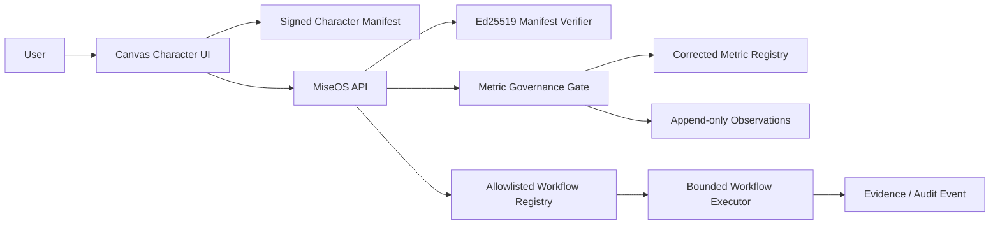

# MiseOS Metric + Clickable Workflow Architecture

The PNG remains inert. The signed manifest declares hotspots and metric gates; the registry defines governance thresholds; the executor permits only local allowlisted modules.
