# MiseOS Registry Product Card Gallery

> A grouped, GitHub-compatible gallery for canonical MiseOS **registry manifest** card art.
>
> **Canonical ecosystem:** 112 character collectibles + 23 separate registry products.
> **This gallery covers registry products only.** Per [`registry/registry-catalog.manifest.json`](registry/registry-catalog.manifest.json): *"Registry manifests are product infrastructure and must never be loaded into the character roster."* See [`README_3D_CHARACTER_CAROUSEL.md`](README_3D_CHARACTER_CAROUSEL.md) for the separate 112-character roster gallery.
> **Registry products with approved card art so far:** 13 of 23 (12 registry manifests + 1 flagship theme mascot).

## Asset contract

Each registry product uses the following canonical paths:

```text
media/images/registry/<registry-slug>/hero.png
cards/registry/<registry-slug>.md
```

`<registry-slug>` is the registry ID from [`registry/registry-catalog.manifest.json`](registry/registry-catalog.manifest.json) with the `miseos.` prefix removed (for example `miseos.policy-checker` → `policy-checker`).

---

## Orchestra Theme

<table>
  <tr>
    <td width="240" valign="top" align="center">
      <a href="cards/registry/conductor-prime.md">
        
      </a>
      <br><strong>MiseOS Conductor Prime</strong>
      <br><sub>Flagship mascot of <code>miseos.orchestra-theme</code>. Every role. Every flavor. One orchestra.</sub>
      <br><a href="cards/registry/conductor-prime.md">Card</a>
    </td>
  </tr>
</table>

---

## Policy & Compliance

<table>
  <tr>
    <td width="240" valign="top" align="center">
      <a href="cards/registry/policy-checker.md">
        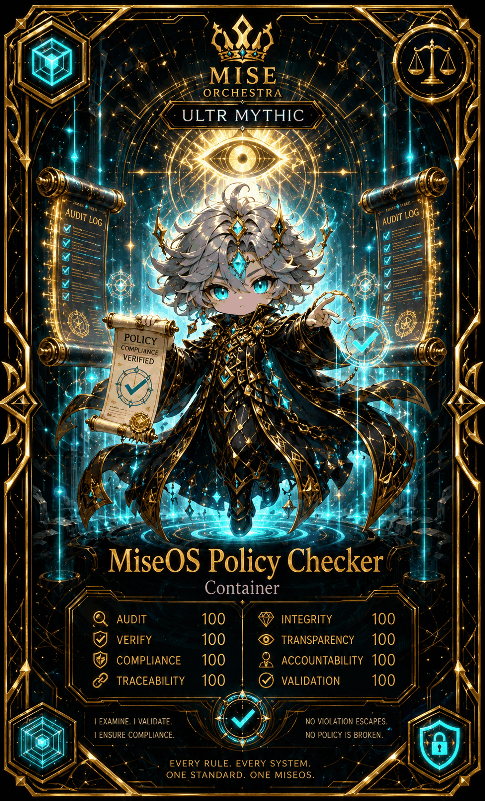
      </a>
      <br><strong>MiseOS Policy Checker</strong> · Container
      <br><sub>I examine. I validate. I ensure compliance.</sub>
      <br><a href="cards/registry/policy-checker.md">Card</a>
    </td>
    <td width="240" valign="top" align="center">
      <a href="cards/registry/attestation-gate.md">
        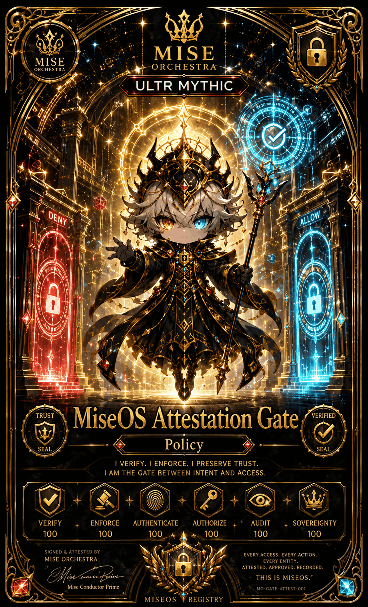
      </a>
      <br><strong>MiseOS Attestation Gate</strong> · Policy
      <br><sub>I verify. I enforce. I preserve trust.</sub>
      <br><a href="cards/registry/attestation-gate.md">Card</a>
    </td>
    <td width="240" valign="top" align="center">
      <a href="cards/registry/maven-policy-adapter.md">
        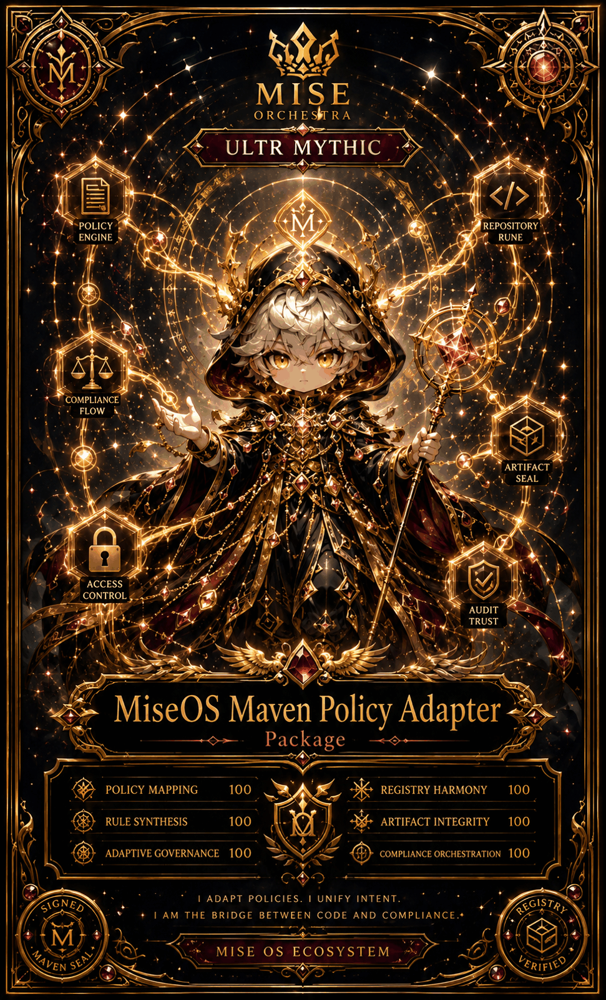
      </a>
      <br><strong>MiseOS Maven Policy Adapter</strong> · Package
      <br><sub>I adapt policies. I unify intent.</sub>
      <br><a href="cards/registry/maven-policy-adapter.md">Card</a>
    </td>
  </tr>
</table>

---

## Build & Package Delivery

<table>
  <tr>
    <td width="240" valign="top" align="center">
      <a href="cards/registry/nuget-client.md">
        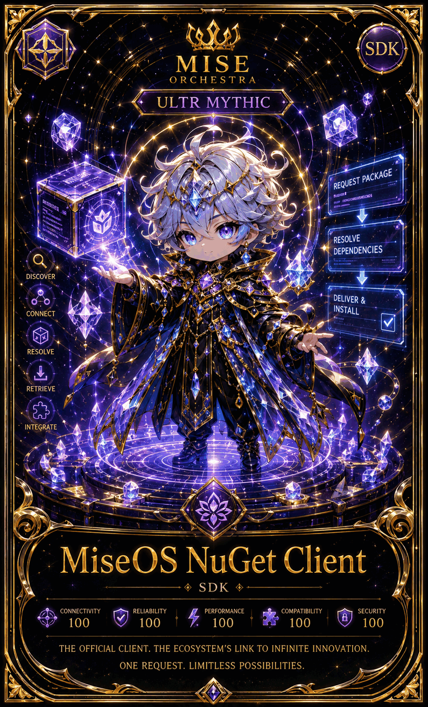
      </a>
      <br><strong>MiseOS NuGet Client</strong> · SDK
      <br><sub>The official client. One request, limitless possibilities.</sub>
      <br><a href="cards/registry/nuget-client.md">Card</a>
    </td>
    <td width="240" valign="top" align="center">
      <a href="cards/registry/gradle-plugin.md">
        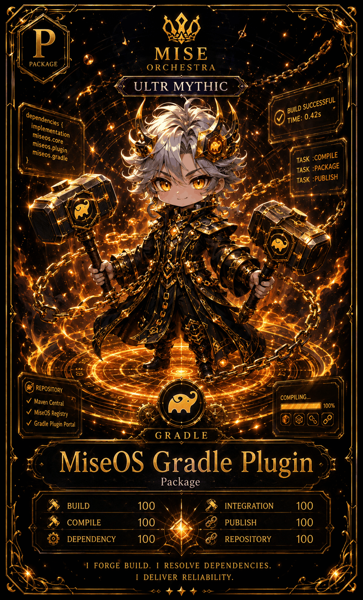
      </a>
      <br><strong>MiseOS Gradle Plugin</strong> · Package
      <br><sub>I forge build. I resolve dependencies.</sub>
      <br><a href="cards/registry/gradle-plugin.md">Card</a>
    </td>
    <td width="240" valign="top" align="center">
      <a href="cards/registry/cli.md">
        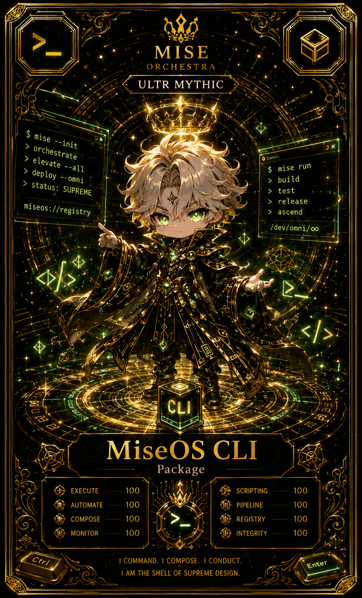
      </a>
      <br><strong>MiseOS CLI</strong> · Package
      <br><sub>I command. I compose. I conduct.</sub>
      <br><a href="cards/registry/cli.md">Card</a>
    </td>
    <td width="240" valign="top" align="center">
      <a href="cards/registry/agent-sdk.md">
        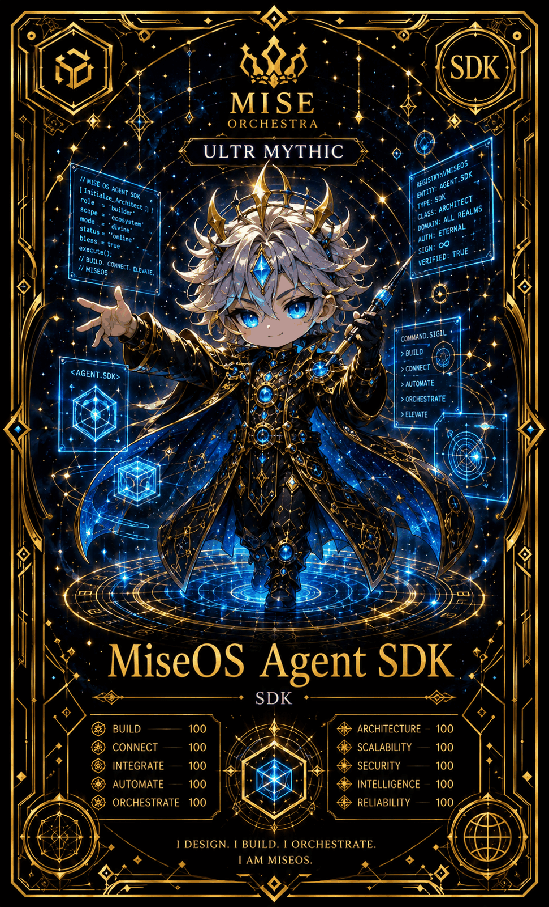
      </a>
      <br><strong>MiseOS Agent SDK</strong> · SDK
      <br><sub>I design. I build. I orchestrate.</sub>
      <br><a href="cards/registry/agent-sdk.md">Card</a>
    </td>
  </tr>
</table>

---

## Knowledge & Analytics

<table>
  <tr>
    <td width="240" valign="top" align="center">
      <a href="cards/registry/docs-builder.md">
        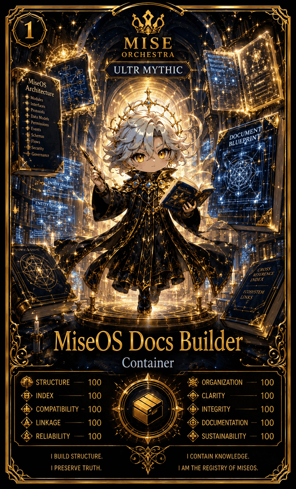
      </a>
      <br><strong>MiseOS Docs Builder</strong> · Container
      <br><sub>I build structure. I preserve truth.</sub>
      <br><a href="cards/registry/docs-builder.md">Card</a>
    </td>
    <td width="240" valign="top" align="center">
      <a href="cards/registry/analytics-engine.md">
        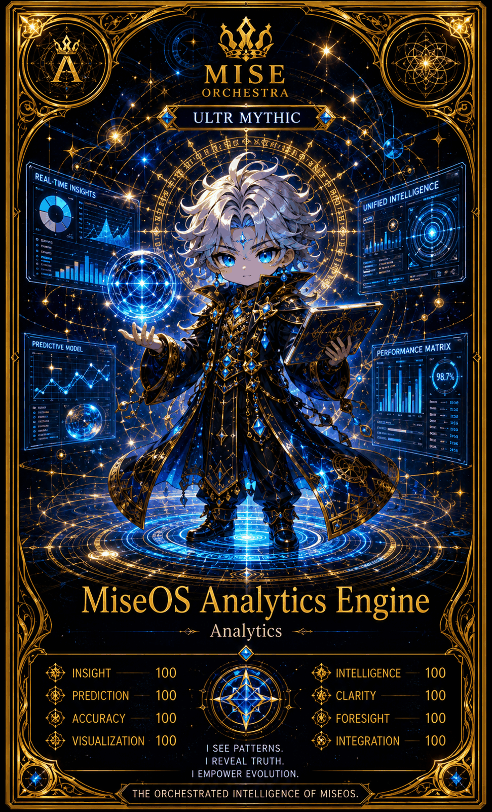
      </a>
      <br><strong>MiseOS Analytics Engine</strong> · Analytics
      <br><sub>I see patterns. I reveal truth.</sub>
      <br><a href="cards/registry/analytics-engine.md">Card</a>
    </td>
  </tr>
</table>

---

## Repository Operations Agents

<table>
  <tr>
    <td width="240" valign="top" align="center">
      <a href="cards/registry/release-sentinel.md">
        
      </a>
      <br><strong>MiseOS Release Sentinel</strong> · Agent #13
      <br><sub>Celestial guardian of deployment.</sub>
      <br><a href="cards/registry/release-sentinel.md">Card</a>
    </td>
    <td width="240" valign="top" align="center">
      <a href="cards/registry/repo-steward.md">
        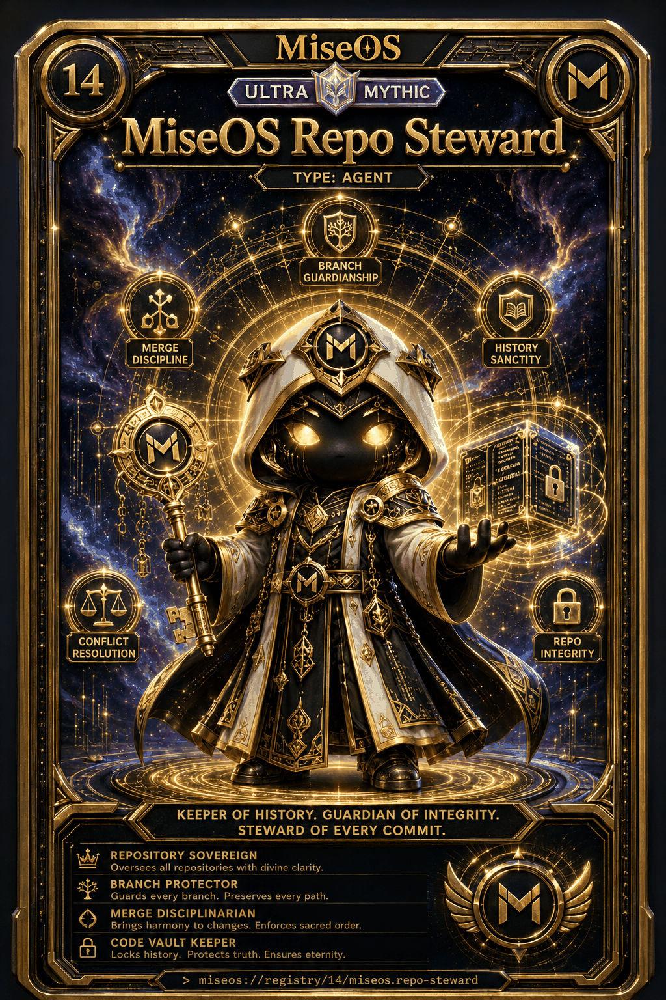
      </a>
      <br><strong>MiseOS Repo Steward</strong> · Agent #14
      <br><sub>Keeper of history. Guardian of integrity.</sub>
      <br><a href="cards/registry/repo-steward.md">Card</a>
    </td>
    <td width="240" valign="top" align="center">
      <a href="cards/registry/repo-pet.md">
        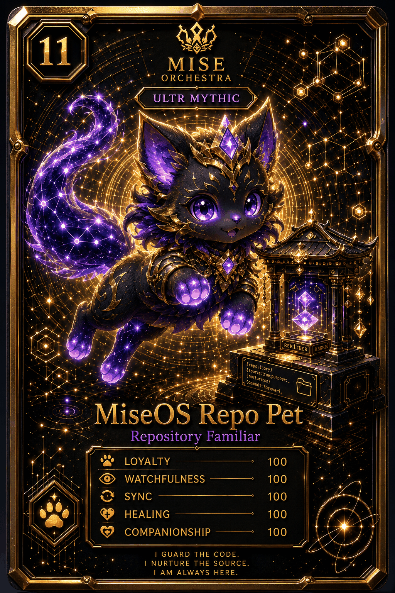
      </a>
      <br><strong>MiseOS Repo Pet</strong> · Repository Familiar #11
      <br><sub>I guard the code. I nurture the source.</sub>
      <br><a href="cards/registry/repo-pet.md">Card</a>
    </td>
  </tr>
</table>

---

## Registry completion gate

10 of the 23 registry manifests in [`registry/registry-catalog.manifest.json`](registry/registry-catalog.manifest.json) do not yet have approved card art and are **not** pictured here: `docs-hub-template`, `policy-engine`, `registry-schema`, `ruby-steward`, `runner`, `sbom-indexer`, `trust-graph`, `workflow-linter`, `workflow-pack`, `repo-reliability-kit`.

Required validation before publishing new registry cards:

- Every registry product maps to exactly one `registry_id` in `registry/registry-catalog.manifest.json`.
- Every hero image path resolves.
- Registry product cards are never counted toward the 112-character roster.
- Placeholder media is never presented as complete or minted.
