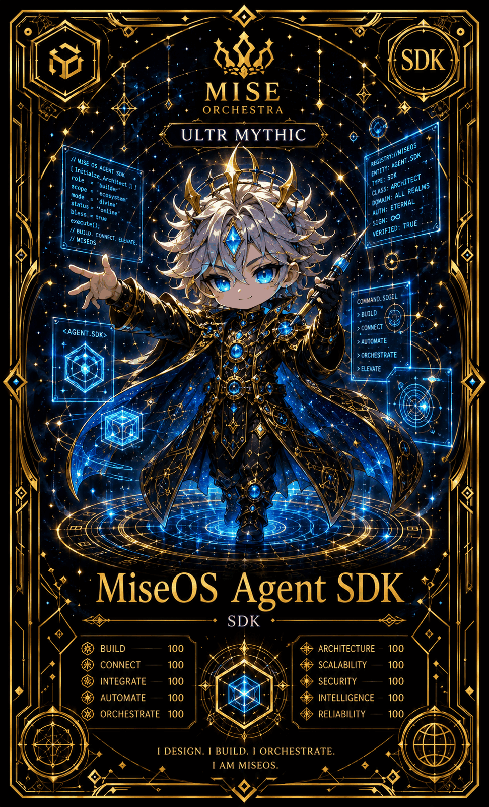

# MiseOS Agent SDK

**Registry ID:** `miseos.agent-sdk`
**Class:** SDK
**Rarity:** Ultra Mythic

## Hero art

## Stats

| Stat | Value |
|---|---:|
| Build | 100 |
| Connect | 100 |
| Integrate | 100 |
| Automate | 100 |
| Orchestrate | 100 |
| Architecture | 100 |
| Scalability | 100 |
| Security | 100 |
| Intelligence | 100 |
| Reliability | 100 |

## Command sigil

`build → connect → automate → orchestrate → elevate`

## Lore

> I design. I build. I orchestrate.
> I am MiseOS.

## Proof gate

No agent built with this SDK ships without a signed `registry://miseos` manifest entry.
