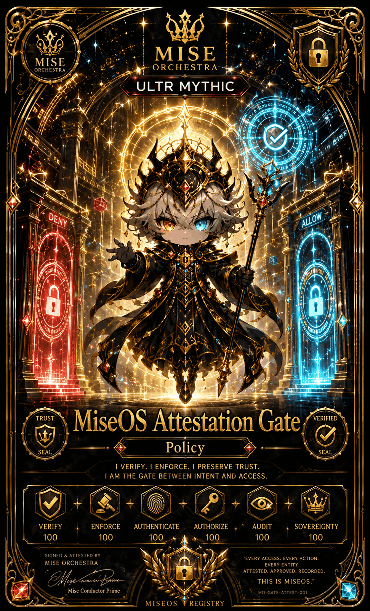

# MiseOS Attestation Gate

**Registry ID:** `miseos.attestation-gate`
**Class:** Policy
**Rarity:** Ultra Mythic
**Seal ID:** MO-GATE-ATTEST-001

## Hero art

## Stats

| Stat | Value |
|---|---:|
| Verify | 100 |
| Enforce | 100 |
| Authenticate | 100 |
| Authorize | 100 |
| Audit | 100 |
| Sovereignty | 100 |

## Lore

> I verify. I enforce. I preserve trust.
> I am the gate between intent and access.
>
> Every access. Every action. Every entity. Attested. Approved. Recorded. This is MiseOS.

Signed and attested by Mise Orchestra.

## Proof gate

No credential, action, or entity gains `ALLOW` without passing verification; the `DENY` gate is the default state.
