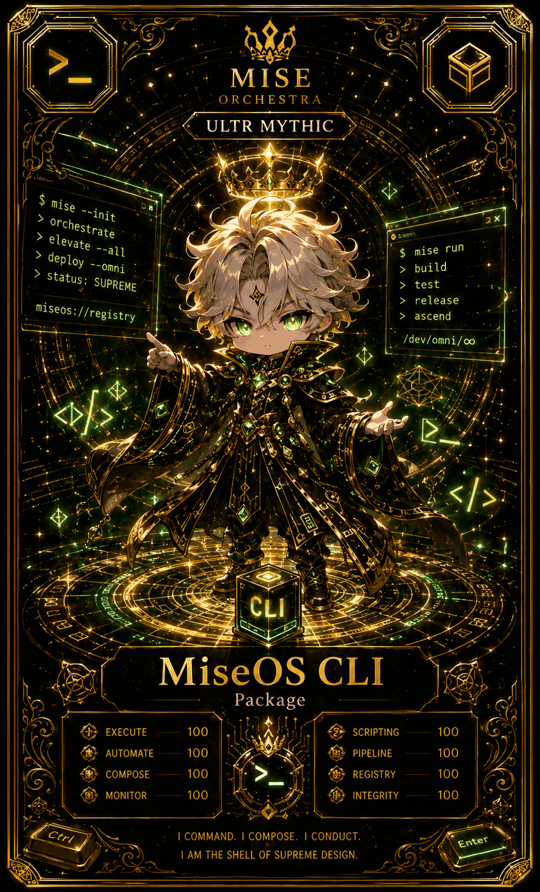

# MiseOS CLI

**Registry ID:** `miseos.cli`
**Class:** Package
**Rarity:** Ultra Mythic

## Hero art



## Stats

| Stat | Value |
|---|---:|
| Execute | 100 |
| Automate | 100 |
| Compose | 100 |
| Monitor | 100 |
| Scripting | 100 |
| Pipeline | 100 |
| Registry | 100 |
| Integrity | 100 |

## Command surface

```
$ mise --init
> orchestrate
> elevate --all
> deploy --omni
> status: SUPREME

$ mise run
> build
> test
> release
```

## Lore

> I command. I compose. I conduct.
> I am the shell of supreme design.

## Proof gate

No `mise run release` completes unless `build` and `test` have both exited clean in the same invocation.
