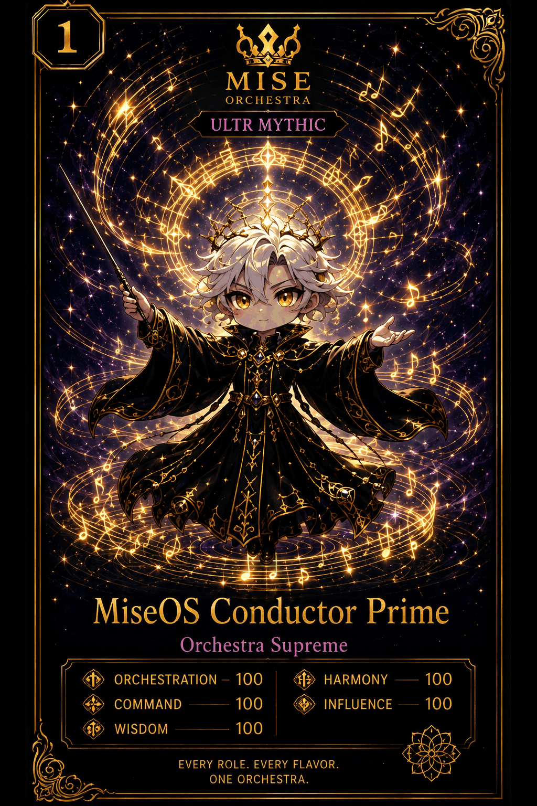

# MiseOS Conductor Prime

**Registry ID:** `miseos.conductor-prime` (flagship mascot of `miseos.orchestra-theme`)
**Class:** Orchestra Supreme
**Rarity:** Ultra Mythic
**Type:** Theme

## Hero art

## Stats

| Stat | Value |
|---|---:|
| Orchestration | 100 |
| Command | 100 |
| Wisdom | 100 |
| Harmony | 100 |
| Influence | 100 |

## Lore

> Every role. Every flavor. One orchestra.

Conductor Prime is the flagship persona for the Mise Orchestra visual theme — the umbrella identity that unifies every registry manifest card under one house style. It does not gate any single system on its own; it represents the ensemble.

## Proof gate

No release, package, or theme asset ships under the Mise Orchestra identity without matching this card's canonical hero art and registry linkage.
