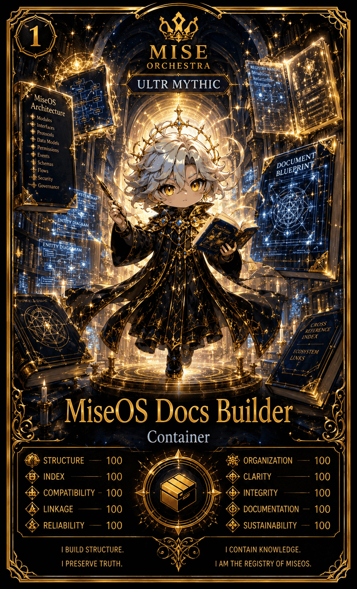

# MiseOS Docs Builder

**Registry ID:** `miseos.docs-builder`
**Class:** Container
**Rarity:** Ultra Mythic

## Hero art

## Stats

| Stat | Value |
|---|---:|
| Structure | 100 |
| Index | 100 |
| Compatibility | 100 |
| Linkage | 100 |
| Reliability | 100 |
| Organization | 100 |
| Clarity | 100 |
| Integrity | 100 |
| Documentation | 100 |
| Sustainability | 100 |

## Lore

> I build structure. I preserve truth.
> I contain knowledge. I am the registry of MiseOS.

## Proof gate

No documentation set publishes with a broken cross-reference index or an unresolved entity diagram link.
