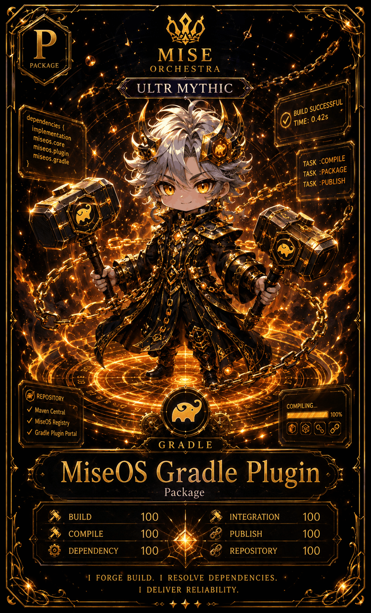

# MiseOS Gradle Plugin

**Registry ID:** `miseos.gradle-plugin`
**Class:** Package
**Rarity:** Ultra Mythic

## Hero art

## Stats

| Stat | Value |
|---|---:|
| Build | 100 |
| Integration | 100 |
| Compile | 100 |
| Publish | 100 |
| Dependency | 100 |
| Repository | 100 |

## Repository targets

Maven Central · MiseOS Registry · Gradle Plugin Portal

## Tasks

`compile → package → publish`

## Lore

> I forge build. I resolve dependencies.
> I deliver reliability.

## Proof gate

No publish task runs unless `compile`, `package`, and `publish` all report a successful, logged status.
