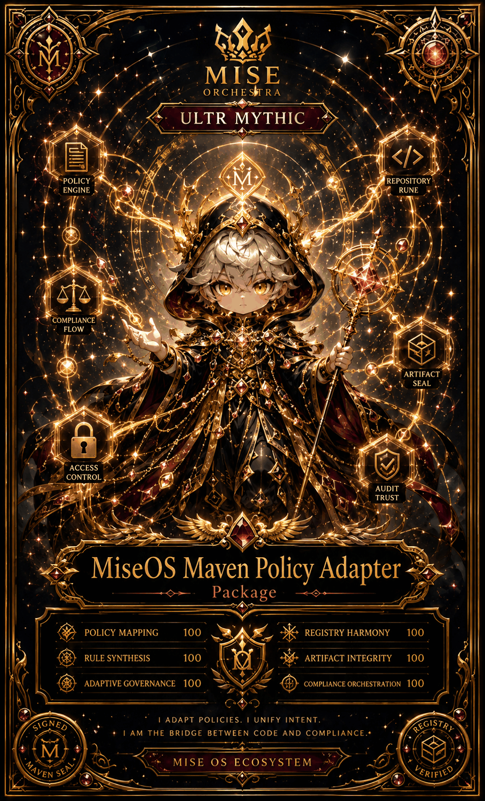

# MiseOS Maven Policy Adapter

**Registry ID:** `miseos.maven-policy-adapter`
**Class:** Package
**Rarity:** Ultra Mythic

## Hero art

Alternate art: [`hero-alt.png`](../../media/images/registry/maven-policy-adapter/hero-alt.png)

## Stats

| Stat | Value |
|---|---:|
| Policy Mapping | 100 |
| Rule Synthesis | 100 |
| Adaptive Governance | 100 |
| Registry Harmony | 100 |
| Artifact Integrity | 100 |
| Compliance Orchestration | 100 |

## Capability houses

Policy Engine · Repository Rune · Compliance Flow · Artifact Seal · Access Control · Audit Trust

## Lore

> I adapt policies. I unify intent.
> I am the bridge between code and compliance.

Signed: Maven Seal · Registry Verified

## Proof gate

No Maven artifact publishes without a policy mapping resolved against the MiseOS registry schema.
