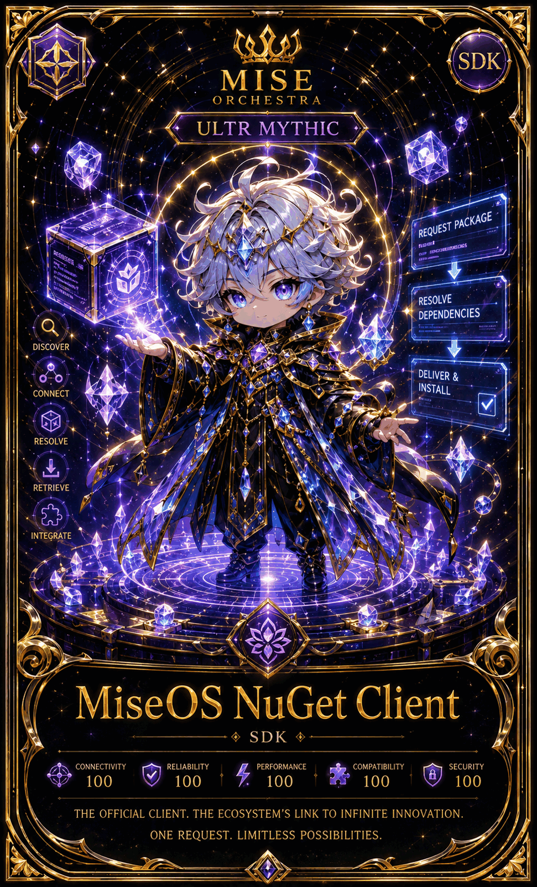

# MiseOS NuGet Client

**Registry ID:** `miseos.nuget-client`
**Class:** SDK
**Rarity:** Ultra Mythic

## Hero art

## Stats

| Stat | Value |
|---|---:|
| Connectivity | 100 |
| Reliability | 100 |
| Performance | 100 |
| Compatibility | 100 |
| Security | 100 |

## Capabilities

`Discover → Connect → Resolve → Retrieve → Integrate`

## Package flow

`Request Package → Resolve Dependencies → Deliver & Install`

## Lore

> The official client. The ecosystem's link to infinite innovation.
> One request. Limitless possibilities.

## Proof gate

No package is delivered to a consuming project without a resolved, verified dependency graph.
