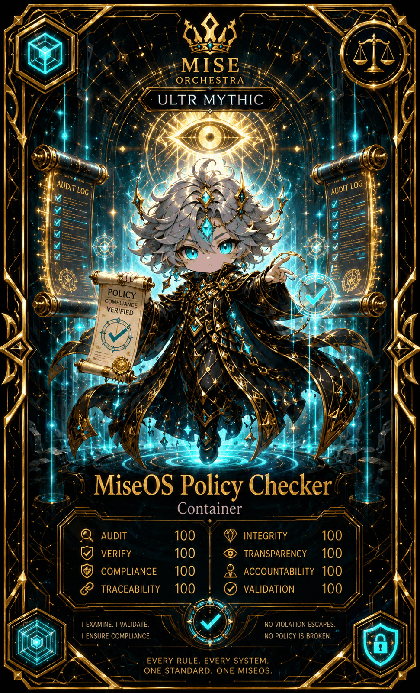

# MiseOS Policy Checker

**Registry ID:** `miseos.policy-checker`
**Class:** Container
**Rarity:** Ultra Mythic

## Hero art

## Stats

| Stat | Value |
|---|---:|
| Audit | 100 |
| Verify | 100 |
| Compliance | 100 |
| Traceability | 100 |
| Integrity | 100 |
| Transparency | 100 |
| Accountability | 100 |
| Validation | 100 |

## Lore

> I examine. I validate. I ensure compliance.
> No violation escapes. No policy is broken.

Every rule, every system, one standard — one MiseOS.

## Proof gate

No merge or release proceeds while an unresolved policy violation is outstanding in this container's audit log.
