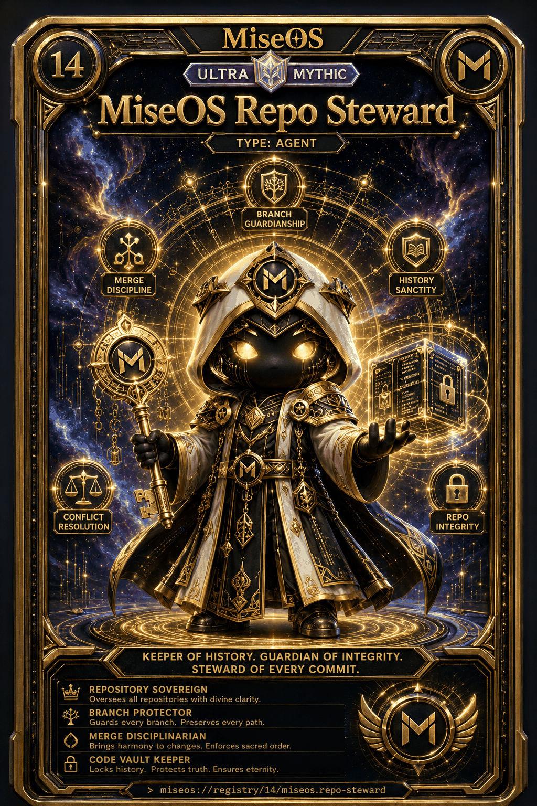

# MiseOS Repo Steward

**Registry ID:** `miseos.repo-steward`
**Class:** Agent
**Rarity:** Ultra Mythic
**Number:** 14
**Registry path:** `miseos://registry/14/miseos.repo-steward`

## Hero art

## Traits

- Repository Sovereign — oversees all repositories with divine clarity.
- Branch Protector — guards every branch, preserves every path.
- Merge Disciplinarian — brings harmony to changes, enforces sacred order.
- Code Vault Keeper — locks history, protects truth, ensures eternity.

## Lore

> Keeper of history. Guardian of integrity.
> Steward of every commit.

## Proof gate

No branch merges without conflict resolution and an intact, unrewritten history.
