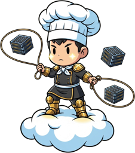

<!-- generated by tools/player-cards/scripts/build-character-pages.mjs from data/agents.json; do not edit by hand -->
# Cloud Chef

| Field | Value |
|---|---|
| Kind | brigade_mascot_agent |
| Role | Cloud Provisioner |
| Group | Platform & Infrastructure — Compute · Storage · Observe |
| Aliases | — |
| Source | `icloud/Mise-OS-main.zip/Mise-OS-main/artifacts/dashboard/src/lib/brigade-data.ts:150` |
| Character | Not yet defined in the source material |
| Cards | Not yet defined in the source material |
| Repo pet | — |

## Config and definition files

- [`agents/cloud-chef/Cloud-Chef.png`](../../agents/cloud-chef/Cloud-Chef.png)
- [`agents/cloud-chef/agent.json`](../../agents/cloud-chef/agent.json)

[← All agents](./README.md)
