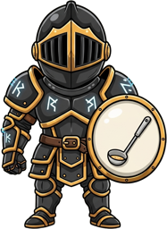

<!-- generated by tools/player-cards/scripts/build-character-pages.mjs from data/agents.json; do not edit by hand -->
# Kuro Guard

| Field | Value |
|---|---|
| Kind | brigade_mascot_agent |
| Role | Chief Sentinel |
| Group | Executive Chefs — Leadership & Orchestration |
| Aliases | — |
| Source | `icloud/Mise-OS-main.zip/Mise-OS-main/artifacts/dashboard/src/lib/brigade-data.ts:55` |
| Character | [Kuro Guard](../characters/kuro-guard.md) |
| Cards | [kuro-guard](../characters/kuro-guard.md), [kuro-guard](../characters/kuro-guard.md), [kuro-guard](../characters/kuro-guard.md), [kuro-guard](../characters/kuro-guard.md) |
| Repo pet | [kuro-guard](../repo-pets/kuro-guard.md) |

## Config and definition files

- [`agents/kuro-guard/Kuro-Guard.png`](../../agents/kuro-guard/Kuro-Guard.png)
- [`agents/kuro-guard/agent.json`](../../agents/kuro-guard/agent.json)

[← All agents](./README.md)
