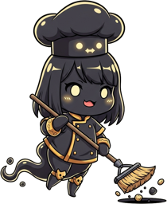

<!-- generated by tools/player-cards/scripts/build-character-pages.mjs from data/agents.json; do not edit by hand -->
# Null Chan

| Field | Value |
|---|---|
| Kind | brigade_mascot_agent |
| Role | Fallback Handler |
| Group | Service Layer — Runtime · Cache · Delivery |
| Aliases | — |
| Source | `icloud/Mise-OS-main.zip/Mise-OS-main/artifacts/dashboard/src/lib/brigade-data.ts:94` |
| Character | [Null-chan](../characters/null-chan.md) |
| Cards | [null-chan](../characters/null-chan.md) |
| Repo pet | [null-chan](../repo-pets/null-chan.md) |

## Config and definition files

- [`agents/null-chan/Null-Chan.png`](../../agents/null-chan/Null-Chan.png)
- [`agents/null-chan/agent.json`](../../agents/null-chan/agent.json)

[← All agents](./README.md)
