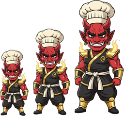

<!-- generated by tools/player-cards/scripts/build-character-pages.mjs from data/agents.json; do not edit by hand -->
# Scale Oni

| Field | Value |
|---|---|
| Kind | brigade_mascot_agent |
| Role | Autoscaler |
| Group | Kitchen Operations — Build · Schedule · Dispatch |
| Aliases | — |
| Source | `icloud/Mise-OS-main.zip/Mise-OS-main/artifacts/dashboard/src/lib/brigade-data.ts:78` |
| Character | [Scale Oni](../characters/scale-oni.md) |
| Cards | [scale-oni](../characters/scale-oni.md), [scale-oni](../characters/scale-oni.md), [scale-oni](../characters/scale-oni.md) |
| Repo pet | [scale-oni](../repo-pets/scale-oni.md) |

## Config and definition files

- [`agents/scale-oni/Scale-Oni.png`](../../agents/scale-oni/Scale-Oni.png)
- [`agents/scale-oni/agent.json`](../../agents/scale-oni/agent.json)

[← All agents](./README.md)
