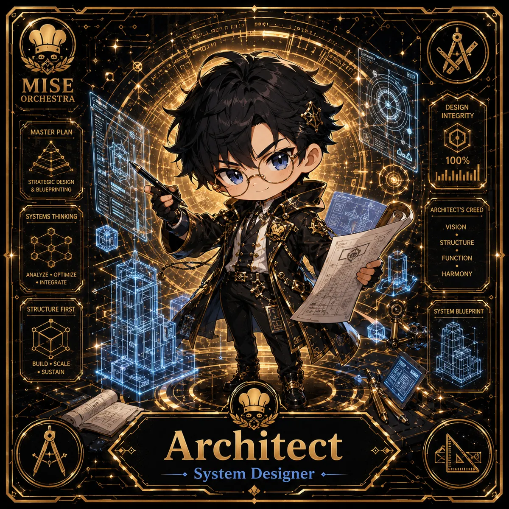

<!-- generated by tools/player-cards/scripts/build-character-pages.mjs; do not edit by hand -->
# Card: Architect

This card is not yet matched to a registry character, registry manifest or catalogue chef. File facts come from [`data/player-cards.json`](../../data/player-cards.json) and OCR in [`data/player-cards-ocr.json`](../../data/player-cards-ocr.json); the card profile comes from [`data/card-details.json`](../../data/card-details.json), where every field cites its source and values marked `authored: card design` were written for the card rather than found in the repo.

| Field | Value |
|---|---|
| Collection | 1×1 Chefs |
| Printed title | Architect |
| File | [`assets/player-cards/1by1-chefs/architect.webp`](../../assets/player-cards/1by1-chefs/architect.webp) |
| Original size | 1254×1254 |
| Original source | `extract:img-1by1-chefs/1by1 chefs /BA45E8F8-F35E-4D59-87EB-0816218676F1.PNG` |
| Duplicates | — |
| Character | [Template Tanaka](../characters/template-tanaka.md) (canon crosswalk: provisional) source: `docs/source-library/icloud/Catalogue/All images/Mise/MiseOS Bible/MiseOS-Canon-Bible-v1.0-package.zip/miseos_canon_bible_v1_0/registry/asset-registry.csv` |
| Role / title | System Designer source: `data/player-cards-ocr.json (subtitle printed under the name)` |
| Kitchen / department | Platform Kitchen source: `docs/source-library/icloud/Catalogue/All images/Mise/MiseOS Bible/MiseOS-Canon-Bible-v1.0-package.zip/miseos_canon_bible_v1_0/registry/asset-registry.csv → data/characters/template-tanaka.json` |
| Department mission | Provide golden paths and stable service foundations. source: `data/imports/miseos_character_master_inventory_001_300.csv` |
| Rarity | Common source: `authored: card design (default tier)` |
| Printed rarity | Not printed on the card source: `data/player-cards-ocr.json` |
| Printed stars | Not printed on the card source: `data/player-cards-ocr.json` |
| Roster stats | power 74 · precision 68 · speed 76 · resilience 68 · intelligence 65 · teamwork 76 source: `authored: card design (6-axis roster scale; baseline from stars + theme "code")` |
| Abilities | Design, Integrity, Master Plan, Strategic Design, Blueprinting, Systems Thinking source: `data/player-cards-ocr.json (printed card labels, glued OCR words segmented)` |
| Lore | Picture a terminal glowing beside the prep list: that is where Architect is happiest. As Platform Kitchen's System Designer, Architect turns a plan into working code through a plan, code, test, deploy loop. The card calls out Design, Integrity, Master Plan: the checks Architect runs before calling anything ready. In the canon crosswalk this card is a provisional match for Template Tanaka. source: `authored: card design (derived from printed card text/role)` |
| Signature phrase | Clean code, perfect dish. source: `authored: card design (derived from printed card text/role)` |
| Agents | [Architect](../agents/architect.md) source: `data/agents.json` |
| Repo pets | [Build-Kun](../repo-pets/build-kun.md) · [Mise Bootstrap](../repo-pets/mise-bootstrap.md) source: `authored: card design (closest repo pets for theme "code")` |
| Related characters | [Template Tanaka](../characters/template-tanaka.md) · [DX Mei](../characters/dx-mei.md) · [Backlog Benji](../characters/backlog-benji.md) · [Null-chan](../characters/null-chan.md) · [Yume Builder](../characters/yume-builder.md) source: `docs/source-library/icloud/Catalogue/All images/Mise/MiseOS Bible/MiseOS-Canon-Bible-v1.0-package.zip/miseos_canon_bible_v1_0/registry/asset-registry.csv + authored: card design (same theme "code")` |

## Workflow

| Step | Value |
|---|---|
| Summary | Architect turns a plan into working code through a plan, code, test, deploy loop. source: `authored: card design (theme "code")` |
| Inputs | task / issue, repository context, acceptance criteria |
| Outputs | commit / pull request, test results, deploy status |
| Proof gate | CI gate: no merge without green tests and a reviewed diff. |
| Problem it addresses | Ideas stall between plan and production. source: `authored: card design (theme "code")` |

## Actions / commands

- command: `mise roster run architect --dept platform-kitchen --solo --emit report` · status: `proposed` source: `authored: follows data/imports/master-roster-cards.csv (mise roster run command convention)`
- command: `mise architect plan` · reads: `task / issue` · emits: `commit / pull request` · status: `proposed` source: `authored: card design (theme "code")`
- command: `mise architect build` · reads: `repository context` · emits: `test results` · status: `proposed` source: `authored: card design (theme "code")`
- command: `mise architect ship` · reads: `acceptance criteria` · emits: `deploy status` · status: `proposed` source: `authored: card design (theme "code")`

## Implementation

**Status:** Designed (not yet implemented in code)

- Proposed handler: `architect` (not written yet)
- Proposed command: `mise roster run architect --dept platform-kitchen --solo --emit report`
- Contract: inputs: task / issue, repository context, acceptance criteria → outputs: commit / pull request, test results, deploy status; refuses to emit 'ready' unless the proof gate passes

source: `no dedicated code for this card; authored: proposed handler spec`

Values marked `authored: card design` were written for this card by [`enrich-characters.py`](../../tools/player-cards/scripts/enrich-characters.py) from its printed text and theme; the rest cite the repo file they came from.

## Printed text (OCR)

- MISE
- ORCHESTRA
- DESIGN
- INTEGRITY
- MASTERPLAN
- 100%
- STRATEGICDESIGN
- &BLUEPRINTING
- ARCHITECT'SCREED
- SYSTEMSTHINKING
- VISION
- STRUCTURE
- FUNCTION
- ANALYZE·OPTIMIZE
- HARMONY
- ·INTEGRATE
- STRUCTUREFIRST
- SYSTEM
- JEPRINT
- BUILD·SCALE
- ·SUSTAIN
- Architect
- System Designer

[← All characters](../characters/README.md)
