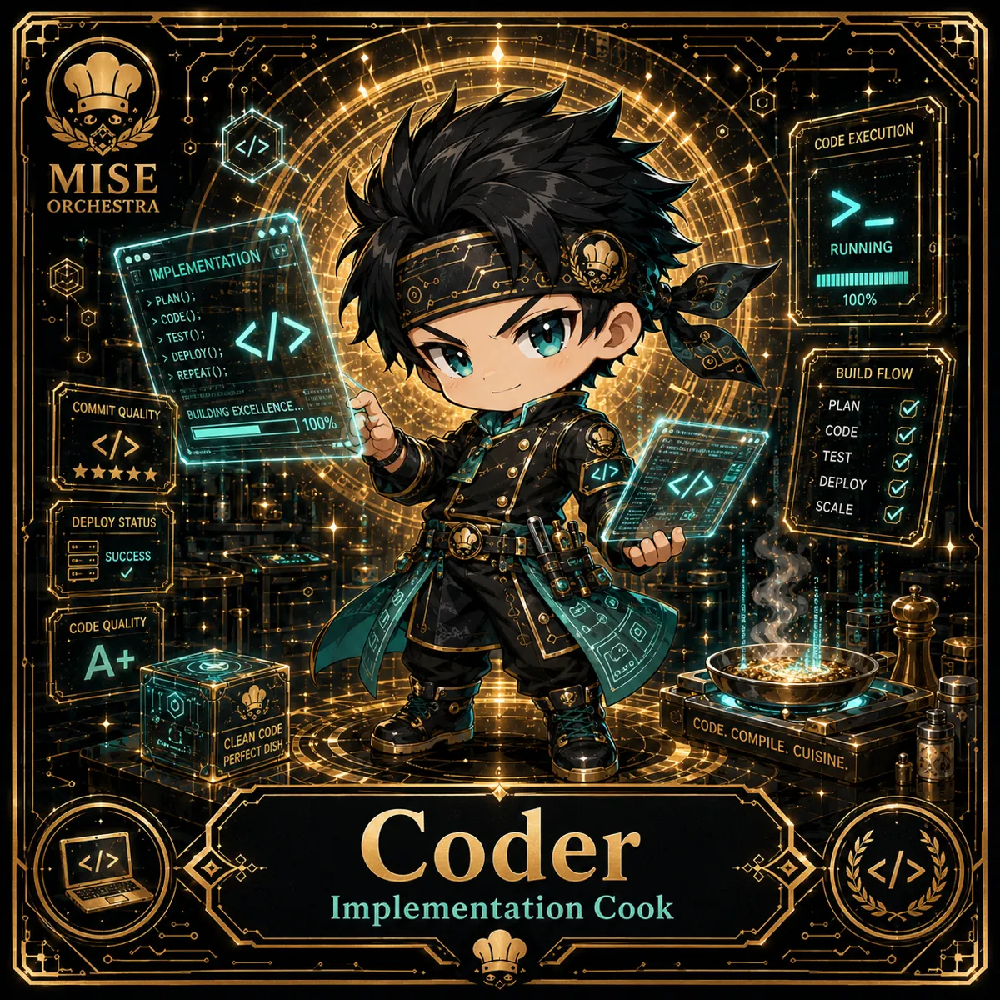

<!-- generated by tools/player-cards/scripts/build-character-pages.mjs; do not edit by hand -->
# Card: Coder

This card is not yet matched to a registry character, registry manifest or catalogue chef. File facts come from [`data/player-cards.json`](../../data/player-cards.json) and OCR in [`data/player-cards-ocr.json`](../../data/player-cards-ocr.json); the card profile comes from [`data/card-details.json`](../../data/card-details.json), where every field cites its source and values marked `authored: card design` were written for the card rather than found in the repo.

| Field | Value |
|---|---|
| Collection | 1×1 Chefs |
| Printed title | Coder |
| File | [`assets/player-cards/1by1-chefs/coder.webp`](../../assets/player-cards/1by1-chefs/coder.webp) |
| Original size | 1254×1254 |
| Original source | `extract:img-1by1-chefs/1by1 chefs /6C53B580-0E36-4D18-BB4E-BD53D8E03FEF.PNG` |
| Duplicates | — |
| Character | [Yume Builder](../characters/yume-builder.md) (canon crosswalk: provisional) source: `docs/source-library/icloud/Catalogue/All images/Mise/MiseOS Bible/MiseOS-Canon-Bible-v1.0-package.zip/miseos_canon_bible_v1_0/registry/asset-registry.csv` |
| Role / title | Implementation Cook source: `data/player-cards-ocr.json (subtitle printed under the name)` |
| Kitchen / department | Pipeline Kitchen source: `docs/source-library/icloud/Catalogue/All images/Mise/MiseOS Bible/MiseOS-Canon-Bible-v1.0-package.zip/miseos_canon_bible_v1_0/registry/asset-registry.csv → data/characters/yume-builder.json` |
| Department mission | Build. Test. Deploy. Repeat. source: `data/imports/miseos_character_master_inventory_001_300.csv` |
| Rarity | Epic source: `authored: card design (from printed stars 4)` |
| Printed rarity | Not printed on the card source: `data/player-cards-ocr.json` |
| Printed stars | 4 source: `data/player-cards-ocr.json` |
| Roster stats | power 73 · precision 78 · speed 100 · resilience 86 · intelligence 82 · teamwork 84 source: `authored: card design (6-axis roster scale; printed meters mapped: speed←Building Excellence 100%)` |
| Abilities | Code Execution, Running, Implementation, Build Flow, Commit Quality, Plan source: `data/player-cards-ocr.json (printed card labels, glued OCR words segmented)` |
| Lore | Picture a terminal glowing beside the prep list: that is where Coder is happiest. As Pipeline Kitchen's Implementation Cook, Coder turns a plan into working code through a plan, code, test, deploy loop. The card calls out Code Execution, Running, Implementation: the checks Coder runs before calling anything ready. In the canon crosswalk this card is a provisional match for Yume Builder. source: `authored: card design (derived from printed card text/role)` |
| Signature phrase | Code. Compile. Cuisine. source: `authored: card design (derived from printed card text/role)` |
| Agents | [Coder](../agents/coder.md) source: `data/agents.json` |
| Repo pets | [Build-Kun](../repo-pets/build-kun.md) · [Mise Bootstrap](../repo-pets/mise-bootstrap.md) source: `authored: card design (closest repo pets for theme "code")` |
| Related characters | [Yume Builder](../characters/yume-builder.md) · [Null-chan](../characters/null-chan.md) · [Backlog Benji](../characters/backlog-benji.md) · [DX Mei](../characters/dx-mei.md) source: `docs/source-library/icloud/Catalogue/All images/Mise/MiseOS Bible/MiseOS-Canon-Bible-v1.0-package.zip/miseos_canon_bible_v1_0/registry/asset-registry.csv + authored: card design (same theme "code")` |

## Workflow

| Step | Value |
|---|---|
| Summary | Coder turns a plan into working code through a plan, code, test, deploy loop. source: `authored: card design (theme "code")` |
| Inputs | task / issue, repository context, acceptance criteria |
| Outputs | commit / pull request, test results, deploy status |
| Proof gate | CI gate: no merge without green tests and a reviewed diff. |
| Problem it addresses | Ideas stall between plan and production. source: `authored: card design (theme "code")` |

## Actions / commands

- command: `mise roster run coder --dept pipeline-kitchen --solo --emit report` · status: `proposed` source: `authored: follows data/imports/master-roster-cards.csv (mise roster run command convention)`
- command: `mise coder plan` · reads: `task / issue` · emits: `commit / pull request` · status: `proposed` source: `authored: card design (theme "code")`
- command: `mise coder build` · reads: `repository context` · emits: `test results` · status: `proposed` source: `authored: card design (theme "code")`
- command: `mise coder ship` · reads: `acceptance criteria` · emits: `deploy status` · status: `proposed` source: `authored: card design (theme "code")`

## Implementation

**Status:** Designed (not yet implemented in code)

- Proposed handler: `coder` (not written yet)
- Proposed command: `mise roster run coder --dept pipeline-kitchen --solo --emit report`
- Contract: inputs: task / issue, repository context, acceptance criteria → outputs: commit / pull request, test results, deploy status; refuses to emit 'ready' unless the proof gate passes

source: `no dedicated code for this card; authored: proposed handler spec`

Values marked `authored: card design` were written for this card by [`enrich-characters.py`](../../tools/player-cards/scripts/enrich-characters.py) from its printed text and theme; the rest cite the repo file they came from.

## Printed text (OCR)

- CODEEXECUTION
- MISE
- ORCHESTRA
- RUNNING
- IMPLEMENTATION
- > PLAN();
- 100%
- > CODE();
- > TEST();
- > DEPLOY();
- REPEAT();
- BUILD FLOW
- COMMITQUALITY
- PLAN
- BUILDING EXCELLENCE
- 1100%
- <>
- CODE
- TEST
- ★★★★
- DEPLOY
- SCALE
- DEPLOYSTATUS
- SUCCESS
- CODEQUALITY
- A+
- CODE.COMPILE.CUISINE
- CLEAN CODE
- PERFECTDISH
- Coder
- </>
- </>
- Implementation Cook

[← All characters](../characters/README.md)
