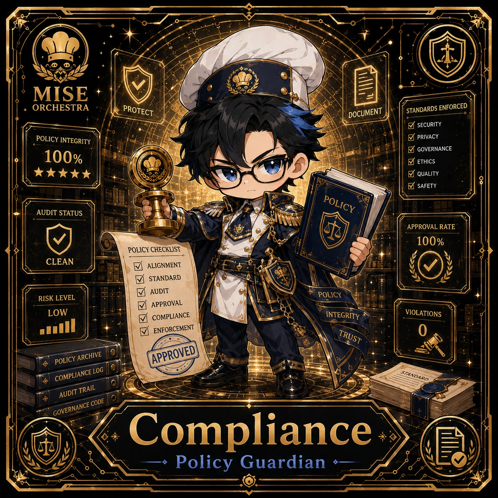

<!-- generated by tools/player-cards/scripts/build-character-pages.mjs; do not edit by hand -->
# Card: Compliance

This card is not yet matched to a registry character, registry manifest or catalogue chef. Fields below are read from [`data/player-cards.json`](../../data/player-cards.json) and OCR in [`data/player-cards-ocr.json`](../../data/player-cards-ocr.json).

| Field | Value |
|---|---|
| Collection | 1×1 Chefs |
| Printed title | Compliance |
| File | [`assets/player-cards/1by1-chefs/compliance.webp`](../../assets/player-cards/1by1-chefs/compliance.webp) |
| Original size | 1254×1254 |
| Original source | `extract:img-1by1-chefs/1by1 chefs /3C08EDF1-AF16-412A-B410-6C46C9BED90C.PNG` |
| Duplicates | — |
| Character | Not yet defined in the source material |
| Agent | [Compliance](../agents/compliance.md) |
| Repo pet | Not yet defined in the source material |
| Workflow / actions / implementation | Not yet defined in the source material |

## Printed text (OCR)

- MISE
- ORCHESTRA
- PROTECT
- DOCUMENT
- STANDARDS ENFORCED
-  SECURITY
- POLICY INTEGRITY
-  PRIVACY
- 100%
-  GOVERNANCE
-  ETHICS
- ★★★★★
- 图 QUALITY
-  SAFETY
- POLICY
- AUDITSTATUS
- APPROVALRATE
- 100%
- POLICYCHECKLIST
- CLEAN
- ALIGNMENT
-  STANDARD
- AUDIT
- POLICY
- RISK LEVEL
- APPROVAL
- LoOW
- INTEGRITY
- VIOLATIONS
- COMPLIANCE
- ENFORCEMENT
- TRUST
- APPROVED
- POLICY ARCHIVE
- COMPLIANCE LOG
- AUDIT TRAIL
- GOVERNANCE CODE
- Compliance
- Policy Guardian

[← All characters](../characters/README.md)
