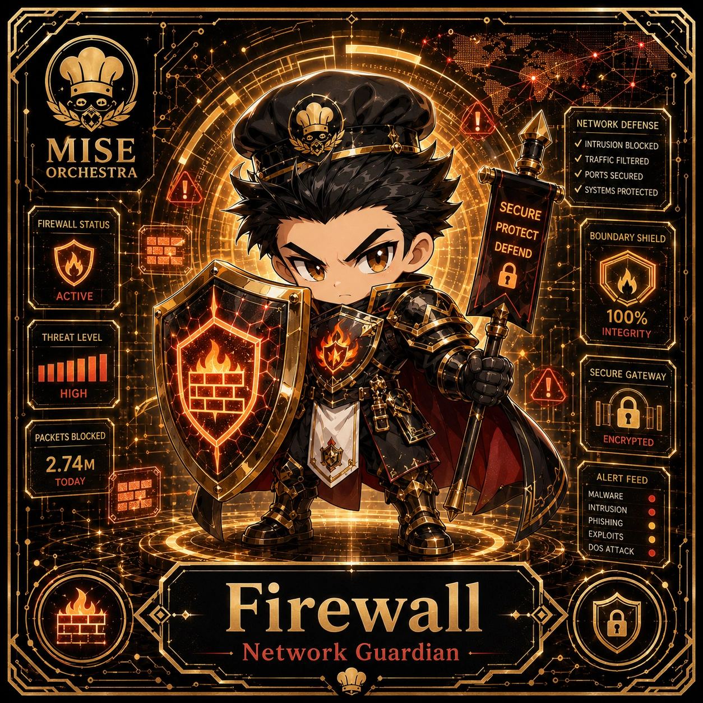

<!-- generated by tools/player-cards/scripts/build-character-pages.mjs; do not edit by hand -->
# Card: Firewall

This card is not yet matched to a registry character, registry manifest or catalogue chef. Fields below are read from [`data/player-cards.json`](../../data/player-cards.json) and OCR in [`data/player-cards-ocr.json`](../../data/player-cards-ocr.json).

| Field | Value |
|---|---|
| Collection | 1×1 Chefs |
| Printed title | Firewall |
| File | [`assets/player-cards/1by1-chefs/firewall.webp`](../../assets/player-cards/1by1-chefs/firewall.webp) |
| Original size | 1254×1254 |
| Original source | `extract:img-1by1-chefs/1by1 chefs /EF8F4F01-38AA-4806-87EE-F69A36F167CF.PNG` |
| Duplicates | — |
| Character | Not yet defined in the source material |
| Agent | [Firewall](../agents/firewall.md) |
| Repo pet | Not yet defined in the source material |
| Workflow / actions / implementation | Not yet defined in the source material |

## Printed text (OCR)

- NETWORK DEFENSE
- MISE
- VINTRUSION BLOCKED
- TRAFFIC FILTERED
- ORCHESTRA
- VPORTS SECURED
- VSYSTEMSPROTECTED
- SECURE
- FIREWALL STATUS
- PROTECT
- BOUNDARY SHIELD
- DEFEND
- ACTIVE
- 100%
- INTEGRITY
- THREAT LEVEL
- SECURE GATEWAY
- HIGH
- PACKETSBLOCKED
- ENCRYPTED
- 2.74M
- ALERTFEED
- TODAY
- MALWARE
- INTRUSION
- PHISHING
- EXPLOITS
- DOS ATTACK
- Firewall
- Network Guardian

[← All characters](../characters/README.md)
