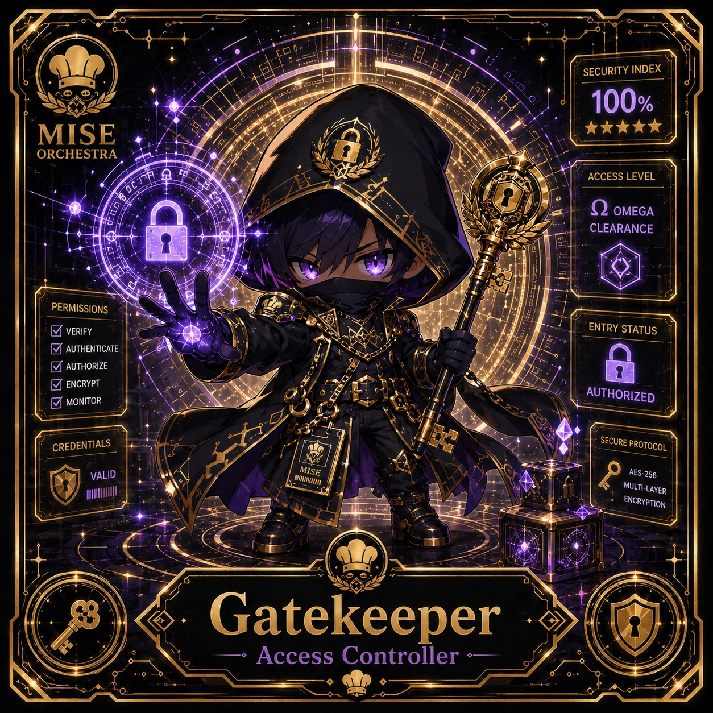

<!-- generated by tools/player-cards/scripts/build-character-pages.mjs; do not edit by hand -->
# Card: Gatekeeper

This card is not yet matched to a registry character, registry manifest or catalogue chef. Fields below are read from [`data/player-cards.json`](../../data/player-cards.json) and OCR in [`data/player-cards-ocr.json`](../../data/player-cards-ocr.json).

| Field | Value |
|---|---|
| Collection | 1×1 Chefs |
| Printed title | Gatekeeper |
| File | [`assets/player-cards/1by1-chefs/gatekeeper.webp`](../../assets/player-cards/1by1-chefs/gatekeeper.webp) |
| Original size | 1254×1254 |
| Original source | `extract:img-1by1-chefs/1by1 chefs /0A62F4EE-68DE-4F88-996A-1E14B8C4F3A2.PNG` |
| Duplicates | — |
| Character | Not yet defined in the source material |
| Agent | [Gatekeeper](../agents/gatekeeper.md) |
| Repo pet | Not yet defined in the source material |
| Workflow / actions / implementation | Not yet defined in the source material |

## Printed text (OCR)

- SECURITY INDEX
- 100%
- MISE
- ★★★★★
- ORCHESTRA
- ACCESS LEVEL
- OMEGA
- CLEARANCE
- PERMISSIONS
- VERIFY
- ENTRYSTATUS
- AUTHENTICATE
-  AUTHORIZE
-  ENCRYPT
- AUTHORIZED
-  MONITOR
- SECURE PROTOCOL
- CREDENTIALS
- MISE
- VALID
- AES-256
- MULTI-LAYER
- ENCRYPTION
- Gatekeeper
- Access Controller

[← All characters](../characters/README.md)
