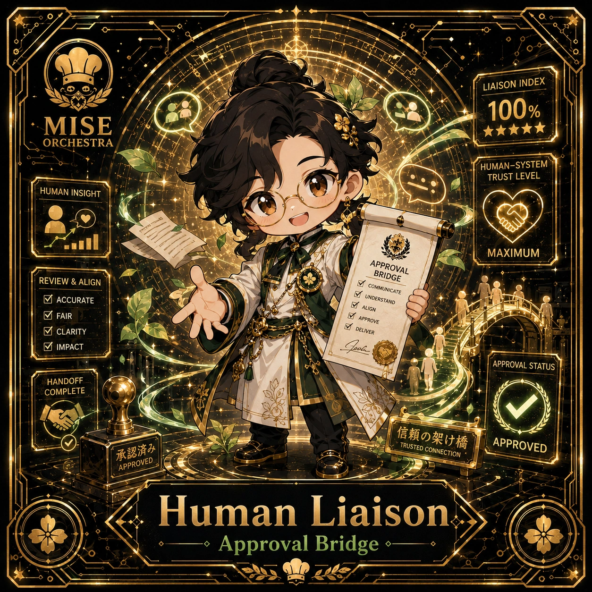

<!-- generated by tools/player-cards/scripts/build-character-pages.mjs; do not edit by hand -->
# Card: Human Liaison

This card is not yet matched to a registry character, registry manifest or catalogue chef. File facts come from [`data/player-cards.json`](../../data/player-cards.json) and OCR in [`data/player-cards-ocr.json`](../../data/player-cards-ocr.json); the card profile comes from [`data/card-details.json`](../../data/card-details.json), where every field cites its source and values marked `authored: card design` were written for the card rather than found in the repo.

| Field | Value |
|---|---|
| Collection | 1×1 Chefs |
| Printed title | Human Liaison |
| File | [`assets/player-cards/1by1-chefs/human-liaison.webp`](../../assets/player-cards/1by1-chefs/human-liaison.webp) |
| Original size | 1254×1254 |
| Original source | `extract:img-1by1-chefs/1by1 chefs /A8EC46EF-BCA1-4336-B489-83F60342F145.PNG` |
| Duplicates | — |
| Character | [Apprentice Kai](../characters/apprentice-kai.md) (canon crosswalk: provisional) source: `docs/source-library/icloud/Catalogue/All images/Mise/MiseOS Bible/MiseOS-Canon-Bible-v1.0-package.zip/miseos_canon_bible_v1_0/registry/asset-registry.csv` |
| Role / title | Human-in-the-Loop source: `data/agents.json` |
| Kitchen / department | Data & Insight Kitchen source: `docs/source-library/icloud/Catalogue/All images/Mise/MiseOS Bible/MiseOS-Canon-Bible-v1.0-package.zip/miseos_canon_bible_v1_0/registry/asset-registry.csv → data/characters/apprentice-kai.json` |
| Department mission | Learn. Optimize. Evolve. source: `data/imports/miseos_character_master_inventory_001_300.csv` |
| Rarity | Legendary source: `authored: card design (from printed stars 5)` |
| Printed rarity | Not printed on the card source: `data/player-cards-ocr.json` |
| Printed stars | 5 source: `data/player-cards-ocr.json` |
| Roster stats | power 85 · precision 91 · speed 80 · resilience 89 · intelligence 95 · teamwork 91 source: `authored: card design (6-axis roster scale; baseline from stars + theme "data")` |
| Abilities | Liaison Index, Human-System, Trust Level, Human Insight, Maximum, Approval source: `data/player-cards-ocr.json (printed card labels, glued OCR words segmented)` |
| Lore | Most of the brigade only notices Human Liaison when something is missing, which is exactly the point. Human Liaison reads the numbers behind service (covers, waste, timings) and turns them into the next improvement; the image the crew uses for it is a clipboard of tally marks that becomes a chart by morning. The card calls out Liaison Index, Human-System, Trust Level: the checks Human Liaison runs before calling anything ready. In the canon crosswalk this card is a provisional match for Apprentice Kai. source: `authored: card design (derived from printed card text/role)` |
| Signature phrase | Every trend alert accounted for. source: `authored: card design (derived from printed card text/role)` |
| Agents | [Human Liaison](../agents/human-liaison.md) source: `data/agents.json` |
| Repo pets | [Flag Fox](../repo-pets/flag-fox.md) · [Mise Lattice](../repo-pets/mise-lattice.md) source: `authored: card design (closest repo pets for theme "data")` |
| Related characters | [Apprentice Kai](../characters/apprentice-kai.md) · [Culture Chef](../characters/culture-chef.md) · [Cost Kaito](../characters/cost-kaito.md) · [Iron Hashi](../characters/iron-hashi.md) · [Chaos Analyst](../characters/chaos-analyst.md) · [Risk Ryota](../characters/risk-ryota.md) source: `docs/source-library/icloud/Catalogue/All images/Mise/MiseOS Bible/MiseOS-Canon-Bible-v1.0-package.zip/miseos_canon_bible_v1_0/registry/asset-registry.csv + authored: card design (same theme "data")` |

## Workflow

| Step | Value |
|---|---|
| Summary | Human Liaison reads the numbers behind service (covers, waste, timings) and turns them into the next improvement. source: `authored: card design (theme "data")` |
| Inputs | service metrics, logs, historic baselines |
| Outputs | insight report, trend alert, recommended change |
| Proof gate | Evidence gate: every recommendation cites the metric and time window it came from. |
| Problem it addresses | Kitchens repeat the same mistakes when nobody reads the data. source: `authored: card design (theme "data")` |

## Actions / commands

- command: `mise roster run human-liaison --dept data-insight-kitchen --solo --emit report` · status: `proposed` source: `authored: follows data/imports/master-roster-cards.csv (mise roster run command convention)`
- command: `mise human-liaison measure` · reads: `service metrics` · emits: `insight report` · status: `proposed` source: `authored: card design (theme "data")`
- command: `mise human-liaison analyze` · reads: `logs` · emits: `trend alert` · status: `proposed` source: `authored: card design (theme "data")`
- command: `mise human-liaison recommend` · reads: `historic baselines` · emits: `recommended change` · status: `proposed` source: `authored: card design (theme "data")`

## Implementation

**Status:** Designed (not yet implemented in code)

- Proposed handler: `humanLiaison` (not written yet)
- Proposed command: `mise roster run human-liaison --dept data-insight-kitchen --solo --emit report`
- Contract: inputs: service metrics, logs, historic baselines → outputs: insight report, trend alert, recommended change; refuses to emit 'ready' unless the proof gate passes

source: `no dedicated code for this card; authored: proposed handler spec`

Values marked `authored: card design` were written for this card by [`enrich-characters.py`](../../tools/player-cards/scripts/enrich-characters.py) from its printed text and theme; the rest cite the repo file they came from.

## Printed text (OCR)

- LIAISON INDEX
- 100%
- MISE
- ★★★★★
- ORCHESTRA
- HUMAN-SYSTEM
- TRUST LEVEL
- HUMAN INSIGHT
- MAXIMUM
- APPROVAL
- BRIDGE
- REVIEW&ALIGN
- COMMUNICATE
-  ACCURATE
- UNDERSTAND
- 7ALIGN
-  FAIR
- MAPPROVE
-  CLARITY
- DELIVER
-  IMPACT
- APPROVAL STATUS
- HANDOFF
- COMPLETE
- 信颗の架汁橘
- APPROVED
- TRUSTED CONNECTION
- 承认济办
- APPROVED
- Human
- Liaison
- Approval Bridge

[← All characters](../characters/README.md)
