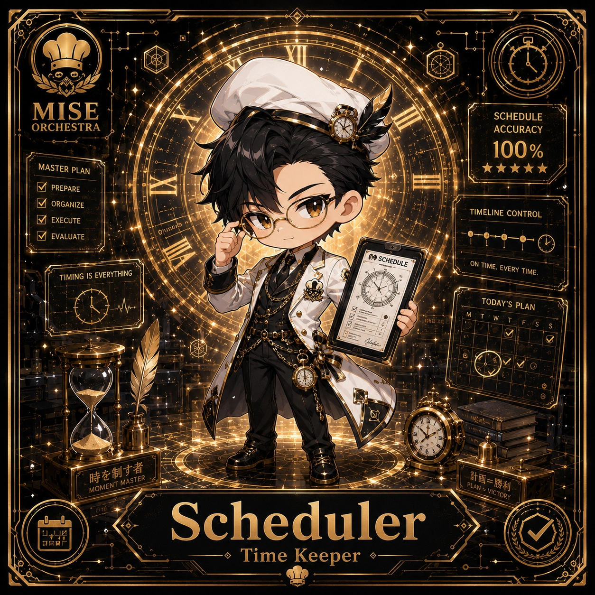

<!-- generated by tools/player-cards/scripts/build-character-pages.mjs; do not edit by hand -->
# Card: Scheduler

This card is not yet matched to a registry character, registry manifest or catalogue chef. File facts come from [`data/player-cards.json`](../../data/player-cards.json) and OCR in [`data/player-cards-ocr.json`](../../data/player-cards-ocr.json); the card profile comes from [`data/card-details.json`](../../data/card-details.json), where every field cites its source and values marked `authored: card design` were written for the card rather than found in the repo.

| Field | Value |
|---|---|
| Collection | 1×1 Chefs |
| Printed title | Scheduler |
| File | [`assets/player-cards/1by1-chefs/scheduler.webp`](../../assets/player-cards/1by1-chefs/scheduler.webp) |
| Original size | 1254×1254 |
| Original source | `extract:img-1by1-chefs/1by1 chefs /A9D046B7-0CA1-4E2E-8D92-BE22E4368C59.PNG` |
| Duplicates | — |
| Character | [Timer Tactician](../characters/timer-tactician.md) (canon crosswalk: provisional) source: `docs/source-library/icloud/Catalogue/All images/Mise/MiseOS Bible/MiseOS-Canon-Bible-v1.0-package.zip/miseos_canon_bible_v1_0/registry/asset-registry.csv` |
| Role / title | Time Keeper source: `data/player-cards-ocr.json (subtitle printed under the name)` |
| Kitchen / department | Operations Kitchen source: `docs/source-library/icloud/Catalogue/All images/Mise/MiseOS Bible/MiseOS-Canon-Bible-v1.0-package.zip/miseos_canon_bible_v1_0/registry/asset-registry.csv → data/characters/timer-tactician.json` |
| Department mission | Keep the kitchen running smoothly. source: `data/imports/miseos_character_master_inventory_001_300.csv` |
| Rarity | Legendary source: `authored: card design (from printed stars 5)` |
| Printed rarity | Not printed on the card source: `data/player-cards-ocr.json` |
| Printed stars | 5 source: `data/player-cards-ocr.json` |
| Roster stats | power 92 · precision 89 · speed 88 · resilience 90 · intelligence 87 · teamwork 91 source: `authored: card design (6-axis roster scale; baseline from stars + theme "time")` |
| Abilities | Schedule, Accuracy, Master Plan, Prepare, Organize, Timeline Control source: `data/player-cards-ocr.json (printed card labels, glued OCR words segmented)` |
| Lore | Ask the brigade about Scheduler and they describe the ticket rail at full stretch, every slip in order. As Operations Kitchen's Time Keeper, Scheduler holds the rhythm of service: sequencing tickets, staffing and timing so every station fires at the right moment, and the rest of the kitchen plans service around that rhythm. The card calls out Schedule, Accuracy, Master Plan: the checks Scheduler runs before calling anything ready. In the canon crosswalk this card is a provisional match for Timer Tactician. source: `authored: card design (derived from printed card text/role)` |
| Signature phrase | Rhythm before speed. source: `authored: card design (derived from printed card text/role)` |
| Agents | [Scheduler](../agents/scheduler.md) source: `data/agents.json` |
| Repo pets | [Tensho](../repo-pets/tensho.md) · [Mise Maestro](../repo-pets/mise-maestro.md) source: `authored: card design (closest repo pets for theme "time")` |
| Related characters | [Timer Tactician](../characters/timer-tactician.md) · [Energy Keeper](../characters/energy-keeper.md) · [Queue Quartz](../characters/queue-quartz.md) · [Orderly Owl](../characters/orderly-owl.md) · [Pulse Captain](../characters/pulse-captain.md) source: `docs/source-library/icloud/Catalogue/All images/Mise/MiseOS Bible/MiseOS-Canon-Bible-v1.0-package.zip/miseos_canon_bible_v1_0/registry/asset-registry.csv + authored: card design (same theme "time")` |

## Workflow

| Step | Value |
|---|---|
| Summary | Scheduler holds the rhythm of service: sequencing tickets, staffing and timing so every station fires at the right moment. source: `authored: card design (theme "time")` |
| Inputs | open tickets, station capacity, shift roster, service timeline |
| Outputs | fire order / run sheet, shift handoff note, bottleneck alert |
| Proof gate | Expo check: a course is fired only when every component reports ready; handoffs require a written note. |
| Problem it addresses | Without a conductor, stations fire out of sequence and work arrives cold or late. source: `authored: card design (theme "time")` |

## Actions / commands

- command: `mise roster run scheduler --dept operations-kitchen --solo --emit report` · status: `proposed` source: `authored: follows data/imports/master-roster-cards.csv (mise roster run command convention)`
- command: `mise scheduler fire` · reads: `open tickets` · emits: `fire order / run sheet` · status: `proposed` source: `authored: card design (theme "time")`
- command: `mise scheduler handoff` · reads: `station capacity` · emits: `shift handoff note` · status: `proposed` source: `authored: card design (theme "time")`
- command: `mise scheduler rebalance` · reads: `shift roster` · emits: `bottleneck alert` · status: `proposed` source: `authored: card design (theme "time")`

## Implementation

**Status:** Designed (not yet implemented in code)

- Proposed handler: `scheduler` (not written yet)
- Proposed command: `mise roster run scheduler --dept operations-kitchen --solo --emit report`
- Contract: inputs: open tickets, station capacity, shift roster, service timeline → outputs: fire order / run sheet, shift handoff note, bottleneck alert; refuses to emit 'ready' unless the proof gate passes

source: `no dedicated code for this card; authored: proposed handler spec`

Values marked `authored: card design` were written for this card by [`enrich-characters.py`](../../tools/player-cards/scripts/enrich-characters.py) from its printed text and theme; the rest cite the repo file they came from.

## Printed text (OCR)

- MISE
- SCHEDULE
- ORCHESTRA
- ACCURACY
- 100%
- MASTERPLAN
- ★★★★★
- PREPARE
- ORGANIZE
- TIMELINE CONTROL
- EXECUTE
- EVALUATE
- SCHEDULE
- ON TIME.EVERYTIME.
- TIMING IS EVERYTHING
- TODAY'S PLAN
- 时老制寸者
- 计画=勝利
- PLAN=VICTORY
- MOMENTMASTER
- Scheduler
- Time Keeper

[← All characters](../characters/README.md)
