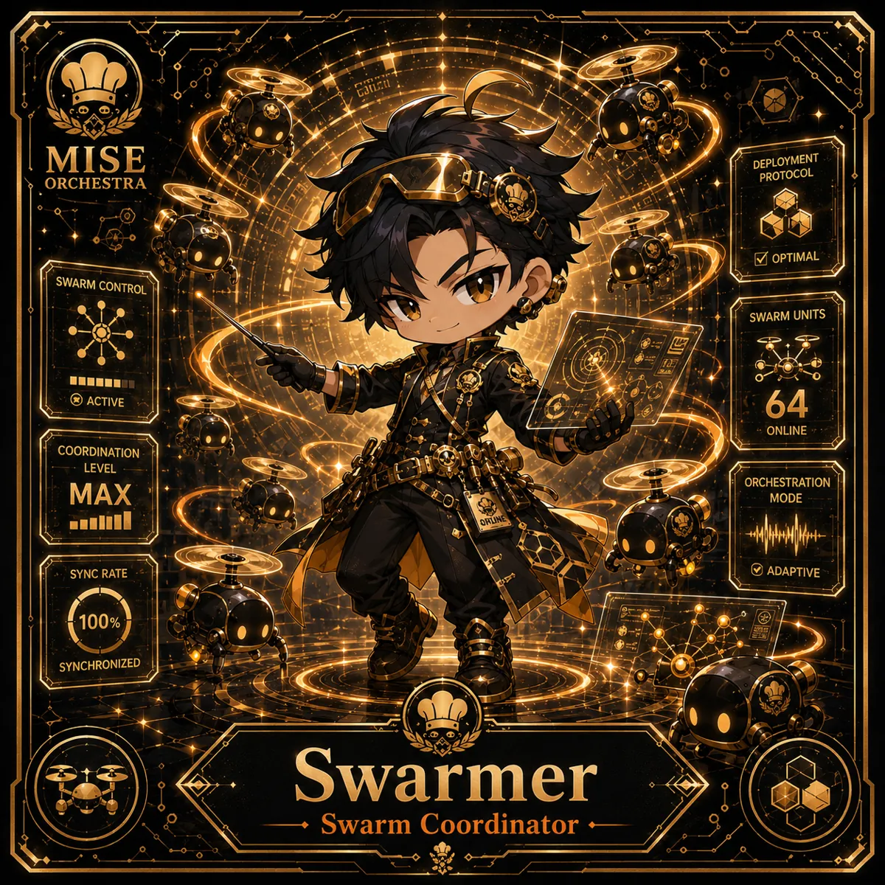

<!-- generated by tools/player-cards/scripts/build-character-pages.mjs; do not edit by hand -->
# Card: Swarmer

This card is not yet matched to a registry character, registry manifest or catalogue chef. Fields below are read from [`data/player-cards.json`](../../data/player-cards.json) and OCR in [`data/player-cards-ocr.json`](../../data/player-cards-ocr.json).

| Field | Value |
|---|---|
| Collection | 1×1 Chefs |
| Printed title | Swarmer |
| File | [`assets/player-cards/1by1-chefs/swarmer.webp`](../../assets/player-cards/1by1-chefs/swarmer.webp) |
| Original size | 1254×1254 |
| Original source | `extract:img-1by1-chefs/1by1 chefs /8577DB5B-8C6C-41C7-967B-5A3AAA716C1D.PNG` |
| Duplicates | — |
| Character | Not yet defined in the source material |
| Agent | [Swarmar](../agents/swarmar.md) |
| Repo pet | Not yet defined in the source material |
| Workflow / actions / implementation | Not yet defined in the source material |

## Printed text (OCR)

- MISE
- DEPLOYMENT
- ORCHESTRA
- PROTOCOL
-  OPTIMAL
- SWARMCONTROL
- SWARM UNITS
- ACTIVE
- 64
- ONLINE
- COORDINATION
- LEVEL
- MAX
- ORCHESTRATION
- MODE
- ORLN
-  ADAPTIVE
- SYNC RATE
- 100%
- SYNCHRONIZED
- Swarm Coordinator

[← All characters](../characters/README.md)
