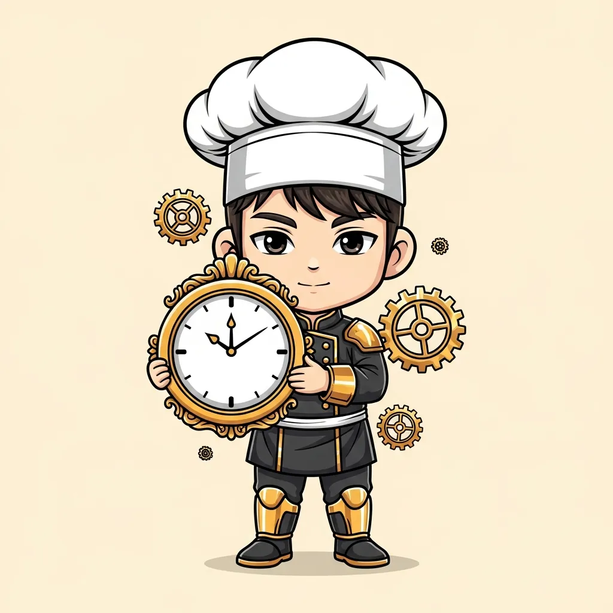

<!-- generated by tools/player-cards/scripts/build-character-pages.mjs; do not edit by hand -->
# Card: Clockwork Chef

This card is not yet matched to a registry character, registry manifest or catalogue chef. File facts come from [`data/player-cards.json`](../../data/player-cards.json) and OCR in [`data/player-cards-ocr.json`](../../data/player-cards-ocr.json); the card profile comes from [`data/card-details.json`](../../data/card-details.json), where every field cites its source and values marked `authored: card design` were written for the card rather than found in the repo.

| Field | Value |
|---|---|
| Collection | Cartoon Chefs |
| Printed title | Clockwork Chef (no title printed; name authored from the art) |
| File | [`assets/player-cards/cartoon-chefs/img_5947.webp`](../../assets/player-cards/cartoon-chefs/img_5947.webp) |
| Original size | 1024×1024 |
| Original source | `extract:img-cartoon-chefs/Cartoon chefs /IMG_5947.PNG` |
| Duplicates | — |
| Character | No registry character matched yet (card-only design) source: `data/player-cards.json + canon crosswalk (no registry match; card-only design)` |
| Visual design | chef holding a large clock surrounded by gears source: `authored: visual reading of the card art (tools/player-cards/scripts/cartoon-chef-visuals.json); no text is printed` |
| Role / title | Aboyeur (expediter) source: `authored: card design (brigade station for theme "time")` |
| Kitchen / department | Operations Kitchen source: `authored: card design (theme "time")` |
| Department mission | Keep the kitchen running smoothly. source: `data/imports/miseos_character_master_inventory_001_300.csv` |
| Rarity | Common source: `authored: card design (default tier)` |
| Printed rarity | Not printed on the card source: `data/player-cards-ocr.json` |
| Printed stars | Not printed on the card source: `data/player-cards-ocr.json` |
| Roster stats | power 80 · precision 79 · speed 77 · resilience 73 · intelligence 79 · teamwork 73 source: `authored: card design (6-axis roster scale; baseline from stars + theme "time")` |
| Abilities | Fire, Handoff, Rebalance, Fire Order / Run Sheet source: `authored: card design (no text printed; from role and theme "time")` |
| Lore | Drawn as a chef holding a large clock surrounded by gears. Ask the brigade about Clockwork Chef and they describe the ticket rail at full stretch, every slip in order. As Operations Kitchen's Aboyeur (expediter), Clockwork Chef holds the rhythm of service: sequencing tickets, staffing and timing so every station fires at the right moment, and the rest of the kitchen plans service around that rhythm. source: `authored: card design (derived from the card art)` |
| Signature phrase | Rhythm before speed. source: `authored: card design (derived from printed card text/role)` |
| Agents | [Conductor](../agents/conductor.md) · [Scheduler](../agents/scheduler.md) · [Tensho](../agents/tensho.md) source: `authored: card design (closest agents for theme "time")` |
| Repo pets | [Tensho](../repo-pets/tensho.md) · [Mise Maestro](../repo-pets/mise-maestro.md) source: `authored: card design (closest repo pets for theme "time")` |
| Related characters | [Pulse Captain](../characters/pulse-captain.md) · [Queue Quartz](../characters/queue-quartz.md) · [Energy Keeper](../characters/energy-keeper.md) · [Kitchen Conductor](../characters/kitchen-conductor.md) · [Timer Tactician](../characters/timer-tactician.md) source: `authored: card design (same theme "time")` |

## Workflow

| Step | Value |
|---|---|
| Summary | Clockwork Chef holds the rhythm of service: sequencing tickets, staffing and timing so every station fires at the right moment. source: `authored: card design (theme "time")` |
| Inputs | open tickets, station capacity, shift roster, service timeline |
| Outputs | fire order / run sheet, shift handoff note, bottleneck alert |
| Proof gate | Expo check: a course is fired only when every component reports ready; handoffs require a written note. |
| Problem it addresses | Without a conductor, stations fire out of sequence and work arrives cold or late. source: `authored: card design (theme "time")` |

## Actions / commands

- command: `mise roster run clockwork-chef --dept operations-kitchen --solo --emit report` · status: `proposed` source: `authored: follows data/imports/master-roster-cards.csv (mise roster run command convention)`
- command: `mise clockwork-chef fire` · reads: `open tickets` · emits: `fire order / run sheet` · status: `proposed` source: `authored: card design (theme "time")`
- command: `mise clockwork-chef handoff` · reads: `station capacity` · emits: `shift handoff note` · status: `proposed` source: `authored: card design (theme "time")`
- command: `mise clockwork-chef rebalance` · reads: `shift roster` · emits: `bottleneck alert` · status: `proposed` source: `authored: card design (theme "time")`

## Implementation

**Status:** Designed (not yet implemented in code)

- Proposed handler: `clockworkChef` (not written yet)
- Proposed command: `mise roster run clockwork-chef --dept operations-kitchen --solo --emit report`
- Contract: inputs: open tickets, station capacity, shift roster, service timeline → outputs: fire order / run sheet, shift handoff note, bottleneck alert; refuses to emit 'ready' unless the proof gate passes

source: `no dedicated code for this card; authored: proposed handler spec`

Values marked `authored: card design` were written for this card by [`enrich-characters.py`](../../tools/player-cards/scripts/enrich-characters.py) from its printed text and theme; the rest cite the repo file they came from.

## Printed text (OCR)

_No text detected on this card._

[← All characters](../characters/README.md)
