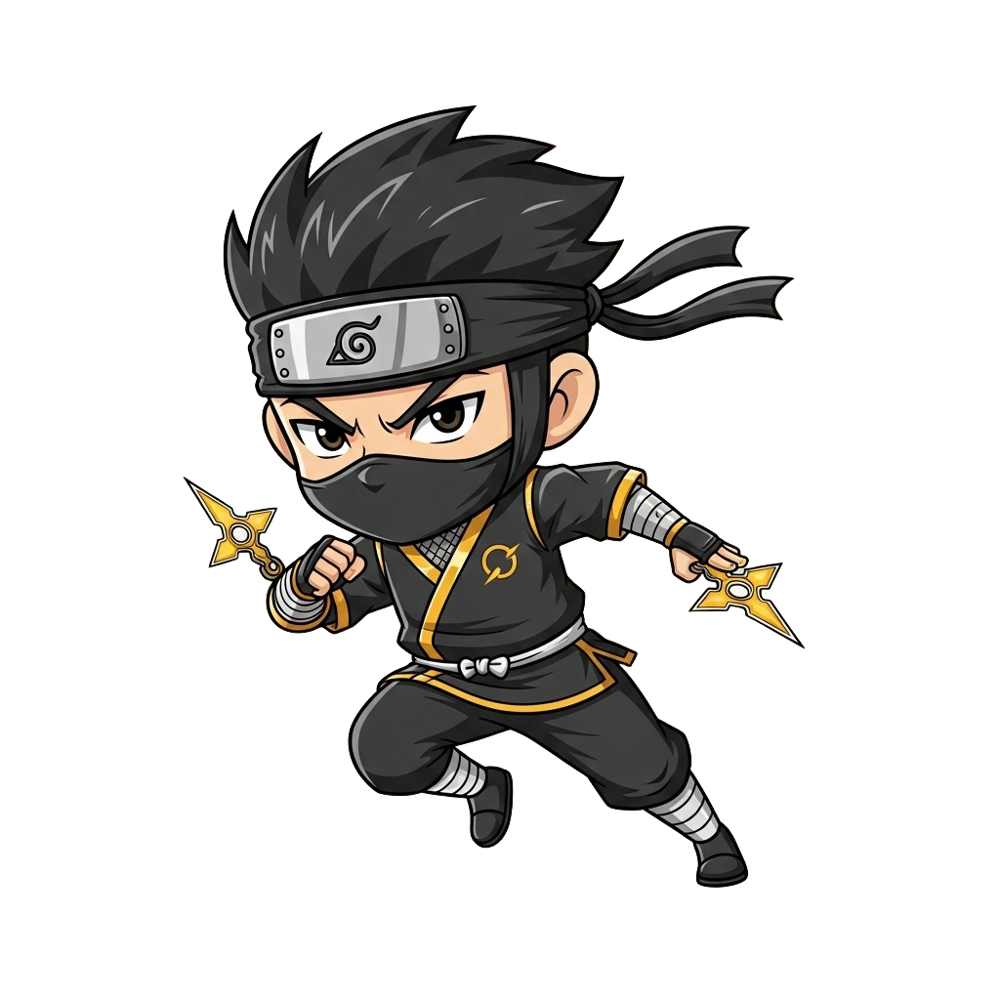

<!-- generated by tools/player-cards/scripts/build-character-pages.mjs; do not edit by hand -->
# Card: Shadow Ninja Cook

This card is not yet matched to a registry character, registry manifest or catalogue chef. File facts come from [`data/player-cards.json`](../../data/player-cards.json) and OCR in [`data/player-cards-ocr.json`](../../data/player-cards-ocr.json); the card profile comes from [`data/card-details.json`](../../data/card-details.json), where every field cites its source and values marked `authored: card design` were written for the card rather than found in the repo.

| Field | Value |
|---|---|
| Collection | Cartoon Chefs |
| Printed title | Shadow Ninja Cook (no title printed; name authored from the art) |
| File | [`assets/player-cards/cartoon-chefs/img_5951.webp`](../../assets/player-cards/cartoon-chefs/img_5951.webp) |
| Original size | 1024×1024 |
| Original source | `extract:img-cartoon-chefs/Cartoon chefs /IMG_5951.PNG` |
| Duplicates | — |
| Character | No registry character matched yet (card-only design) source: `data/player-cards.json + canon crosswalk (no registry match; card-only design)` |
| Visual design | masked ninja chef throwing blades source: `authored: visual reading of the card art (tools/player-cards/scripts/cartoon-chef-visuals.json); no text is printed` |
| Role / title | Boucher (portioning) source: `authored: card design (brigade station for theme "blade")` |
| Kitchen / department | Pipeline Kitchen source: `authored: card design (theme "blade")` |
| Department mission | Build. Test. Deploy. Repeat. source: `data/imports/miseos_character_master_inventory_001_300.csv` |
| Rarity | Common source: `authored: card design (default tier)` |
| Printed rarity | Not printed on the card source: `data/player-cards-ocr.json` |
| Printed stars | Not printed on the card source: `data/player-cards-ocr.json` |
| Roster stats | power 74 · precision 73 · speed 86 · resilience 78 · intelligence 76 · teamwork 71 source: `authored: card design (6-axis roster scale; baseline from stars + theme "blade")` |
| Abilities | Portion, Weigh, Yield, Portioned Units source: `authored: card design (no text printed; from role and theme "blade")` |
| Lore | Drawn as a masked ninja chef throwing blades. Most of the brigade only notices Shadow Ninja Cook when something is missing, which is exactly the point. Shadow Ninja Cook breaks large work down into clean, consistent portions so every downstream station gets exactly what it needs; the image the crew uses for it is a freshly honed edge and a cutting board ruled in centimetres. source: `authored: card design (derived from the card art)` |
| Signature phrase | Measure, then cut. source: `authored: card design (derived from printed card text/role)` |
| Agents | [Dispatcher](../agents/dispatcher.md) · [Automator](../agents/automator.md) · [Iron Hashi](../agents/iron-hashi.md) source: `authored: card design (closest agents for theme "blade")` |
| Repo pets | [Iron Hashi](../repo-pets/iron-hashi.md) · [Flash Riku](../repo-pets/flash-riku.md) source: `authored: card design (closest repo pets for theme "blade")` |
| Related characters | [Slicer Swift](../characters/slicer-swift.md) · [Prep Pulse](../characters/prep-pulse.md) · [Butcher Blade](../characters/butcher-blade.md) source: `authored: card design (same theme "blade")` |

## Workflow

| Step | Value |
|---|---|
| Summary | Shadow Ninja Cook breaks large work down into clean, consistent portions so every downstream station gets exactly what it needs. source: `authored: card design (theme "blade")` |
| Inputs | whole product / large task, portion spec, yield target |
| Outputs | portioned units, yield report, trim / waste count |
| Proof gate | Yield gate: portions are weighed against spec; out-of-tolerance cuts are re-trimmed or logged as waste before they reach a station. |
| Problem it addresses | Oversized, uneven work items jam the line and waste effort. source: `authored: card design (theme "blade")` |

## Actions / commands

- command: `mise roster run shadow-ninja-cook --dept pipeline-kitchen --solo --emit report` · status: `proposed` source: `authored: follows data/imports/master-roster-cards.csv (mise roster run command convention)`
- command: `mise shadow-ninja-cook portion` · reads: `whole product / large task` · emits: `portioned units` · status: `proposed` source: `authored: card design (theme "blade")`
- command: `mise shadow-ninja-cook weigh` · reads: `portion spec` · emits: `yield report` · status: `proposed` source: `authored: card design (theme "blade")`
- command: `mise shadow-ninja-cook yield` · reads: `yield target` · emits: `trim / waste count` · status: `proposed` source: `authored: card design (theme "blade")`

## Implementation

**Status:** Designed (not yet implemented in code)

- Proposed handler: `shadowNinjaCook` (not written yet)
- Proposed command: `mise roster run shadow-ninja-cook --dept pipeline-kitchen --solo --emit report`
- Contract: inputs: whole product / large task, portion spec, yield target → outputs: portioned units, yield report, trim / waste count; refuses to emit 'ready' unless the proof gate passes

source: `no dedicated code for this card; authored: proposed handler spec`

Values marked `authored: card design` were written for this card by [`enrich-characters.py`](../../tools/player-cards/scripts/enrich-characters.py) from its printed text and theme; the rest cite the repo file they came from.

## Printed text (OCR)

_No text detected on this card._

[← All characters](../characters/README.md)
