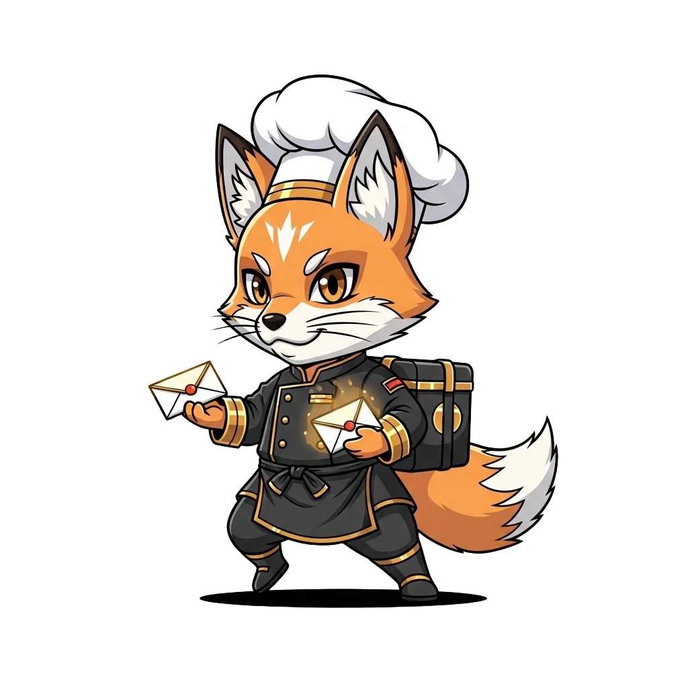

<!-- generated by tools/player-cards/scripts/build-character-pages.mjs; do not edit by hand -->
# Card: Fox Server

This card is not yet matched to a registry character, registry manifest or catalogue chef. File facts come from [`data/player-cards.json`](../../data/player-cards.json) and OCR in [`data/player-cards-ocr.json`](../../data/player-cards-ocr.json); the card profile comes from [`data/card-details.json`](../../data/card-details.json), where every field cites its source and values marked `authored: card design` were written for the card rather than found in the repo.

| Field | Value |
|---|---|
| Collection | Cartoon Chefs |
| Printed title | Fox Server (no title printed; name authored from the art) |
| File | [`assets/player-cards/cartoon-chefs/img_5955.webp`](../../assets/player-cards/cartoon-chefs/img_5955.webp) |
| Original size | 1024×1024 |
| Original source | `extract:img-cartoon-chefs/Cartoon chefs /IMG_5955.PNG` |
| Duplicates | — |
| Character | No registry character matched yet (card-only design) source: `data/player-cards.json + canon crosswalk (no registry match; card-only design)` |
| Visual design | fox chef carrying a dish source: `authored: visual reading of the card art (tools/player-cards/scripts/cartoon-chef-visuals.json); no text is printed` |
| Role / title | Saucier source: `authored: card design (brigade station for theme "sauce")` |
| Kitchen / department | Platform Kitchen source: `authored: card design (theme "sauce")` |
| Department mission | Provide golden paths and stable service foundations. source: `data/imports/miseos_character_master_inventory_001_300.csv` |
| Rarity | Common source: `authored: card design (default tier)` |
| Printed rarity | Not printed on the card source: `data/player-cards-ocr.json` |
| Printed stars | Not printed on the card source: `data/player-cards-ocr.json` |
| Roster stats | power 65 · precision 89 · speed 70 · resilience 75 · intelligence 74 · teamwork 73 source: `authored: card design (6-axis roster scale; baseline from stars + theme "sauce")` |
| Abilities | Reduce, Taste, Label, Finished Base Batch source: `authored: card design (no text printed; from role and theme "sauce")` |
| Lore | Drawn as a fox chef carrying a dish. Ask the brigade about Fox Server and they describe the back burner where the stockpots never go cold. As Platform Kitchen's Saucier, Fox Server builds the base flavours other stations depend on: reductions, stocks and mother sauces that must taste the same every time, and the rest of the kitchen plans service around that rhythm. source: `authored: card design (derived from the card art)` |
| Signature phrase | Taste twice, ship once. source: `authored: card design (derived from printed card text/role)` |
| Agents | [Umami Code](../agents/umami-code.md) · [API Gateway](../agents/api-gateway.md) · [Architect](../agents/architect.md) source: `authored: card design (closest agents for theme "sauce")` |
| Repo pets | [Umami Code](../repo-pets/umami-code.md) · [Mise Sauce](../repo-pets/mise-sauce.md) source: `authored: card design (closest repo pets for theme "sauce")` |
| Related characters | [Kombu Keeper](../characters/kombu-keeper.md) · [Stock Sage](../characters/stock-sage.md) · [Glaze Whisperer](../characters/glaze-whisperer.md) · [Umami Seeker](../characters/umami-seeker.md) · [Umami Code](../characters/umami-code.md) source: `authored: card design (same theme "sauce")` |

## Workflow

| Step | Value |
|---|---|
| Summary | Fox Server builds the base flavours other stations depend on: reductions, stocks and mother sauces that must taste the same every time. source: `authored: card design (theme "sauce")` |
| Inputs | base recipe / spec, ingredient batch, taste targets (salt, acid, umami), station order |
| Outputs | finished base batch, tasting note, batch label with date and allergens |
| Proof gate | Taste-and-label check: a batch only ships to stations after it matches the spec on taste and carries a dated allergen label. |
| Problem it addresses | Every dish downstream drifts when the shared base (or shared library) changes without anyone tasting it. source: `authored: card design (theme "sauce")` |

## Actions / commands

- command: `mise roster run fox-server --dept platform-kitchen --solo --emit report` · status: `proposed` source: `authored: follows data/imports/master-roster-cards.csv (mise roster run command convention)`
- command: `mise fox-server reduce` · reads: `base recipe / spec` · emits: `finished base batch` · status: `proposed` source: `authored: card design (theme "sauce")`
- command: `mise fox-server taste` · reads: `ingredient batch` · emits: `tasting note` · status: `proposed` source: `authored: card design (theme "sauce")`
- command: `mise fox-server label` · reads: `taste targets (salt, acid, umami)` · emits: `batch label with date and allergens` · status: `proposed` source: `authored: card design (theme "sauce")`

## Implementation

**Status:** Designed (not yet implemented in code)

- Proposed handler: `foxServer` (not written yet)
- Proposed command: `mise roster run fox-server --dept platform-kitchen --solo --emit report`
- Contract: inputs: base recipe / spec, ingredient batch, taste targets (salt, acid, umami), station order → outputs: finished base batch, tasting note, batch label with date and allergens; refuses to emit 'ready' unless the proof gate passes

source: `no dedicated code for this card; authored: proposed handler spec`

Values marked `authored: card design` were written for this card by [`enrich-characters.py`](../../tools/player-cards/scripts/enrich-characters.py) from its printed text and theme; the rest cite the repo file they came from.

## Printed text (OCR)

_No text detected on this card._

[← All characters](../characters/README.md)
