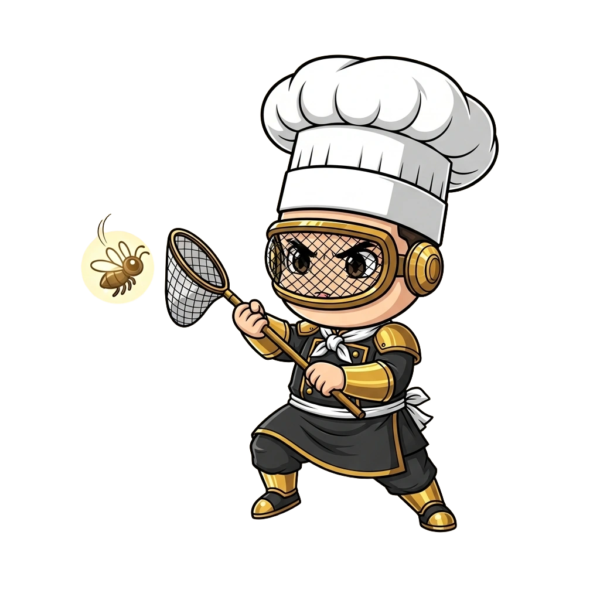

<!-- generated by tools/player-cards/scripts/build-character-pages.mjs; do not edit by hand -->
# Card: Sifter Scout

This card is not yet matched to a registry character, registry manifest or catalogue chef. File facts come from [`data/player-cards.json`](../../data/player-cards.json) and OCR in [`data/player-cards-ocr.json`](../../data/player-cards-ocr.json); the card profile comes from [`data/card-details.json`](../../data/card-details.json), where every field cites its source and values marked `authored: card design` were written for the card rather than found in the repo.

| Field | Value |
|---|---|
| Collection | Cartoon Chefs |
| Printed title | Sifter Scout (no title printed; name authored from the art) |
| File | [`assets/player-cards/cartoon-chefs/img_5962.webp`](../../assets/player-cards/cartoon-chefs/img_5962.webp) |
| Original size | 1024×1024 |
| Original source | `extract:img-cartoon-chefs/Cartoon chefs /IMG_5962.PNG` |
| Duplicates | — |
| Character | No registry character matched yet (card-only design) source: `data/player-cards.json + canon crosswalk (no registry match; card-only design)` |
| Visual design | masked chef holding a sieve with a gold spark source: `authored: visual reading of the card art (tools/player-cards/scripts/cartoon-chef-visuals.json); no text is printed` |
| Role / title | Taster (quality control) source: `authored: card design (brigade station for theme "quality")` |
| Kitchen / department | Reliability Kitchen source: `authored: card design (theme "quality")` |
| Department mission | Observe. Measure. Improve. source: `data/imports/miseos_character_master_inventory_001_300.csv` |
| Rarity | Common source: `authored: card design (default tier)` |
| Printed rarity | Not printed on the card source: `data/player-cards-ocr.json` |
| Printed stars | Not printed on the card source: `data/player-cards-ocr.json` |
| Roster stats | power 67 · precision 84 · speed 68 · resilience 69 · intelligence 68 · teamwork 65 source: `authored: card design (6-axis roster scale; baseline from stars + theme "quality")` |
| Abilities | Taste, Review, Verdict, Pass / Send-Back Verdict source: `authored: card design (no text printed; from role and theme "quality")` |
| Lore | Drawn as a masked chef holding a sieve with a gold spark. Ask the brigade about Sifter Scout and they describe a spoon in every pot. As Reliability Kitchen's specialist for taster (quality control), Sifter Scout tastes and tests before anything is served: reviews, checks and canaries against the spec, and the rest of the kitchen plans service around that rhythm. source: `authored: card design (derived from the card art)` |
| Signature phrase | Evidence or it goes back. source: `authored: card design (derived from printed card text/role)` |
| Agents | [Reviewer](../agents/reviewer.md) · [Tester](../agents/tester.md) · [Quality Guard](../agents/quality-guard.md) source: `authored: card design (closest agents for theme "quality")` |
| Repo pets | [Mise Garde](../repo-pets/mise-garde.md) · [Mise Brigadier](../repo-pets/mise-brigadier.md) source: `authored: card design (closest repo pets for theme "quality")` |
| Related characters | [Nina Promoter](../characters/nina-promoter.md) · [Hugo Matrix](../characters/hugo-matrix.md) · [Resilience Ryu](../characters/resilience-ryu.md) · [Runtime Riku](../characters/runtime-riku.md) · [Release Conductor](../characters/release-conductor.md) source: `authored: card design (same theme "quality")` |

## Workflow

| Step | Value |
|---|---|
| Summary | Sifter Scout tastes and tests before anything is served: reviews, checks and canaries against the spec. source: `authored: card design (theme "quality")` |
| Inputs | candidate change / dish, spec / acceptance tests, previous results |
| Outputs | pass / send-back verdict, review notes, test evidence |
| Proof gate | Taste gate: a change ships only with recorded evidence that it meets the spec. |
| Problem it addresses | Defects reach the guest when nobody tastes before serving. source: `authored: card design (theme "quality")` |

## Actions / commands

- command: `mise roster run sifter-scout --dept reliability-kitchen --solo --emit report` · status: `proposed` source: `authored: follows data/imports/master-roster-cards.csv (mise roster run command convention)`
- command: `mise sifter-scout taste` · reads: `candidate change / dish` · emits: `pass / send-back verdict` · status: `proposed` source: `authored: card design (theme "quality")`
- command: `mise sifter-scout review` · reads: `spec / acceptance tests` · emits: `review notes` · status: `proposed` source: `authored: card design (theme "quality")`
- command: `mise sifter-scout verdict` · reads: `previous results` · emits: `test evidence` · status: `proposed` source: `authored: card design (theme "quality")`

## Implementation

**Status:** Designed (not yet implemented in code)

- Proposed handler: `sifterScout` (not written yet)
- Proposed command: `mise roster run sifter-scout --dept reliability-kitchen --solo --emit report`
- Contract: inputs: candidate change / dish, spec / acceptance tests, previous results → outputs: pass / send-back verdict, review notes, test evidence; refuses to emit 'ready' unless the proof gate passes

source: `no dedicated code for this card; authored: proposed handler spec`

Values marked `authored: card design` were written for this card by [`enrich-characters.py`](../../tools/player-cards/scripts/enrich-characters.py) from its printed text and theme; the rest cite the repo file they came from.

## Printed text (OCR)

_No text detected on this card._

[← All characters](../characters/README.md)
