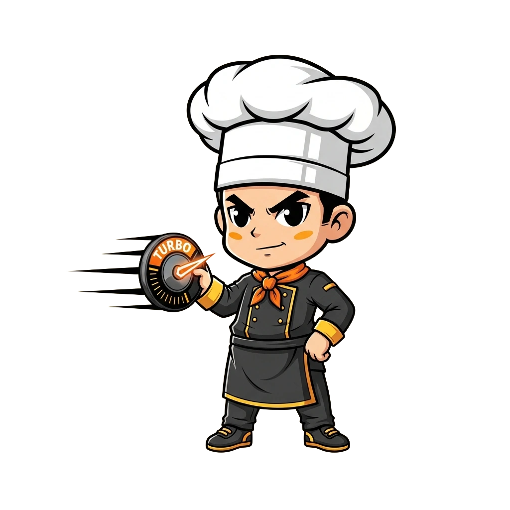

<!-- generated by tools/player-cards/scripts/build-character-pages.mjs; do not edit by hand -->
# Card: Img_5966

This card is not yet matched to a registry character, registry manifest or catalogue chef. File facts come from [`data/player-cards.json`](../../data/player-cards.json) and OCR in [`data/player-cards-ocr.json`](../../data/player-cards-ocr.json); the card profile comes from [`data/card-details.json`](../../data/card-details.json), where every field cites its source and values marked `authored: card design` were written for the card rather than found in the repo.

| Field | Value |
|---|---|
| Collection | Cartoon Chefs |
| Printed title | Img_5966 (no title printed; name authored from the art) |
| File | [`assets/player-cards/cartoon-chefs/img_5966.webp`](../../assets/player-cards/cartoon-chefs/img_5966.webp) |
| Original size | 1024×1024 |
| Original source | `extract:img-cartoon-chefs/Cartoon chefs /IMG_5966.PNG` |
| Duplicates | — |
| Character | No registry character matched yet (card-only design) source: `data/player-cards.json + canon crosswalk (no registry match; card-only design)` |
| Role / title | Aboyeur (expediter) source: `authored: card design (brigade station for theme "time")` |
| Kitchen / department | Operations Kitchen source: `authored: card design (theme "time")` |
| Department mission | Keep the kitchen running smoothly. source: `data/imports/miseos_character_master_inventory_001_300.csv` |
| Rarity | Common source: `authored: card design (default tier)` |
| Printed rarity | Not printed on the card source: `data/player-cards-ocr.json` |
| Printed stars | Not printed on the card source: `data/player-cards-ocr.json` |
| Roster stats | power 75 · precision 71 · speed 76 · resilience 67 · intelligence 72 · teamwork 77 source: `authored: card design (6-axis roster scale; baseline from stars + theme "time")` |
| Abilities | Kurbo source: `data/player-cards-ocr.json (printed card labels, glued OCR words segmented)` |
| Lore | Picture the ticket rail at full stretch, every slip in order: that is where Img_5966 is happiest. As Operations Kitchen's Aboyeur (expediter), Img_5966 holds the rhythm of service: sequencing tickets, staffing and timing so every station fires at the right moment. The card calls out Kurbo: the checks Img_5966 runs before calling anything ready. source: `authored: card design (derived from printed card text/role)` |
| Signature phrase | Fire first, then service. source: `authored: card design (derived from printed card text/role)` |
| Agents | [Conductor](../agents/conductor.md) · [Scheduler](../agents/scheduler.md) · [Tensho](../agents/tensho.md) source: `authored: card design (closest agents for theme "time")` |
| Repo pets | [Tensho](../repo-pets/tensho.md) · [Mise Maestro](../repo-pets/mise-maestro.md) source: `authored: card design (closest repo pets for theme "time")` |
| Related characters | [Timer Tactician](../characters/timer-tactician.md) · [Queue Quartz](../characters/queue-quartz.md) · [Pulse Captain](../characters/pulse-captain.md) · [Energy Keeper](../characters/energy-keeper.md) · [Kitchen Conductor](../characters/kitchen-conductor.md) source: `authored: card design (same theme "time")` |

## Workflow

| Step | Value |
|---|---|
| Summary | Img_5966 holds the rhythm of service: sequencing tickets, staffing and timing so every station fires at the right moment. source: `authored: card design (theme "time")` |
| Inputs | open tickets, station capacity, shift roster, service timeline |
| Outputs | fire order / run sheet, shift handoff note, bottleneck alert |
| Proof gate | Expo check: a course is fired only when every component reports ready; handoffs require a written note. |
| Problem it addresses | Without a conductor, stations fire out of sequence and work arrives cold or late. source: `authored: card design (theme "time")` |

## Actions / commands

- command: `mise roster run img-5966 --dept operations-kitchen --solo --emit report` · status: `proposed` source: `authored: follows data/imports/master-roster-cards.csv (mise roster run command convention)`
- command: `mise img-5966 fire` · reads: `open tickets` · emits: `fire order / run sheet` · status: `proposed` source: `authored: card design (theme "time")`
- command: `mise img-5966 handoff` · reads: `station capacity` · emits: `shift handoff note` · status: `proposed` source: `authored: card design (theme "time")`
- command: `mise img-5966 rebalance` · reads: `shift roster` · emits: `bottleneck alert` · status: `proposed` source: `authored: card design (theme "time")`

## Implementation

**Status:** Designed (not yet implemented in code)

- Proposed handler: `img5966` (not written yet)
- Proposed command: `mise roster run img-5966 --dept operations-kitchen --solo --emit report`
- Contract: inputs: open tickets, station capacity, shift roster, service timeline → outputs: fire order / run sheet, shift handoff note, bottleneck alert; refuses to emit 'ready' unless the proof gate passes

source: `no dedicated code for this card; authored: proposed handler spec`

Values marked `authored: card design` were written for this card by [`enrich-characters.py`](../../tools/player-cards/scripts/enrich-characters.py) from its printed text and theme; the rest cite the repo file they came from.

## Printed text (OCR)

- KURBO

[← All characters](../characters/README.md)
