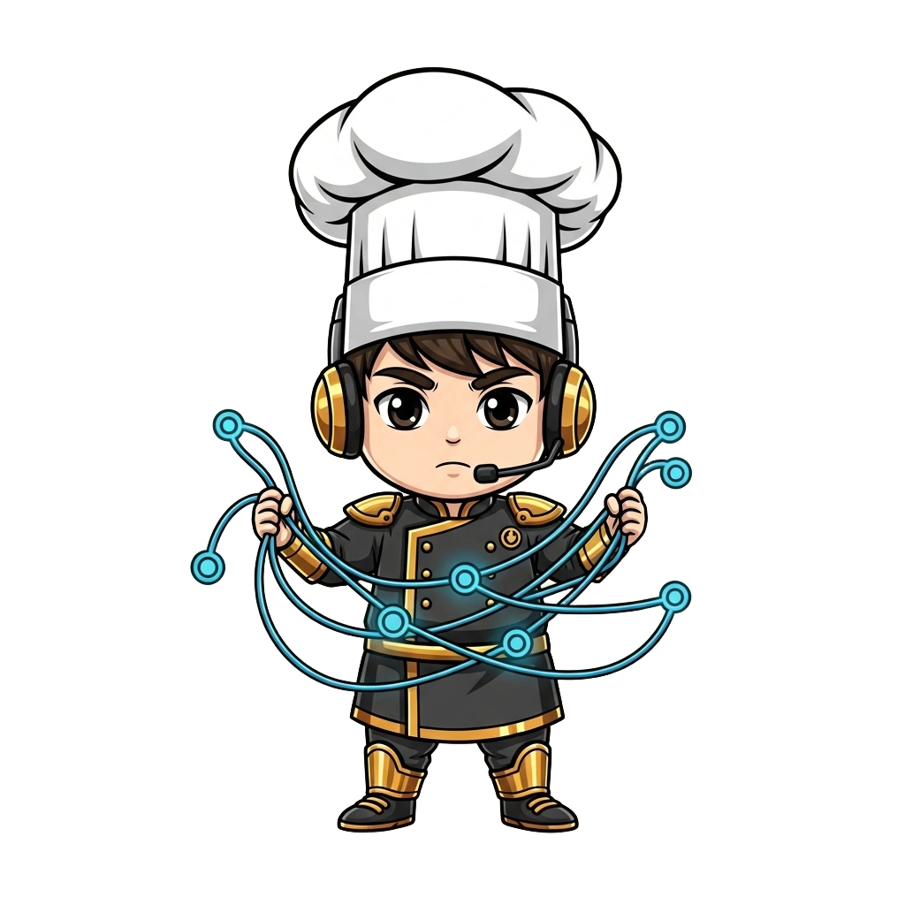

<!-- generated by tools/player-cards/scripts/build-character-pages.mjs; do not edit by hand -->
# Card: Wire Weaver

This card is not yet matched to a registry character, registry manifest or catalogue chef. File facts come from [`data/player-cards.json`](../../data/player-cards.json) and OCR in [`data/player-cards-ocr.json`](../../data/player-cards-ocr.json); the card profile comes from [`data/card-details.json`](../../data/card-details.json), where every field cites its source and values marked `authored: card design` were written for the card rather than found in the repo.

| Field | Value |
|---|---|
| Collection | Cartoon Chefs |
| Printed title | Wire Weaver (no title printed; name authored from the art) |
| File | [`assets/player-cards/cartoon-chefs/img_5983.webp`](../../assets/player-cards/cartoon-chefs/img_5983.webp) |
| Original size | 1024×1024 |
| Original source | `extract:img-cartoon-chefs/Cartoon chefs /IMG_5983.PNG` |
| Duplicates | — |
| Character | No registry character matched yet (card-only design) source: `data/player-cards.json + canon crosswalk (no registry match; card-only design)` |
| Visual design | chef wrapped in glowing network cables source: `authored: visual reading of the card art (tools/player-cards/scripts/cartoon-chef-visuals.json); no text is printed` |
| Role / title | Station builder (platform) source: `authored: card design (brigade station for theme "platform")` |
| Kitchen / department | Platform Kitchen source: `authored: card design (theme "platform")` |
| Department mission | Provide golden paths and stable service foundations. source: `data/imports/miseos_character_master_inventory_001_300.csv` |
| Rarity | Common source: `authored: card design (default tier)` |
| Printed rarity | Not printed on the card source: `data/player-cards-ocr.json` |
| Printed stars | Not printed on the card source: `data/player-cards-ocr.json` |
| Roster stats | power 67 · precision 67 · speed 74 · resilience 89 · intelligence 73 · teamwork 75 source: `authored: card design (6-axis roster scale; baseline from stars + theme "platform")` |
| Abilities | Install, Pin, Verify, Installed Capability source: `authored: card design (no text printed; from role and theme "platform")` |
| Lore | Drawn as a chef wrapped in glowing network cables. Ask the brigade about Wire Weaver and they describe the stainless steel shelving every station is bolted to. As Platform Kitchen's specialist for station builder (platform), Wire Weaver provides a shared platform building block other kitchens install and build on, and the rest of the kitchen plans service around that rhythm. source: `authored: card design (derived from the card art)` |
| Signature phrase | Build once, serve every kitchen. source: `authored: card design (derived from printed card text/role)` |
| Agents | [Architect](../agents/architect.md) · [Terraformer](../agents/terraformer.md) · [Docker](../agents/docker.md) source: `authored: card design (closest agents for theme "platform")` |
| Repo pets | [Mise Bootstrap](../repo-pets/mise-bootstrap.md) · [Mise Brigadier](../repo-pets/mise-brigadier.md) source: `authored: card design (closest repo pets for theme "platform")` |
| Related characters | [Terra Forge](../characters/terra-forge.md) · [Platform Sensei](../characters/platform-sensei.md) · [Bootstrap Aiko](../characters/bootstrap-aiko.md) · [Queue Mizu](../characters/queue-mizu.md) · [Template Tanaka](../characters/template-tanaka.md) source: `authored: card design (same theme "platform")` |

## Workflow

| Step | Value |
|---|---|
| Summary | Wire Weaver provides a shared platform building block other kitchens install and build on. source: `authored: card design (theme "platform")` |
| Inputs | consumer repository, manifest / configuration, version pin |
| Outputs | installed capability, version record, compatibility report |
| Proof gate | Golden-path gate: consumers install only pinned, signed versions that pass the registry schema. |
| Problem it addresses | Every team reinvents the same foundations differently. source: `authored: card design (theme "platform")` |

## Actions / commands

- command: `mise roster run wire-weaver --dept platform-kitchen --solo --emit report` · status: `proposed` source: `authored: follows data/imports/master-roster-cards.csv (mise roster run command convention)`
- command: `mise wire-weaver install` · reads: `consumer repository` · emits: `installed capability` · status: `proposed` source: `authored: card design (theme "platform")`
- command: `mise wire-weaver pin` · reads: `manifest / configuration` · emits: `version record` · status: `proposed` source: `authored: card design (theme "platform")`
- command: `mise wire-weaver verify` · reads: `version pin` · emits: `compatibility report` · status: `proposed` source: `authored: card design (theme "platform")`

## Implementation

**Status:** Designed (not yet implemented in code)

- Proposed handler: `wireWeaver` (not written yet)
- Proposed command: `mise roster run wire-weaver --dept platform-kitchen --solo --emit report`
- Contract: inputs: consumer repository, manifest / configuration, version pin → outputs: installed capability, version record, compatibility report; refuses to emit 'ready' unless the proof gate passes

source: `no dedicated code for this card; authored: proposed handler spec`

Values marked `authored: card design` were written for this card by [`enrich-characters.py`](../../tools/player-cards/scripts/enrich-characters.py) from its printed text and theme; the rest cite the repo file they came from.

## Printed text (OCR)

_No text detected on this card._

[← All characters](../characters/README.md)
