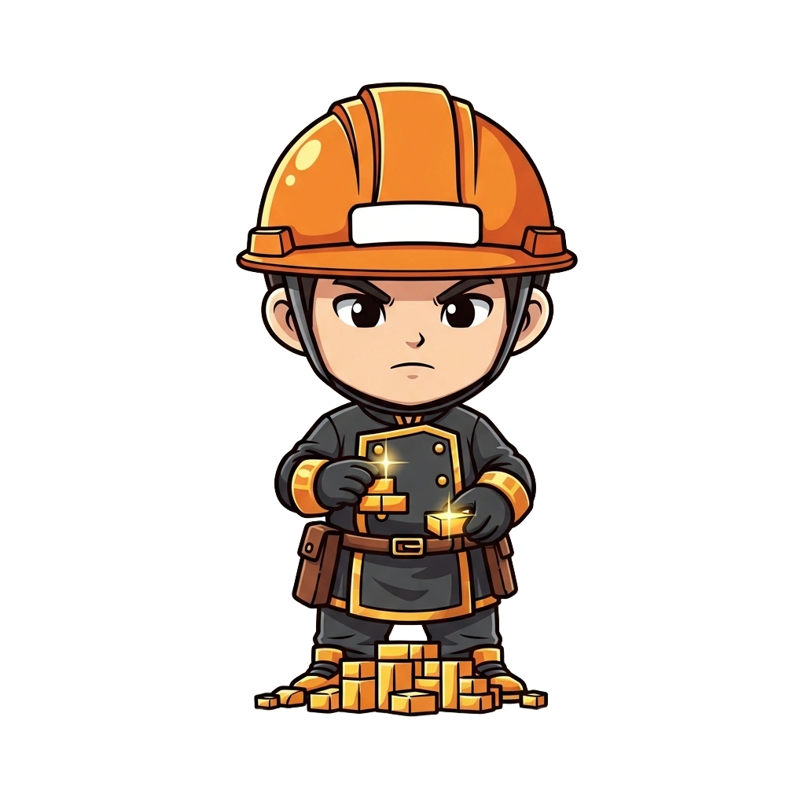

<!-- generated by tools/player-cards/scripts/build-character-pages.mjs; do not edit by hand -->
# Card: Hard Hat Builder

This card is not yet matched to a registry character, registry manifest or catalogue chef. File facts come from [`data/player-cards.json`](../../data/player-cards.json) and OCR in [`data/player-cards-ocr.json`](../../data/player-cards-ocr.json); the card profile comes from [`data/card-details.json`](../../data/card-details.json), where every field cites its source and values marked `authored: card design` were written for the card rather than found in the repo.

| Field | Value |
|---|---|
| Collection | Cartoon Chefs |
| Printed title | Hard Hat Builder (no title printed; name authored from the art) |
| File | [`assets/player-cards/cartoon-chefs/img_5990.webp`](../../assets/player-cards/cartoon-chefs/img_5990.webp) |
| Original size | 1024×1024 |
| Original source | `extract:img-cartoon-chefs/Cartoon chefs /IMG_5990.PNG` |
| Duplicates | — |
| Character | No registry character matched yet (card-only design) source: `data/player-cards.json + canon crosswalk (no registry match; card-only design)` |
| Visual design | chef in an orange hard hat on a pile of blocks source: `authored: visual reading of the card art (tools/player-cards/scripts/cartoon-chef-visuals.json); no text is printed` |
| Role / title | Implementation cook source: `authored: card design (brigade station for theme "code")` |
| Kitchen / department | Pipeline Kitchen source: `authored: card design (theme "code")` |
| Department mission | Build. Test. Deploy. Repeat. source: `data/imports/miseos_character_master_inventory_001_300.csv` |
| Rarity | Common source: `authored: card design (default tier)` |
| Printed rarity | Not printed on the card source: `data/player-cards-ocr.json` |
| Printed stars | Not printed on the card source: `data/player-cards-ocr.json` |
| Roster stats | power 79 · precision 73 · speed 84 · resilience 77 · intelligence 79 · teamwork 65 source: `authored: card design (6-axis roster scale; baseline from stars + theme "code")` |
| Abilities | Plan, Build, Ship, Commit / Pull Request source: `authored: card design (no text printed; from role and theme "code")` |
| Lore | Drawn as a chef in an orange hard hat on a pile of blocks. Ask the brigade about Hard Hat Builder and they describe a terminal glowing beside the prep list. As Pipeline Kitchen's Implementation cook, Hard Hat Builder turns a plan into working code through a plan, code, test, deploy loop, and the rest of the kitchen plans service around that rhythm. source: `authored: card design (derived from the card art)` |
| Signature phrase | Plan it, prove it, ship it. source: `authored: card design (derived from printed card text/role)` |
| Agents | [Coder](../agents/coder.md) · [Build Kun](../agents/build-kun.md) · [Debugger](../agents/debugger.md) source: `authored: card design (closest agents for theme "code")` |
| Repo pets | [Build-Kun](../repo-pets/build-kun.md) · [Mise Bootstrap](../repo-pets/mise-bootstrap.md) source: `authored: card design (closest repo pets for theme "code")` |
| Related characters | [Null-chan](../characters/null-chan.md) · [Backlog Benji](../characters/backlog-benji.md) · [DX Mei](../characters/dx-mei.md) · [Yume Builder](../characters/yume-builder.md) source: `authored: card design (same theme "code")` |

## Workflow

| Step | Value |
|---|---|
| Summary | Hard Hat Builder turns a plan into working code through a plan, code, test, deploy loop. source: `authored: card design (theme "code")` |
| Inputs | task / issue, repository context, acceptance criteria |
| Outputs | commit / pull request, test results, deploy status |
| Proof gate | CI gate: no merge without green tests and a reviewed diff. |
| Problem it addresses | Ideas stall between plan and production. source: `authored: card design (theme "code")` |

## Actions / commands

- command: `mise roster run hard-hat-builder --dept pipeline-kitchen --solo --emit report` · status: `proposed` source: `authored: follows data/imports/master-roster-cards.csv (mise roster run command convention)`
- command: `mise hard-hat-builder plan` · reads: `task / issue` · emits: `commit / pull request` · status: `proposed` source: `authored: card design (theme "code")`
- command: `mise hard-hat-builder build` · reads: `repository context` · emits: `test results` · status: `proposed` source: `authored: card design (theme "code")`
- command: `mise hard-hat-builder ship` · reads: `acceptance criteria` · emits: `deploy status` · status: `proposed` source: `authored: card design (theme "code")`

## Implementation

**Status:** Designed (not yet implemented in code)

- Proposed handler: `hardHatBuilder` (not written yet)
- Proposed command: `mise roster run hard-hat-builder --dept pipeline-kitchen --solo --emit report`
- Contract: inputs: task / issue, repository context, acceptance criteria → outputs: commit / pull request, test results, deploy status; refuses to emit 'ready' unless the proof gate passes

source: `no dedicated code for this card; authored: proposed handler spec`

Values marked `authored: card design` were written for this card by [`enrich-characters.py`](../../tools/player-cards/scripts/enrich-characters.py) from its printed text and theme; the rest cite the repo file they came from.

## Printed text (OCR)

_No text detected on this card._

[← All characters](../characters/README.md)
