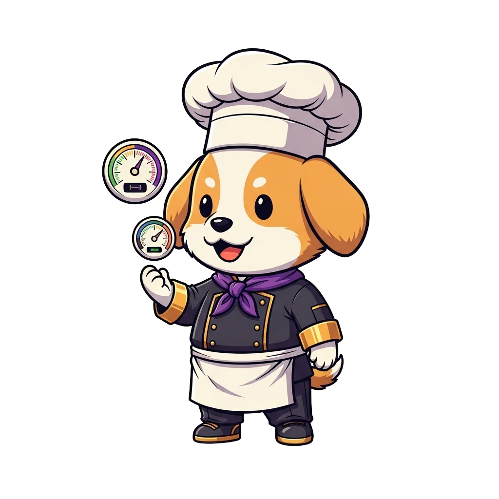

<!-- generated by tools/player-cards/scripts/build-character-pages.mjs; do not edit by hand -->
# Card: Gauge Pup

This card is not yet matched to a registry character, registry manifest or catalogue chef. File facts come from [`data/player-cards.json`](../../data/player-cards.json) and OCR in [`data/player-cards-ocr.json`](../../data/player-cards-ocr.json); the card profile comes from [`data/card-details.json`](../../data/card-details.json), where every field cites its source and values marked `authored: card design` were written for the card rather than found in the repo.

| Field | Value |
|---|---|
| Collection | Cartoon Chefs |
| Printed title | Gauge Pup (no title printed; name authored from the art) |
| File | [`assets/player-cards/cartoon-chefs/img_5998.webp`](../../assets/player-cards/cartoon-chefs/img_5998.webp) |
| Original size | 1024×1024 |
| Original source | `extract:img-cartoon-chefs/Cartoon chefs /IMG_5998.PNG` |
| Duplicates | — |
| Character | No registry character matched yet (card-only design) source: `data/player-cards.json + canon crosswalk (no registry match; card-only design)` |
| Visual design | puppy chef holding a pressure gauge source: `authored: visual reading of the card art (tools/player-cards/scripts/cartoon-chef-visuals.json); no text is printed` |
| Role / title | Garde-manger (cold & temperature) source: `authored: card design (brigade station for theme "cold")` |
| Kitchen / department | Reliability Kitchen source: `authored: card design (theme "cold")` |
| Department mission | Observe. Measure. Improve. source: `data/imports/miseos_character_master_inventory_001_300.csv` |
| Rarity | Common source: `authored: card design (default tier)` |
| Printed rarity | Not printed on the card source: `data/player-cards-ocr.json` |
| Printed stars | Not printed on the card source: `data/player-cards-ocr.json` |
| Roster stats | power 70 · precision 71 · speed 78 · resilience 82 · intelligence 66 · teamwork 73 source: `authored: card design (6-axis roster scale; baseline from stars + theme "cold")` |
| Abilities | Probe, Chill, Log Temp, Temperature Log source: `authored: card design (no text printed; from role and theme "cold")` |
| Lore | Drawn as a puppy chef holding a pressure gauge. Ask the brigade about Gauge Pup and they describe the walk-in, humming at three degrees. As Reliability Kitchen's specialist for garde-manger (cold & temperature), Gauge Pup keeps every item inside its safe temperature band and flags drift before it becomes spoilage, and the rest of the kitchen plans service around that rhythm. source: `authored: card design (derived from the card art)` |
| Signature phrase | Cold logic, safe food. source: `authored: card design (derived from printed card text/role)` |
| Agents | [Observatory](../agents/observatory.md) · [Alarmer](../agents/alarmer.md) · [SRE Chef](../agents/sre-chef.md) source: `authored: card design (closest agents for theme "cold")` |
| Repo pets | [Mise Runtime](../repo-pets/mise-runtime.md) · [Null-chan](../repo-pets/null-chan.md) source: `authored: card design (closest repo pets for theme "cold")` |
| Related characters | [Temp Tamer](../characters/temp-tamer.md) · [Steam Whisper](../characters/steam-whisper.md) · [Cold Zero](../characters/cold-zero.md) source: `authored: card design (same theme "cold")` |

## Workflow

| Step | Value |
|---|---|
| Summary | Gauge Pup keeps every item inside its safe temperature band and flags drift before it becomes spoilage. source: `authored: card design (theme "cold")` |
| Inputs | probe / sensor readings, storage map, HACCP limits, hold times |
| Outputs | temperature log, drift alert, discard / re-chill decision |
| Proof gate | Temperature gate: readings outside the safe band for longer than the hold limit force a discard or re-chill; no override without a logged reason. |
| Problem it addresses | Silent drift (heat, latency, resource pressure) spoils work long before anyone notices. source: `authored: card design (theme "cold")` |

## Actions / commands

- command: `mise roster run gauge-pup --dept reliability-kitchen --solo --emit report` · status: `proposed` source: `authored: follows data/imports/master-roster-cards.csv (mise roster run command convention)`
- command: `mise gauge-pup probe` · reads: `probe / sensor readings` · emits: `temperature log` · status: `proposed` source: `authored: card design (theme "cold")`
- command: `mise gauge-pup chill` · reads: `storage map` · emits: `drift alert` · status: `proposed` source: `authored: card design (theme "cold")`
- command: `mise gauge-pup log-temp` · reads: `HACCP limits` · emits: `discard / re-chill decision` · status: `proposed` source: `authored: card design (theme "cold")`

## Implementation

**Status:** Designed (not yet implemented in code)

- Proposed handler: `gaugePup` (not written yet)
- Proposed command: `mise roster run gauge-pup --dept reliability-kitchen --solo --emit report`
- Contract: inputs: probe / sensor readings, storage map, HACCP limits, hold times → outputs: temperature log, drift alert, discard / re-chill decision; refuses to emit 'ready' unless the proof gate passes

source: `no dedicated code for this card; authored: proposed handler spec`

Values marked `authored: card design` were written for this card by [`enrich-characters.py`](../../tools/player-cards/scripts/enrich-characters.py) from its printed text and theme; the rest cite the repo file they came from.

## Printed text (OCR)

_No text detected on this card._

[← All characters](../characters/README.md)
