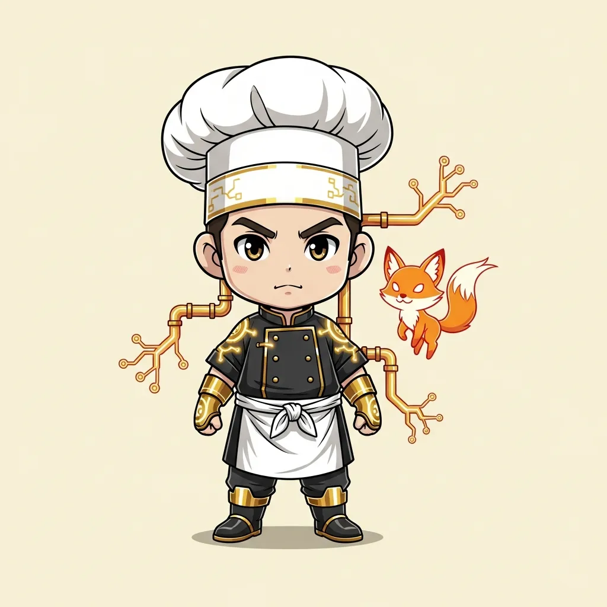

<!-- generated by tools/player-cards/scripts/build-character-pages.mjs; do not edit by hand -->
# Card: Ember Fox Chef

This card is not yet matched to a registry character, registry manifest or catalogue chef. File facts come from [`data/player-cards.json`](../../data/player-cards.json) and OCR in [`data/player-cards-ocr.json`](../../data/player-cards-ocr.json); the card profile comes from [`data/card-details.json`](../../data/card-details.json), where every field cites its source and values marked `authored: card design` were written for the card rather than found in the repo.

| Field | Value |
|---|---|
| Collection | Cartoon Chefs |
| Printed title | Ember Fox Chef (no title printed; name authored from the art) |
| File | [`assets/player-cards/cartoon-chefs/img_6005.webp`](../../assets/player-cards/cartoon-chefs/img_6005.webp) |
| Original size | 1024×1024 |
| Original source | `extract:img-cartoon-chefs/Cartoon chefs /IMG_6005.PNG` |
| Duplicates | — |
| Character | No registry character matched yet (card-only design) source: `data/player-cards.json + canon crosswalk (no registry match; card-only design)` |
| Visual design | chef with a fiery fox spirit source: `authored: visual reading of the card art (tools/player-cards/scripts/cartoon-chef-visuals.json); no text is printed` |
| Role / title | Grillardin source: `authored: card design (brigade station for theme "heat")` |
| Kitchen / department | Reliability Kitchen source: `authored: card design (theme "heat")` |
| Department mission | Observe. Measure. Improve. source: `data/imports/miseos_character_master_inventory_001_300.csv` |
| Rarity | Common source: `authored: card design (default tier)` |
| Printed rarity | Not printed on the card source: `data/player-cards-ocr.json` |
| Printed stars | Not printed on the card source: `data/player-cards-ocr.json` |
| Roster stats | power 76 · precision 81 · speed 79 · resilience 71 · intelligence 77 · teamwork 74 source: `authored: card design (6-axis roster scale; baseline from stars + theme "heat")` |
| Abilities | Sear, Probe, Cool Down, Cooked-To-Spec Item source: `authored: card design (no text printed; from role and theme "heat")` |
| Lore | Drawn as a chef with a fiery fox spirit. Most of the brigade only notices Ember Fox Chef when something is missing, which is exactly the point. Ember Fox Chef runs the high-heat line: controls flame, timing and doneness so pressure never turns into burn; the image the crew uses for it is the flat-top at the peak of Friday service. source: `authored: card design (derived from the card art)` |
| Signature phrase | Pull it at the line, not past it. source: `authored: card design (derived from printed card text/role)` |
| Agents | [Kaji](../agents/kaji.md) · [Scale Oni](../agents/scale-oni.md) · [Perf Chef](../agents/perf-chef.md) source: `authored: card design (closest agents for theme "heat")` |
| Repo pets | [Kaji](../repo-pets/kaji.md) · [Scale Oni](../repo-pets/scale-oni.md) source: `authored: card design (closest repo pets for theme "heat")` |
| Related characters | [Ashen One](../characters/ashen-one.md) · [Scale Oni](../characters/scale-oni.md) · [Roast Commander](../characters/roast-commander.md) · [Build-Kun](../characters/build-kun.md) · [Pan Phantom](../characters/pan-phantom.md) source: `authored: card design (same theme "heat")` |

## Workflow

| Step | Value |
|---|---|
| Summary | Ember Fox Chef runs the high-heat line: controls flame, timing and doneness so pressure never turns into burn. source: `authored: card design (theme "heat")` |
| Inputs | ticket with doneness target, heat / load reading, timer, protein or batch on the pass |
| Outputs | cooked-to-spec item, doneness check, heat log, escalation if the line runs hot |
| Proof gate | Doneness gate: nothing leaves the station without a probe/timer reading inside the target band; overheated runs are pulled, not served. |
| Problem it addresses | Under load, the hottest station is where quality collapses first (outages, burnt releases). source: `authored: card design (theme "heat")` |

## Actions / commands

- command: `mise roster run ember-fox-chef --dept reliability-kitchen --solo --emit report` · status: `proposed` source: `authored: follows data/imports/master-roster-cards.csv (mise roster run command convention)`
- command: `mise ember-fox-chef sear` · reads: `ticket with doneness target` · emits: `cooked-to-spec item` · status: `proposed` source: `authored: card design (theme "heat")`
- command: `mise ember-fox-chef probe` · reads: `heat / load reading` · emits: `doneness check` · status: `proposed` source: `authored: card design (theme "heat")`
- command: `mise ember-fox-chef cool-down` · reads: `timer` · emits: `escalation if the line runs hot` · status: `proposed` source: `authored: card design (theme "heat")`

## Implementation

**Status:** Designed (not yet implemented in code)

- Proposed handler: `emberFoxChef` (not written yet)
- Proposed command: `mise roster run ember-fox-chef --dept reliability-kitchen --solo --emit report`
- Contract: inputs: ticket with doneness target, heat / load reading, timer, protein or batch on the pass → outputs: cooked-to-spec item, doneness check, heat log, escalation if the line runs hot; refuses to emit 'ready' unless the proof gate passes

source: `no dedicated code for this card; authored: proposed handler spec`

Values marked `authored: card design` were written for this card by [`enrich-characters.py`](../../tools/player-cards/scripts/enrich-characters.py) from its printed text and theme; the rest cite the repo file they came from.

## Printed text (OCR)

_No text detected on this card._

[← All characters](../characters/README.md)
