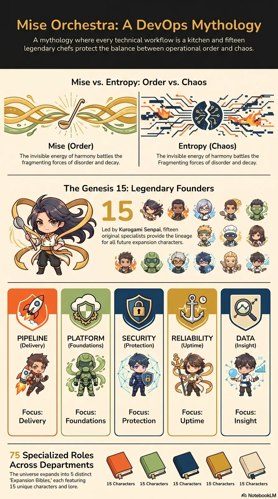

<!-- generated by tools/player-cards/scripts/build-character-pages.mjs; do not edit by hand -->
# Card: Focus:

This card is not yet matched to a registry character, registry manifest or catalogue chef. Fields below are read from [`data/player-cards.json`](../../data/player-cards.json) and OCR in [`data/player-cards-ocr.json`](../../data/player-cards-ocr.json).

| Field | Value |
|---|---|
| Collection | Character Building Theme |
| Printed title | Focus: |
| File | [`assets/player-cards/character-building/focus.webp`](../../assets/player-cards/character-building/focus.webp) |
| Original size | 1536×2752 |
| Original source | `extract:img-character-building-theme/Character building theme /Mise Orchestra DevOps Mythology 2.PNG` |
| Duplicates | `extract:img-character-building-theme/Character building theme /Mise Orchestra DevOps Mythology.PNG` `icloud:Mise_Orchestra_DevOps_Mythology.png` |
| Character | Not yet defined in the source material |
| Agent | Not yet defined in the source material |
| Repo pet | Not yet defined in the source material |
| Workflow / actions / implementation | Not yet defined in the source material |

## Printed text (OCR)

- MiseOrchestra:ADevOps Mythology
- A mythology where every technical workflow is a kitchen and fifteen
- Legendarychefsprotectthebalancebetweenoperationalorderand chaos.
- Mise vs. Entropy: Order vs. Chaos
- Mise (Order)
- Entropy (Chaos)
- Theinvisibleenergyofharmonybattlesthe
- The invisible energy of harmony battles the
- fragmentingforcesofdisorderanddecay.
- Fragmenting forces of disorder and decay.
- The Genesis 15: Legendary Founders
- LedbyKurogamiSenpai,fifteen
- original specialists providethe lineage
- for allfuture expansion characters.
- PIPELINE
- PLATFORM
- SECURITY
- RELIABILITY
- DATA
- (Delivery)
- (Protection)
- (Foundations)
- (Uptime)
- (Insight)
- Focus:
- Focus:
- Focus:
- Focus:
- Focus:
- Delivery
- Foundations
- Protection
- Uptime
- Insight
- 75 Specialized Roles
- Across Departments
- The universe expands into 5distinct
- 'Expansion Bibles' each featuring
- 15Characters
- 15 unique characters and lore.
- 15Characters 15Characters 15Characters 15Characters
- NotebookLM

[← All characters](../characters/README.md)
