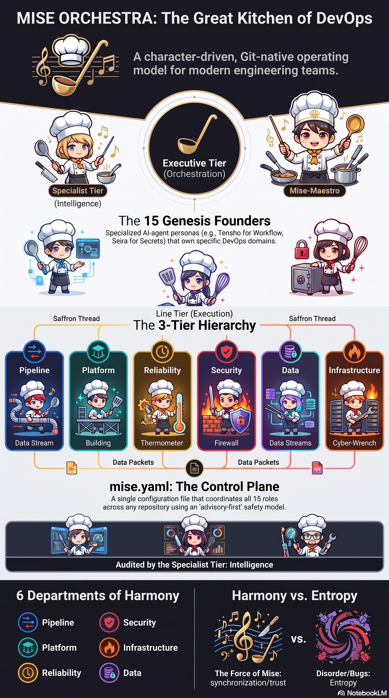

<!-- generated by tools/player-cards/scripts/build-character-pages.mjs; do not edit by hand -->
# Card: Harmonyvs.Entropy

This card is not yet matched to a registry character, registry manifest or catalogue chef. Fields below are read from [`data/player-cards.json`](../../data/player-cards.json) and OCR in [`data/player-cards-ocr.json`](../../data/player-cards-ocr.json).

| Field | Value |
|---|---|
| Collection | Character Building Theme |
| Printed title | Harmonyvs.Entropy |
| File | [`assets/player-cards/character-building/harmonyvs-entropy.webp`](../../assets/player-cards/character-building/harmonyvs-entropy.webp) |
| Original size | 1536×2752 |
| Original source | `extract:img-character-building-theme/Character building theme /DevOps Kitchen Engineering Operating Model.PNG` |
| Duplicates | — |
| Character | Not yet defined in the source material |
| Agent | Not yet defined in the source material |
| Repo pet | Not yet defined in the source material |
| Workflow / actions / implementation | Not yet defined in the source material |

## Printed text (OCR)

- MISE ORCHESTRA: The Great Kitchen of DevOps
- A character-driven, Git-native operating
- model for modern engineering teams.
- Executive Tier
- (Orchestration)
- Specialist Tier
- Mise-Maestro
- (Intelligence)
- The 15 Genesis Founders
- Specialized Al-agentpersonas (e.g.,Tensho for Workflow,
- SeiraforSecrets)thatownspecificDevOpsdomains.
- Line Tier (Execution)
- SaffronThread
- The 3-Tier Hierarchy
- SaffronThread
- Reliability
- Pipeline
- Platform
- Security
- Data
- Infrastructure
- Data Stream
- Building
- Thermometer
- Data Streams
- Firewall
- Cyber-Wrench
- Data Packets
- Data Packets
- mise.yaml: The Control Plane
- Asingle configurationfilethat coordinates all15 roles
- across any repository using an'advisory-first' safety model.
- AuditedbytheSpecialistTier:Intelligence
- 6 Departments of Harmony
- Harmony vs. Entropy
- Pipeline
- Security
- Platform
- Infrastructure
- Reliability
- Data
- The Force of Mise:
- Disorder/Bugs:
- synchronization/trust
- Entropy
- NotebookLM

[← All characters](../characters/README.md)
