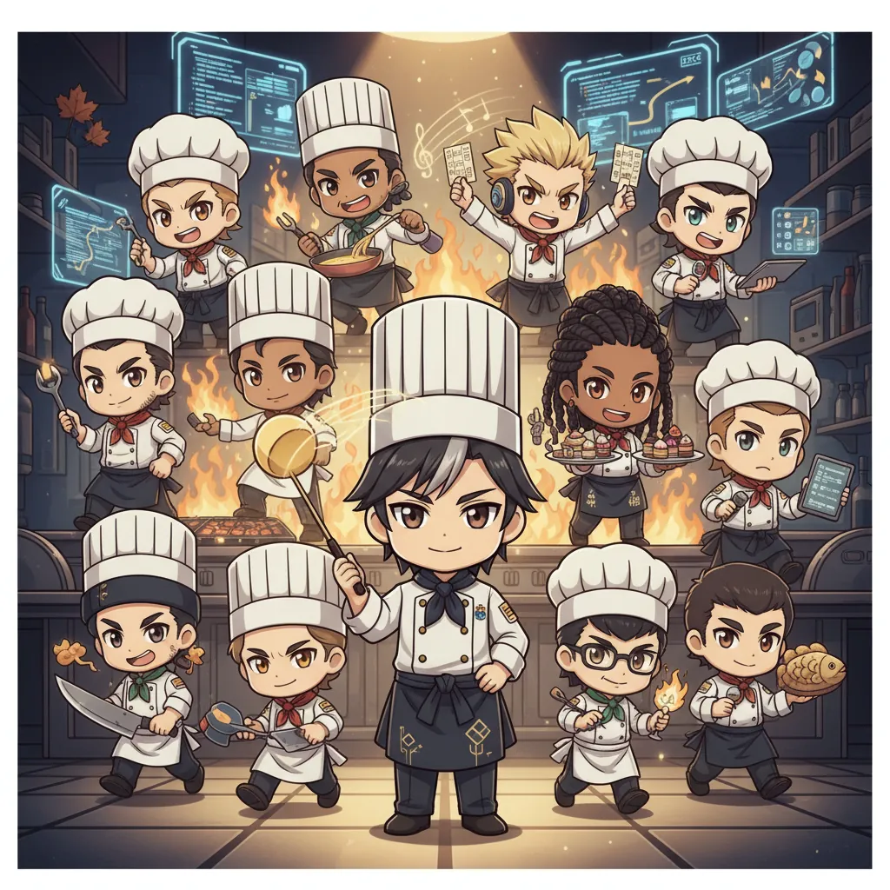

<!-- generated by tools/player-cards/scripts/build-character-pages.mjs; do not edit by hand -->
# Card: img_4556.webp

This card is not yet matched to a registry character, registry manifest or catalogue chef. Fields below are read from [`data/player-cards.json`](../../data/player-cards.json) and OCR in [`data/player-cards-ocr.json`](../../data/player-cards-ocr.json).

| Field | Value |
|---|---|
| Collection | Character Building Theme |
| Printed title | Not yet defined in the source material |
| File | [`assets/player-cards/character-building/img_4556.webp`](../../assets/player-cards/character-building/img_4556.webp) |
| Original size | 1024×1024 |
| Original source | `extract:img-character-building-theme/Character building theme /IMG_4556.PNG` |
| Duplicates | — |
| Character | Not yet defined in the source material |
| Workflow / actions / implementation | Not yet defined in the source material |

## Printed text (OCR)

- ROEM

[← All characters](../characters/README.md)
