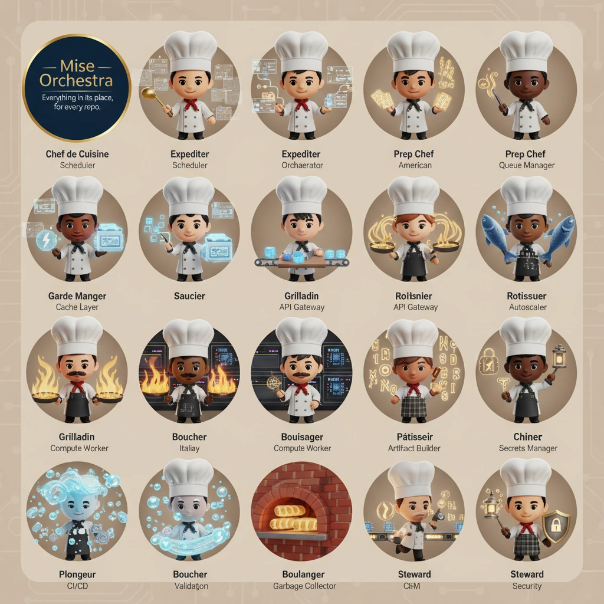

<!-- generated by tools/player-cards/scripts/build-character-pages.mjs; do not edit by hand -->
# Card: Italiay

This card is not yet matched to a registry character, registry manifest or catalogue chef. Fields below are read from [`data/player-cards.json`](../../data/player-cards.json) and OCR in [`data/player-cards-ocr.json`](../../data/player-cards-ocr.json).

| Field | Value |
|---|---|
| Collection | Character Building Theme |
| Printed title | Italiay |
| File | [`assets/player-cards/character-building/italiay.webp`](../../assets/player-cards/character-building/italiay.webp) |
| Original size | 1024×1024 |
| Original source | `extract:img-character-building-theme/Character building theme /IMG_4549.PNG` |
| Duplicates | — |
| Character | Not yet defined in the source material |
| Workflow / actions / implementation | Not yet defined in the source material |

## Printed text (OCR)

- Mise
- Orchestra
- Everything in its place,
- forevery repo.
- Chef de Cuisine
- Expediter
- Expediter
- Prep Chef
- Prep Chef
- Scheduler
- Orchaerator
- Scheduler
- American
- Queue Manager
- Saucier
- Garde Manger
- Roiisnier
- Grilladin
- Rotissuer
- Cache Layer
- APIGateway
- APIGateway
- Autoscaler
- Grilladin
- Boucher
- Bouisager
- Patisseir
- Chiner
- Italiay
- Compute Worker
- ComputeWorker
- Artifact Buider
- Secrets Manager
- Plongeur
- Boucher
- Boulanger
- Steward
- Steward
- CI/CD
- Validaton
- Garbage Collector
- CHM
- Security

[← All characters](../characters/README.md)
