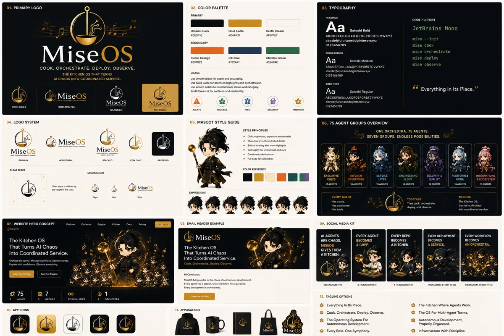

<!-- generated by tools/player-cards/scripts/build-character-pages.mjs; do not edit by hand -->
# Card: MiseOs

This card is not yet matched to a registry character, registry manifest or catalogue chef. File facts come from [`data/player-cards.json`](../../data/player-cards.json) and OCR in [`data/player-cards-ocr.json`](../../data/player-cards-ocr.json); the card profile comes from [`data/card-details.json`](../../data/card-details.json), where every field cites its source and values marked `authored: card design` were written for the card rather than found in the repo.

| Field | Value |
|---|---|
| Collection | Character Building Theme |
| Printed title | MiseOs |
| File | [`assets/player-cards/character-building/miseos-2.webp`](../../assets/player-cards/character-building/miseos-2.webp) |
| Original size | 1536×1024 |
| Original source | `extract:img-character-building-theme/Character building theme /EB1E716A-17D2-4B28-9052-B40270C29633.PNG` |
| Duplicates | — |
| Character | No registry character matched yet (card-only design) source: `data/player-cards.json + canon crosswalk (no registry match; card-only design)` |
| Role / title | Poster / reference sheet source: `authored: card design (poster / reference sheet; topics from printed text)` |
| Kitchen / department | All kitchens (universe-level reference) source: `authored: card design (poster / reference sheet; topics from printed text)` |
| Department mission | n/a (spans every kitchen) |
| Rarity | Not applicable (reference artwork) source: `authored: card design (poster / reference sheet; topics from printed text)` |
| Printed rarity | Not printed on the card source: `data/player-cards-ocr.json` |
| Printed stars | Not printed on the card source: `data/player-cards-ocr.json` |
| Roster stats | Not applicable (reference artwork, not a playable character) source: `authored: card design (poster / reference sheet; topics from printed text)` |
| Abilities | 01.Primarylogo, 03.Typography, Primary, Headings, Code/Ui Font, Satoshi Bold, Gold Ladle, Umami Biack source: `data/player-cards-ocr.json (topics printed on the sheet)` |
| Lore | Use Umami Black for depth and grounding Yry unuaid sy apePog asn source: `data/player-cards-ocr.json (text printed on the card)` |
| Signature phrase | Use Umami Black for depth and grounding source: `data/player-cards-ocr.json (tagline printed on the sheet)` |
| Agents | [Orchestra Core](../agents/orchestra-core.md) source: `authored: card design (universe-level sheet → Orchestra Core)` |
| Repo pets | [Orchestra Core](../repo-pets/orchestra-core.md) source: `authored: card design (universe-level sheet → Orchestra Core)` |
| Related characters | [DX Mei](../characters/dx-mei.md) · [Backlog Benji](../characters/backlog-benji.md) · [Yume Builder](../characters/yume-builder.md) · [Null-chan](../characters/null-chan.md) source: `authored: card design (same theme "code")` |

## Workflow

| Step | Value |
|---|---|
| Summary | Reference sheet for the MiseOS universe: shows 01.Primarylogo, 03.Typography, Primary, Headings. Used as visual canon when designing or checking characters, stations and brand assets. source: `authored: card design (poster / reference sheet; topics from printed text)` |
| Inputs | n/a (static artwork) |
| Outputs | visual canon reference for character and brand work |
| Proof gate | Canon check: any name, colour, tier or role read off this sheet is cross-checked against data/characters/*.json before reuse. |
| Problem it addresses | Keeps designers and agents working from one shared picture of the universe instead of drifting copies. source: `authored: card design (poster / reference sheet; topics from printed text)` |

## Actions / commands

- command: `none` · does: `reference artwork, not a runnable character` source: `authored: card design (poster / sheet)`

## Implementation

**Status:** Reference artwork (no code applies)

Static artwork; no handler or command applies.

source: `authored: card design (poster / reference sheet; topics from printed text)`

Values marked `authored: card design` were written for this card by [`enrich-characters.py`](../../tools/player-cards/scripts/enrich-characters.py) from its printed text and theme; the rest cite the repo file they came from.

## Printed text (OCR)

- 01.PRIMARYLOGO
- 02.COLORPALETTE
- 03.TYPOGRAPHY
- PRIMARY
- HEADINGS
- Aa
- CODE/UI FONT
- Satoshi Bold
- Gold Ladle
- Umami Biack
- Broth Cream
- JetBrains Mono
- MOEOF10
- BF6F1E7
- ABCDEFFUJLUAXOPOEPCRSTCVWXYZ
- abcdetfujuiteorddgintorowxyz
- nise --init
- SECONDARY
- 0123456789
- MiseOs
- mise cook
- SUBHEADINGS
- mise orchestrate
- Flame Orange
- Matcha Green
- Aa
- Ink Blue
- Satoshi Medium
- mise deploy
- RE97822
- 91B2A41
- R2E684E
- ABCOEFOHULAX:OPOEPCRSTCVWXYZ
- COOK.ORCHESTRATE.DEPLOY.OBSERVE.
- nise observe
- THEKITCHENOS THAT TURNS
- USAGE
- AI CHAOS INTO COORDINATED SERVICE.
- Use Umami Black for depth and grounding
- 0123456789
- Yry unuaid sy apePog asn
- ghts and orchestration.
- Usacentco
- ors to communicate status and category.
- Aa
- Broth Cream is for surfaces and read
- Satoshi Regular
- Everything In Its Place."
- MiseOs
- ABCOEFGBIULKKORCEPCRSTCVWXYZ
- MiseOs
- MiseOs
- Jujultaordoginttrmwyz
- HORIZONTAL
- ICON ONLY
- STACKED
- REVERSED
- ALERTS
- SUCCESS
- INFO
- SECURITY
- 0123456769
- PREMIUM
- 04.LOGO SYSTEM
- 05.MASCOTSTYLEGUIDE
- 06.75AGENTGROUPSOVERVIEW
- STYLEPRINCIPLES
- ONEORCHESTRA.75AGENTS.
- SEVENGROUPS.ENDLESSPOSSIBILITIES.
- Miseos
- MiseOs
- MiseOS
- RMARY
- HORIZONTAL
- STACXED
- ICON ONEY
- REVERSED
- CLEAR SPACE
- MIMUM SIZE
- ENGINEERING
- PLATFORM&
- EXECUTIVE
- OPERATIONS
- INTEGRATIONS
- SDEV
- NFRA
- &ECOSTSTEM
- 10 AGENTS
- 10 AGDITS
- pace isdefine
- MiseOS
- 10 AGDITS
- EVERYAGENT
- 24pr
- Mpx
- 32p
- TOGETHER
- Has arole.
- MISEOS
- The Kitchen Os
- Hes took
- into coordited
- 08.EMAIL HEADER EXAMPLE
- O7. WEBSITE HERO CONCEPT
- 09. SOCIAL MEDIA KIT
- MiseOs
- AI AGENTS
- EVERY AGENT
- EVERY REPO
- EVERYDEPLOYMENT
- EVERYWORKFLOW
- TheKitchenOS
- ARE CHAOS.
- BECOMES
- BECOMES
- BECOMES
- ASERVICE.
- BECOMES
- A KITCHEN.
- A CHEF.
- That Turns Al Chaos
- MISEOS
- TheKitchenOS
- AN ORCHESTRA.
- Into Coordinated Service.
- That Turns AI Chaos
- GIVES THEM
- Into Coordinated Service.
- A KITCHEN.
- Cvre seorets
- Cook.Orchestrate.Deploy,Observe.
- Sethe Brigde
- Hei Conductot
- X/UNEDIN (:0
- X/UNKEDN (19)
- INSTAGRAM STORY (9.
- INSTAGRAM (H1)
- 875
- 887
- GROUPS
- POSSIBILITIES
- 12. TAGLINE OPTIONS
- Everything In Its Place.
- The Kitchen Where Agents Work.
- 10. APP ICONS
- 11, APPLICATIONS
- Cook.Orchestrate.Deploy.Observe.
- The OS For Multi-Agent Teams.
- The Operating SystemFor
- Autonomous Development.
- Autonomous Development,
- Properly Organized.
-  Every Role. One Symphony.
- iseOs
-  Infrastructure With Discipline.

[← All characters](../characters/README.md)
