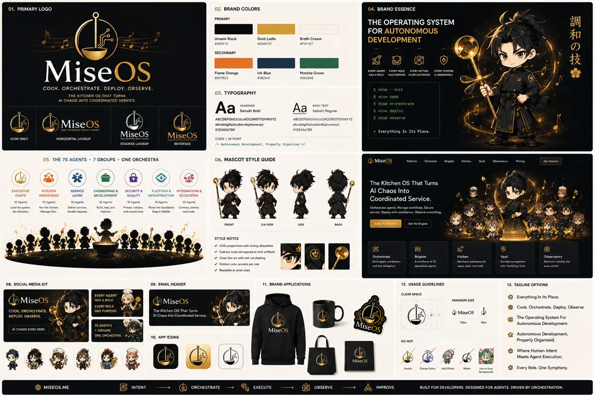

<!-- generated by tools/player-cards/scripts/build-character-pages.mjs; do not edit by hand -->
# Card: MiseOs

This card is not yet matched to a registry character, registry manifest or catalogue chef. Fields below are read from [`data/player-cards.json`](../../data/player-cards.json) and OCR in [`data/player-cards-ocr.json`](../../data/player-cards-ocr.json).

| Field | Value |
|---|---|
| Collection | Character Building Theme |
| Printed title | MiseOs |
| File | [`assets/player-cards/character-building/miseos.webp`](../../assets/player-cards/character-building/miseos.webp) |
| Original size | 1536×1024 |
| Original source | `extract:img-character-building-theme/Character building theme /E3E28BB7-7D2A-480B-AF44-2D5C0B7DEBBA.PNG` |
| Duplicates | — |
| Character | Not yet defined in the source material |
| Agent | Not yet defined in the source material |
| Repo pet | Not yet defined in the source material |
| Workflow / actions / implementation | Not yet defined in the source material |

## Printed text (OCR)

- 01.PRIMARYLOGO
- 02.BRANDCOLORS
- 04.BRANDESSENCE
- PRIMARY
- THEOPERATINGSYSTEM
- 调和の技
- FORAUTONOMOUS
- Umami Black
- Gold Ladle
- Broth Cream
- SOEOF10
- D4AF37
- SF6F1E7
- DEVELOPMENT
- SECONDARY
- MiseOs
- Flame Orange
- Ink Blue
- Matcha Green
- EVERYSSTEM
- #E97822
- 182A41
- W2E6B4E
- COOK.ORCHESTRATE.DEPLOY.OBSERVE.
- 03. TYPOGRAPHY
- $ mise--init
- THE KITCHEN OSTHAT TURNS
- AI CHAOS INTO COORDINATED SERVICE.
- S mise cook
- OOY TEXT
- s mise orchestrate
- Setoshi Bold
- Satoshi Regular
- $mise deploy
- ABCDEFGMZGCALLGDCORSTTOVWXYZ
- UCUORCORSTIOVWXYZ
- ABCDEFGIt
- MiseOs
- S mise observe
- ebcdefgtnuitabordotuwwxyz
- 0123456789
- 0123456789
- Miseos
- MiseOs
- > Everything In Its Place.
- ICON ONLY
- HORIZONTAL LOCKUP
- CODE / UI FONT
- REVERSED
- /- Autonon
- us Develepnent, Properly Organized */
- 05.THE75AGENTS·7GROUPS·ONEORCHESTRA
- 06.MASCOTSTYLEGUIDE
- MiseOS
- Patlom
- Vult
- Obser
- Ricing
- The Kitchen OS That Turns
- EXECUTIVE
- SERVICE
- ENGINEERING&
- PLATFORM&
- INTEGRATIONS&
- KITCHEN
- SECURITY&
- Al Chaos Into
- OPERATIONS
- DEVELOPMENT
- INERASTRUCTURE
- CHEPS
- LAVER
- QUAUTY
- ECOSYSTEM
- Coordinated Service.
- 10 Agents
- 10 Agents
- 10 Agents
- 1S Agents
- 10 Agents
- Pone thef
- Con
- and scale
- FRONT
- 3/4 VEW
- BACK
- STYLE NOTES
- dity ireo
- OB.SOCIALMEDIA KIT
- 09.EMAILHEADER
- 11, BRAND APPLICATIONS
- 12.USAGEGUIDELINES
- 13. TAGLINE OPTIONS
- EVERYAGENT
- CLEAR SPACE
- MiseOs
- HASAROLE.
- MiseOs
- Everything In Its Place.
- UMSIZE
- EVERY ROLE
- COOK,ORCHESTRATE
- Cook, Orchestrate, Deploy, Observe.
- HASPURPOSE
- DEPLOY.OBSERVE.
- AI Chaos Into Coordinated Service.
- MiseOs
- The Operating System For
- MiseOos
- 75 AGENTS
- Autonomous Development.
- AI CHAOS ENDS HERE.
- 7GROUPS
- MiseOs
- ONEORCHESTRA
- 10. APP ICONS
- Autonomous Development,
- DO NOT
- Properly Organized.
- Where Human Intent
- MiseOs
- Meets Agent Execution.
- ASFEfeas
- Charge Cdes
- Every Role. One Symphony.
- MISEOS.ME
- ORCHESTRATE
- EXECUTE
- OBSERVE
- IMPROVE
- BUILT FORDEVELOPERS,DESIGNEDFORAGENTS.DRIVENBYORCHESTRATION.

[← All characters](../characters/README.md)
