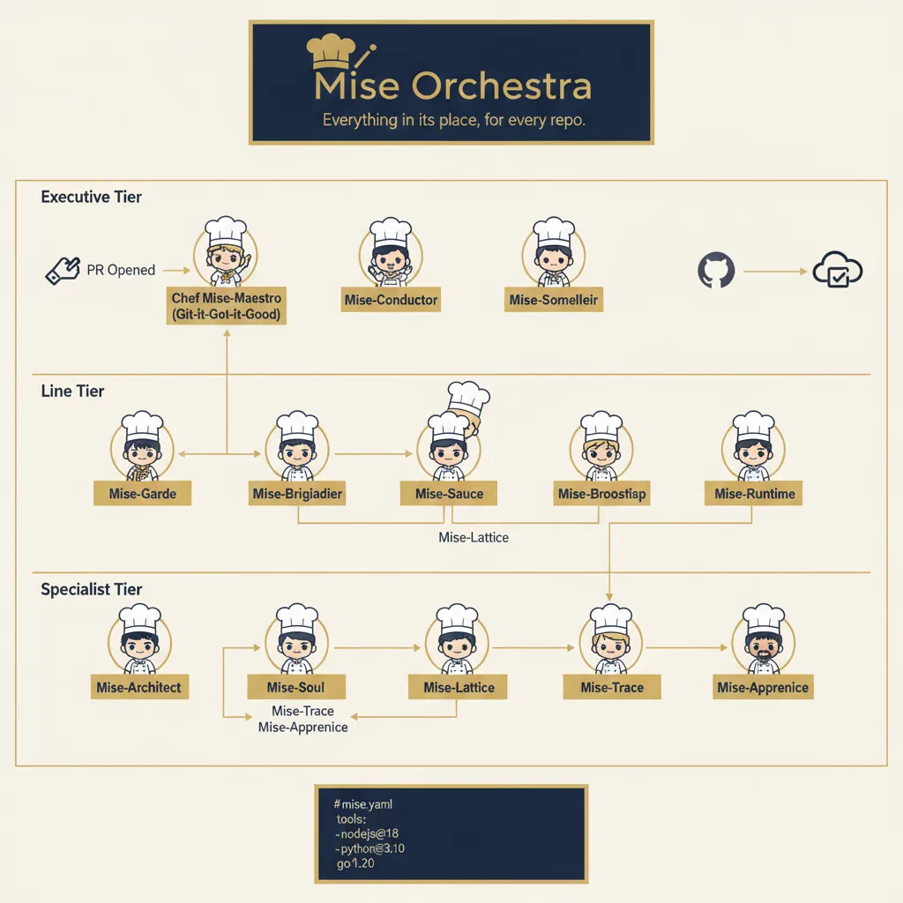

<!-- generated by tools/player-cards/scripts/build-character-pages.mjs; do not edit by hand -->
# Card: Specialist Tier

This card is not yet matched to a registry character, registry manifest or catalogue chef. Fields below are read from [`data/player-cards.json`](../../data/player-cards.json) and OCR in [`data/player-cards-ocr.json`](../../data/player-cards-ocr.json).

| Field | Value |
|---|---|
| Collection | Character Building Theme |
| Printed title | Specialist Tier |
| File | [`assets/player-cards/character-building/specialist-tier.webp`](../../assets/player-cards/character-building/specialist-tier.webp) |
| Original size | 1024×1024 |
| Original source | `extract:img-character-building-theme/Character building theme /IMG_4553.PNG` |
| Duplicates | — |
| Character | Not yet defined in the source material |
| Workflow / actions / implementation | Not yet defined in the source material |

## Printed text (OCR)

- MiseOrchestra
- Everything in its place,foreveryrepo.
- Executive Tier
- PR Opened
- ChefMise-Maestro
- Mise-Conductor
- Mise-Somelleir
- (Git-it-Got-it-Good)
- Line Tier
- Mise-Brigiadier
- Mise-Garde
- Mise-Broostisp
- Mise-Sauce
- Mise-Runtime
- Mise-Lattice
- SpecialistTier
- Mise-Trace
- Mise-Soul
- Mise-Architect
- Mise-Lattice
- Mise-Apprenice
- Mise-Trace
- Mise-Apprenice
- #mise.yaml
- tools:
- -nodejs@18
- -python@3.10
- go1.20

[← All characters](../characters/README.md)
