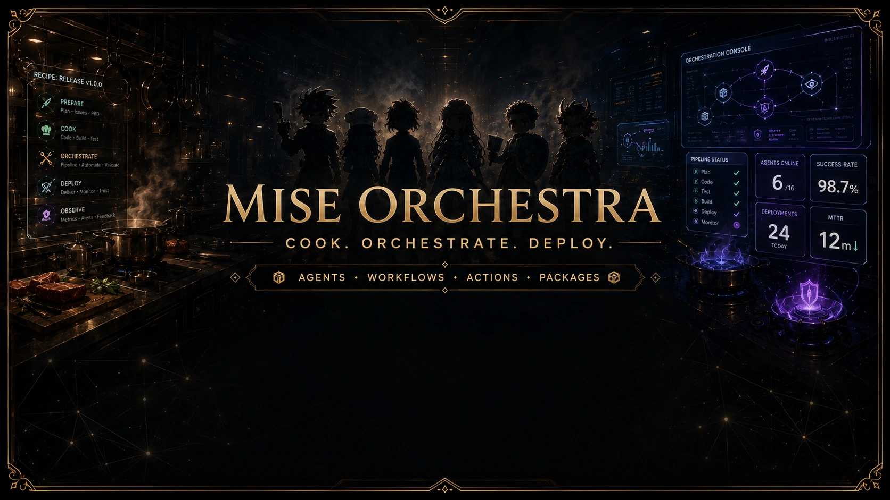

<!-- generated by tools/player-cards/scripts/build-character-pages.mjs; do not edit by hand -->
# Card: 8309bbe1-e173-43bc-9cbb-bb510b648f67.webp

This card is not yet matched to a registry character, registry manifest or catalogue chef. Fields below are read from [`data/player-cards.json`](../../data/player-cards.json) and OCR in [`data/player-cards-ocr.json`](../../data/player-cards-ocr.json).

| Field | Value |
|---|---|
| Collection | Studio Art & Screens |
| Printed title | Not yet defined in the source material |
| File | [`assets/player-cards/icloud-screens/8309bbe1-e173-43bc-9cbb-bb510b648f67.webp`](../../assets/player-cards/icloud-screens/8309bbe1-e173-43bc-9cbb-bb510b648f67.webp) |
| Original size | 1672×941 |
| Original source | `icloud:8309BBE1-E173-43BC-9CBB-BB510B648F67.PNG` |
| Duplicates | — |
| Character | Not yet defined in the source material |
| Workflow / actions / implementation | Not yet defined in the source material |

## Printed text (OCR)

- ORCHESTRATION CONSOLE
- RECIPE:RELEASEV1.0.0
- PREPARE
- SUts - PRO
- COOK
- ORCHESTRATE
- PIPEUNE STATUS
- AGENTS ONLINE
- SUCCESS RATE
- 0 Plan
-  Code
- DEPLOY
- MISE ORCHESTRA
- 98.7%
- 4 Test
- 9 Buld
- Deploy
- OBSERVE
- DEPLOYMENTS
- Monitor
- MTTR
- 24
- 12ml
- COOK.ORCHESTRATE.DEPLOY.
- TODAY
- AGENTS·WORKFLOWS·ACTIONS·PACKAGES

[← All characters](../characters/README.md)
