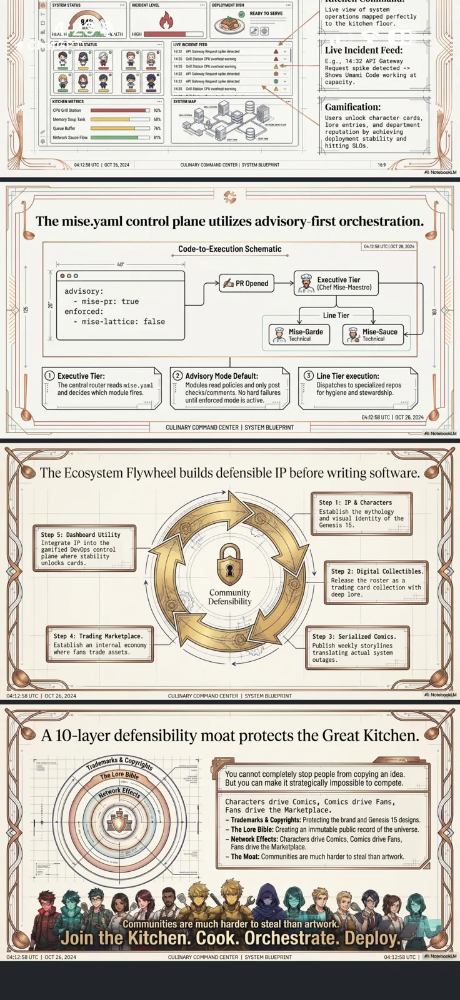

<!-- generated by tools/player-cards/scripts/build-character-pages.mjs; do not edit by hand -->
# Card: A10-layerdefensibilitymoatprotects theGreatKitchen.

This card is not yet matched to a registry character, registry manifest or catalogue chef. File facts come from [`data/player-cards.json`](../../data/player-cards.json) and OCR in [`data/player-cards-ocr.json`](../../data/player-cards-ocr.json); the card profile comes from [`data/card-details.json`](../../data/card-details.json), where every field cites its source and values marked `authored: card design` were written for the card rather than found in the repo.

| Field | Value |
|---|---|
| Collection | Studio Art & Screens |
| Printed title | A10-layerdefensibilitymoatprotects theGreatKitchen. |
| File | [`assets/player-cards/icloud-screens/a10-layerdefensibilitymoatprotects-thegr.webp`](../../assets/player-cards/icloud-screens/a10-layerdefensibilitymoatprotects-thegr.webp) |
| Original size | 1206×2622 |
| Original source | `icloud:Catalogue/All images/Mise/IMG_7370.PNG` |
| Duplicates | — |
| Character | No registry character matched yet (card-only design) source: `data/player-cards.json + canon crosswalk (no registry match; card-only design)` |
| Role / title | Poster / reference sheet source: `authored: card design (poster / reference sheet; topics from printed text)` |
| Kitchen / department | All kitchens (universe-level reference) source: `authored: card design (poster / reference sheet; topics from printed text)` |
| Department mission | n/a (spans every kitchen) |
| Rarity | Not applicable (reference artwork) source: `authored: card design (poster / reference sheet; topics from printed text)` |
| Printed rarity | Genesis source: `data/player-cards-ocr.json` |
| Printed stars | Not printed on the card source: `data/player-cards-ocr.json` |
| Roster stats | Not applicable (reference artwork, not a playable character) source: `authored: card design (poster / reference sheet; topics from printed text)` |
| Abilities | System Status, Ncident Level, Deployment Desh, Readyto Serve, Heal.Hic, St A Status, Liveincibent Feed, E.G.,14:32Api Gateway source: `data/player-cards-ocr.json (topics printed on the sheet)` |
| Lore | Shows Umami Code working at The mise.yaml control plane utilizes advisory-first orchestration. source: `data/player-cards-ocr.json (text printed on the card)` |
| Signature phrase | Shows Umami Code working at source: `data/player-cards-ocr.json (tagline printed on the sheet)` |
| Agents | [Orchestra Core](../agents/orchestra-core.md) source: `authored: card design (universe-level sheet → Orchestra Core)` |
| Repo pets | [Orchestra Core](../repo-pets/orchestra-core.md) source: `authored: card design (universe-level sheet → Orchestra Core)` |
| Related characters | [Lattice](../characters/lattice.md) · [Umami Code](../characters/umami-code.md) source: `data/player-cards-ocr.json (characters named on the card)` |

## Workflow

| Step | Value |
|---|---|
| Summary | Reference sheet for the MiseOS universe: shows System Status, Ncident Level, Deployment Desh, Readyto Serve. Used as visual canon when designing or checking characters, stations and brand assets. source: `authored: card design (poster / reference sheet; topics from printed text)` |
| Inputs | n/a (static artwork) |
| Outputs | visual canon reference for character and brand work |
| Proof gate | Canon check: any name, colour, tier or role read off this sheet is cross-checked against data/characters/*.json before reuse. |
| Problem it addresses | Keeps designers and agents working from one shared picture of the universe instead of drifting copies. source: `authored: card design (poster / reference sheet; topics from printed text)` |

## Actions / commands

- command: `none` · does: `reference artwork, not a runnable character` source: `authored: card design (poster / sheet)`

## Implementation

**Status:** Reference artwork (no code applies)

Static artwork; no handler or command applies.

source: `authored: card design (poster / reference sheet; topics from printed text)`

Values marked `authored: card design` were written for this card by [`enrich-characters.py`](../../tools/player-cards/scripts/enrich-characters.py) from its printed text and theme; the rest cite the repo file they came from.

## Printed text (OCR)

- SYSTEM STATUS
- NCIDENT LEVEL
- DEPLOYMENT DESH
- READYTO SERVE
- Live view of system
- operations mapped perfectly
- to the kitchen floor.
- HEAL.HIC
- HIT
- IGH
- 20
- ST A STATUS
- LIVEINCIBENT FEED
- 432
- Reguest spae detected
- Live Incident Feed:
- E.g.,14:32API Gateway
- Request spike detected ->
- Shows Umami Code working at
- capacity.
- KITCHEN METRICS
- SYSTE
- CPU Gril Station
- Gamification:
- Memory Soup Tank
- Users unlock character cards,
- Queue Buffer
- lore entries, and department
- reputation by achieving
- Netwofk Sauce Flow
- deployment stability and
- hittingSLOs.
- 04:12:58 UTC [ OCT 26, 2024
- CULUNARY COMMAND CENTER1 SYSTEM BLUEPRINT
- The mise.yaml control plane utilizes advisory-first orchestration.
- Code-to-Execution Schematic
- 04:12:58UTCCT26,2024
- APROpened
- Executive Tier
- advisory:
- (Chef Mise-Maestro)
- - mise-pr: true
- enforced:
- -mise-lattice:false
- Line Tier
- Mise-Garde
- Mise-Sauce
- Technical
- Technical
-  Advisory Mode Default:
- Executive Tier:
- Line Tier execution:
- The central router reads mise-yaml
- Modules read policies and only post
- Dispatches to specialized repos
- and decides which module fires.
- checks/comments. No hard failures
- for hygiene and stewardship.
- until enforced mode is active.
- 04:12:58 UTC IOCT 26, 2024
- CULINARY COMMAND CENTER I SYSTEM BLUEPRINT
- Q NotebookLM
- The Ecosystem Flywheel builds defensible IP before writing software.
- Step 1: IP & Characters
- Establishthemythology
- and visual identity of the
- Genesis 15.
- Step 5: Dashboard Utility
- Integrate IP into the
- gamified DevOps control
- plane where stability
- unlocks cards.
- Step 2: Digital Collectibles.
- Release the roster as a
- Community
- trading card collection with
- deep lore.
- Defensibility
- Step 4: Trading Marketplace.
- Step 3: Serialized Comics.
- Establish an internal economy
- Publish weekly storylines
- where fans trade assets.
- translating actual system
- outages.
- CULINARYCOMMANDCENTERISYSTEM BLUEPRINT
- 04:12:58 UTC1OCT26,2024
- NotebookLM
- A 10-layer defensibility moat protects the Great Kitchen.
- The Lore Bible
- Youcannot completely stop.people fromcopyingan idea.
- But you can make it strategically impossible to compete.
- Characters drive Comics, Comics drive Fans,
- Fans drive the Marketplace.
- Trademarks & Copyrights: Protecting the brand and Genesis 15 designs.
-  The Lore Bible: Creating an immutable public record of the universe.
-  Network Effects: Characters drive Comics, Comics drive Fans
- Fans drive the Marketplace.
- The Moat: Communities are much harder to steal than artwork.
- Communitiesaremuchhardertostealthanartwork
- Join the Kitchen.Cook.Orchestrate.Deploy.
- 04:12:58 UTC IOCT 26, 2024
- CULINARY COMMAND CENTER  SYSTEM BLUEPRINT
- 04:12:58 UTC 1@NotebooKM

[← All characters](../characters/README.md)
