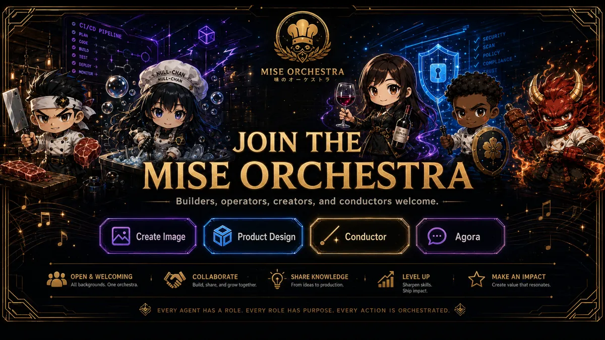

<!-- generated by tools/player-cards/scripts/build-character-pages.mjs; do not edit by hand -->
# Card: Create Image

This card is not yet matched to a registry character, registry manifest or catalogue chef. File facts come from [`data/player-cards.json`](../../data/player-cards.json) and OCR in [`data/player-cards-ocr.json`](../../data/player-cards-ocr.json); the card profile comes from [`data/card-details.json`](../../data/card-details.json), where every field cites its source and values marked `authored: card design` were written for the card rather than found in the repo.

| Field | Value |
|---|---|
| Collection | Studio Art & Screens |
| Printed title | Create Image |
| File | [`assets/player-cards/icloud-screens/create-image.webp`](../../assets/player-cards/icloud-screens/create-image.webp) |
| Original size | 1672×941 |
| Original source | `icloud:D533B19E-712A-4EF3-BE8B-A59513731480.PNG` |
| Duplicates | — |
| Character | No registry character matched yet (card-only design) source: `data/player-cards.json + canon crosswalk (no registry match; card-only design)` |
| Role / title | Poster / reference sheet source: `authored: card design (poster / reference sheet; topics from printed text)` |
| Kitchen / department | All kitchens (universe-level reference) source: `authored: card design (poster / reference sheet; topics from printed text)` |
| Department mission | n/a (spans every kitchen) |
| Rarity | Not applicable (reference artwork) source: `authored: card design (poster / reference sheet; topics from printed text)` |
| Printed rarity | Not printed on the card source: `data/player-cards-ocr.json` |
| Printed stars | Not printed on the card source: `data/player-cards-ocr.json` |
| Roster stats | Not applicable (reference artwork, not a playable character) source: `authored: card design (poster / reference sheet; topics from printed text)` |
| Abilities | Ci/Cd Pipeline, Oplan, Code, Security, Scan, Test, Policy, Deploy source: `data/player-cards-ocr.json (topics printed on the sheet)` |
| Lore | Build, share, and grow together. source: `data/player-cards-ocr.json (text printed on the card)` |
| Signature phrase | Build, share, and grow together. source: `data/player-cards-ocr.json (tagline printed on the sheet)` |
| Agents | [Orchestra Core](../agents/orchestra-core.md) source: `authored: card design (universe-level sheet → Orchestra Core)` |
| Repo pets | [Orchestra Core](../repo-pets/orchestra-core.md) source: `authored: card design (universe-level sheet → Orchestra Core)` |
| Related characters | [Portal Rei](../characters/portal-rei.md) · [Scorecard Shin](../characters/scorecard-shin.md) · [Watchtower Yoru](../characters/watchtower-yoru.md) · [SLO Sage](../characters/slo-sage.md) · [Red Oni](../characters/red-oni.md) source: `authored: card design (same theme "security")` |

## Workflow

| Step | Value |
|---|---|
| Summary | Reference sheet for the MiseOS universe: shows Ci/Cd Pipeline, Oplan, Code, Security. Used as visual canon when designing or checking characters, stations and brand assets. source: `authored: card design (poster / reference sheet; topics from printed text)` |
| Inputs | n/a (static artwork) |
| Outputs | visual canon reference for character and brand work |
| Proof gate | Canon check: any name, colour, tier or role read off this sheet is cross-checked against data/characters/*.json before reuse. |
| Problem it addresses | Keeps designers and agents working from one shared picture of the universe instead of drifting copies. source: `authored: card design (poster / reference sheet; topics from printed text)` |

## Actions / commands

- command: `none` · does: `reference artwork, not a runnable character` source: `authored: card design (poster / sheet)`

## Implementation

**Status:** Reference artwork (no code applies)

Static artwork; no handler or command applies.

source: `authored: card design (poster / reference sheet; topics from printed text)`

Values marked `authored: card design` were written for this card by [`enrich-characters.py`](../../tools/player-cards/scripts/enrich-characters.py) from its printed text and theme; the rest cite the repo file they came from.

## Printed text (OCR)

- CI/CD PIPELINE
- OPLAN
- CODE
- SECURITY
- SCAN
- TEST
- POLICY
- DEPLOY
- COMPLIANCE
- MONITOR+
- MISEORCHESTRA
- 味の才卜
- JOIN THE
- MISEORCHESTRA
- Builders,operators,creators,andconductorswelcome.
- Create Image
- Product Design
- Conductor
- Agora
- OPEN&WELCOMING
- COLLABORATE
- SHAREKNOWLEDGE
- LEVEL UP
- MAKEAN IMPACT
- All backgrounds. One orchestra.
- Build, share, and grow together.
- From ideas to production.
- Sharpen skills.
- Create value that resonates.
- Ship impact.

[← All characters](../characters/README.md)
