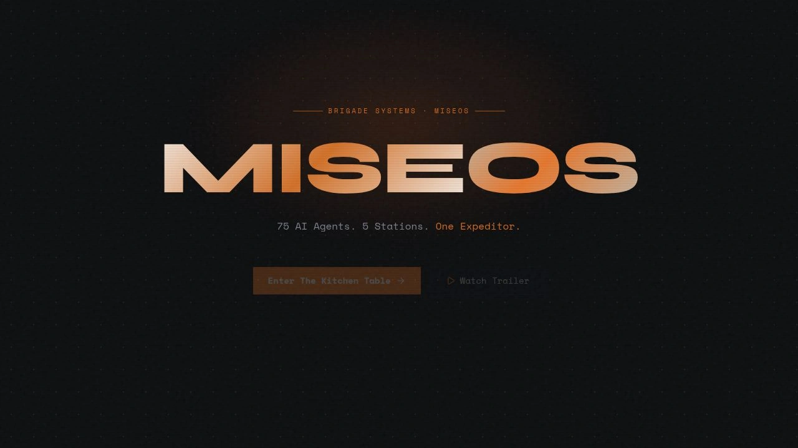

<!-- generated by tools/player-cards/scripts/build-character-pages.mjs; do not edit by hand -->
# Card: Enter The-Kitohen Table →

This card is not yet matched to a registry character, registry manifest or catalogue chef. Fields below are read from [`data/player-cards.json`](../../data/player-cards.json) and OCR in [`data/player-cards-ocr.json`](../../data/player-cards-ocr.json).

| Field | Value |
|---|---|
| Collection | Studio Art & Screens |
| Printed title | Enter The-Kitohen Table → |
| File | [`assets/player-cards/icloud-screens/enter-the-kitohen-table.webp`](../../assets/player-cards/icloud-screens/enter-the-kitohen-table.webp) |
| Original size | 1280×720 |
| Original source | `icloud:Catalogue/All images/Mise/IMG_5820.JPG` |
| Duplicates | — |
| Character | Not yet defined in the source material |
| Workflow / actions / implementation | Not yet defined in the source material |

## Printed text (OCR)

- BRIGADE SYSTEMS
- MISEOS
- MISEOS
- 75 AI Agents. 5 Stations. One Expeditor
- Enter The Kitohren Table )
- D Watch Trailer

[← All characters](../characters/README.md)
