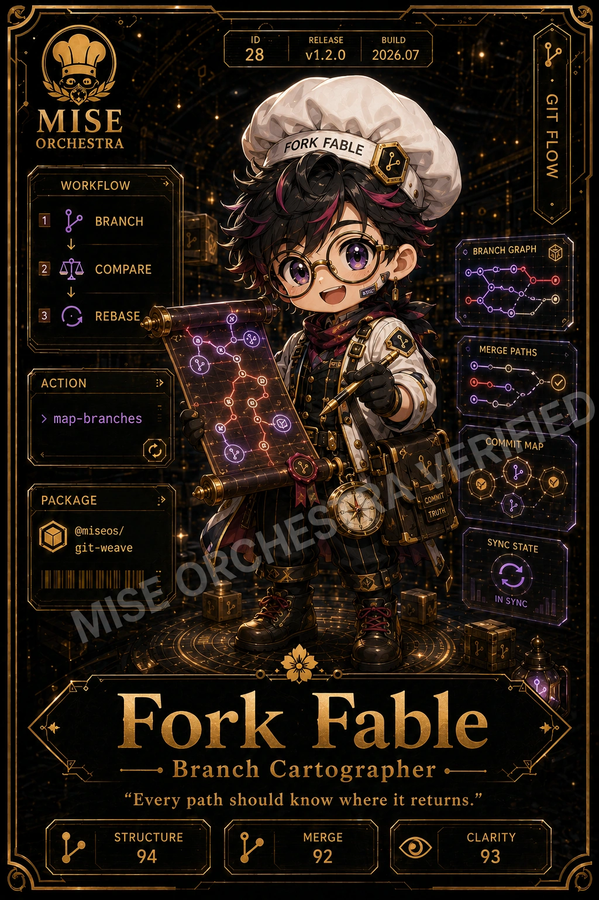

<!-- generated by tools/player-cards/scripts/build-character-pages.mjs; do not edit by hand -->
# Card: Fork Fable

This card is not yet matched to a registry character, registry manifest or catalogue chef. Fields below are read from [`data/player-cards.json`](../../data/player-cards.json) and OCR in [`data/player-cards-ocr.json`](../../data/player-cards-ocr.json).

| Field | Value |
|---|---|
| Collection | Studio Art & Screens |
| Printed title | Fork Fable |
| File | [`assets/player-cards/icloud-screens/fork-fable.webp`](../../assets/player-cards/icloud-screens/fork-fable.webp) |
| Original size | 1024×1536 |
| Original source | `icloud:63BCE2E9-BF9A-4965-92A0-841D2D207479.PNG` |
| Duplicates | — |
| Character | Not yet defined in the source material |
| Agent | Not yet defined in the source material |
| Repo pet | Not yet defined in the source material |
| Workflow / actions / implementation | Not yet defined in the source material |

## Printed text (OCR)

- ID
- RELEASE
- BUILD
- 28
- v1.2.0
- 2026.07
- GIT FLOW
- MISE
- ORCHESTRA
- FORK FABLE
- WORKFLOW
- BRANCH
- BRANCHGRAPH
- COMPARE
- REBASE
- MERGEPATHS
- 011010
- ACTION
- 01010
- map-branches
- COMMITMAP
- PACKAGE
- COMMIT
- TRUTH
- @miseos/
- SYNC STATE
- git-weave
- SEORCHEST
- IN SYNC
- Fork Fable
- Branch Cartographer
- “Every path should know where it returns."
- STRUCTURE
- MERGE
- CLARITY
- 94
- 92
- 93

[← All characters](../characters/README.md)
