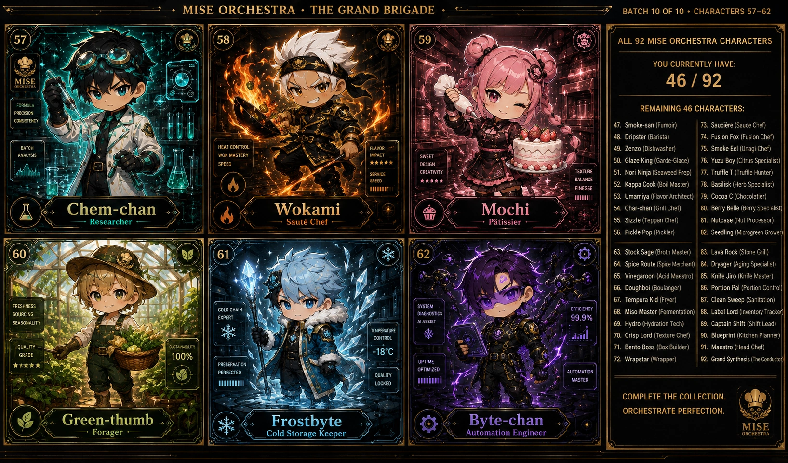

<!-- generated by tools/player-cards/scripts/build-character-pages.mjs; do not edit by hand -->
# Card: Frostbyte

This card is not yet matched to a registry character, registry manifest or catalogue chef. File facts come from [`data/player-cards.json`](../../data/player-cards.json) and OCR in [`data/player-cards-ocr.json`](../../data/player-cards-ocr.json); the card profile comes from [`data/card-details.json`](../../data/card-details.json), where every field cites its source and values marked `authored: card design` were written for the card rather than found in the repo.

| Field | Value |
|---|---|
| Collection | Studio Art & Screens |
| Printed title | Frostbyte |
| File | [`assets/player-cards/icloud-screens/frostbyte.webp`](../../assets/player-cards/icloud-screens/frostbyte.webp) |
| Original size | 1635×962 |
| Original source | `icloud:Catalogue/All images/729526CC-E810-49F7-972E-B801FB9F9B78.PNG` |
| Duplicates | — |
| Character | No registry character matched yet (card-only design) source: `data/player-cards.json + canon crosswalk (no registry match; card-only design)` |
| Role / title | Poster / reference sheet source: `authored: card design (poster / reference sheet; topics from printed text)` |
| Kitchen / department | All kitchens (universe-level reference) source: `authored: card design (poster / reference sheet; topics from printed text)` |
| Department mission | n/a (spans every kitchen) |
| Rarity | Not applicable (reference artwork) source: `authored: card design (poster / reference sheet; topics from printed text)` |
| Printed rarity | Not printed on the card source: `data/player-cards-ocr.json` |
| Printed stars | 4 source: `data/player-cards-ocr.json` |
| Roster stats | Not applicable (reference artwork, not a playable character) source: `authored: card design (poster / reference sheet; topics from printed text)` |
| Abilities | You Currently Have, Remaining 46 Characters, Precision, Consstency, Heat Control, Batch, Flavor, Wokmastery source: `data/player-cards-ocr.json (topics printed on the sheet)` |
| Lore | 75. Smoke Eel (Unagi Chef) 76. Yuzu Boy (Citrus Specialist) source: `data/player-cards-ocr.json (text printed on the card)` |
| Signature phrase | 75. Smoke Eel (Unagi Chef) source: `data/player-cards-ocr.json (tagline printed on the sheet)` |
| Agents | [Orchestra Core](../agents/orchestra-core.md) source: `authored: card design (universe-level sheet → Orchestra Core)` |
| Repo pets | [Orchestra Core](../repo-pets/orchestra-core.md) source: `authored: card design (universe-level sheet → Orchestra Core)` |
| Related characters | [Fermenta](../characters/fermenta.md) · [Stock Sage](../characters/stock-sage.md) source: `data/player-cards-ocr.json (characters named on the card)` |

## Workflow

| Step | Value |
|---|---|
| Summary | Reference sheet for the MiseOS universe: shows You Currently Have, Remaining 46 Characters, Precision, Consstency. Used as visual canon when designing or checking characters, stations and brand assets. source: `authored: card design (poster / reference sheet; topics from printed text)` |
| Inputs | n/a (static artwork) |
| Outputs | visual canon reference for character and brand work |
| Proof gate | Canon check: any name, colour, tier or role read off this sheet is cross-checked against data/characters/*.json before reuse. |
| Problem it addresses | Keeps designers and agents working from one shared picture of the universe instead of drifting copies. source: `authored: card design (poster / reference sheet; topics from printed text)` |

## Actions / commands

- command: `none` · does: `reference artwork, not a runnable character` source: `authored: card design (poster / sheet)`

## Implementation

**Status:** Reference artwork (no code applies)

Static artwork; no handler or command applies.

source: `authored: card design (poster / reference sheet; topics from printed text)`

Values marked `authored: card design` were written for this card by [`enrich-characters.py`](../../tools/player-cards/scripts/enrich-characters.py) from its printed text and theme; the rest cite the repo file they came from.

## Printed text (OCR)

- ·MISEORCHESTRA·THEGRANDBRIGADE
- BATCH10OF10·CHARACTERS57-62
- ALL92MISEORCHESTRACHARACTERS
- YOU CURRENTLY HAVE:
- 46/92
- REMAINING 46 CHARACTERS:
- PRECISION
- CONSSTENCY
- 47. Smoke-san (Fumoir)
- 73. Sauciere (Sauce Chef)
- 48. Dripster (Barista)
- 74.FusionFox (Fusion Chef)
- HEAT CONTROL
- 49. Zenzo (Dishwasher)
- BATCH
- FLAVOR
- 75. Smoke Eel (Unagi Chef)
- WOKMASTERY
- ANALYSIS
- IMPACT
- SWEET
- 50. Glaze King (Garde-Glace)
- SPEED
- ★★★★
- DESIGN
- 76. Yuzu Boy (Citrus Specialist)
- TEXTURE
- 51. Nori Ninja (Seaweed Prep)
- CREATIWITY
- SERVICE
- 77., Truffle T (Truffle Hunter)
- SPEED
- ★★#★
- BALANCE
- 52. Kappa Cook (BoilMaster)
- FINESSE
- 78. Basilisk (Herb Specialist)
- 53. Umamiya (Flavor Architect)
- 79. Cocoa C (Chocolatier)
- Chem-chan
- Wokami
- Mochi
- 54. Char-chan (Grill Chef)
- 80. Berry Belle (Berry Specialist)
- 55. Sizzle (Teppan Chef)
- Patissier
- Saute Chef
- Researcher
- 81. Nutcase (Nut Processor)
- 56. Pickle Pop (Pickler)
- 82.Seedling (MicrogeenGrower)
- 63. Stock Sage (Broth Master)
- 60
- 62
- 83. Lava Rock (Stone Grill)
- 64. Spice Route (Spice Merchant)
- 84. Dryager (Aging Specialist)
- 65. Vinegaroon (Acid Maestro)
- 85.Knife Jiro (Knife Master)
- 66. Doughboi (Boulanger)
- 86.Portion Pal (Portion Control)
- 67. Tempura Kid (Fryer)
- 87.Clean Sweep (Sanitation)
- FRESHNESS
- COLD CHAIN
- SYSTEM
- EFFICIENCY
- 68. Miso Master (Fermentation)
- SOURCING
- 99.9%
- 88. Label Lord (nventory Tracke)
- EXPERT
- ALASSIST
- 69. Hydro (Hydration Tech)
- SEASONALITY
- 89. Captain Shift (Shift Lead)
- TEMPERATURE
- 70. Crisp Lord (Texture Chef)
- CONTROL
- 90. Blueprint (Kitchen Planner)
- QUALITY
- 71. Bento Boss (Box Builder)
- -18℃
- 91. Maestro (Head Chef)
- GRADE
- 100%
- 72. Wrapstar (Wrapper)
- UPTIME
- 92Grand Synthesis(TheConducto
- ★★★
- PRESERVATION
- OPTIMIZED
- QUALITY
- AUTOMATION
- LOCKED
- MASTER
- COMPLETETHECOLLECTION.
- Byte-chan
- ORCHESTRATEPERFECTION.
- Green-thumb
- Frostbyte
- Forager
- Automation Engineer
- Cold Storage Keeper
- MISE
- ORCHESTRA

[← All characters](../characters/README.md)
