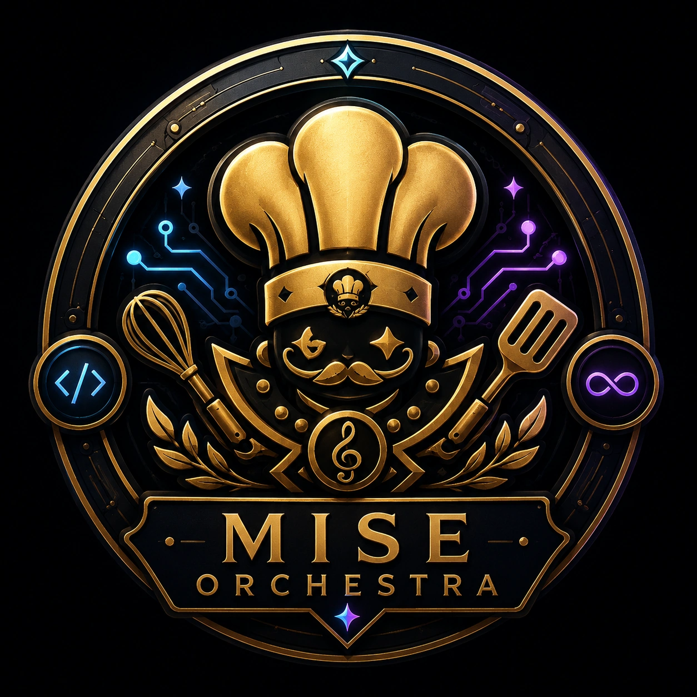

<!-- generated by tools/player-cards/scripts/build-character-pages.mjs; do not edit by hand -->
# Card: MISE

This card is not yet matched to a registry character, registry manifest or catalogue chef. Fields below are read from [`data/player-cards.json`](../../data/player-cards.json) and OCR in [`data/player-cards-ocr.json`](../../data/player-cards-ocr.json).

| Field | Value |
|---|---|
| Collection | Studio Art & Screens |
| Printed title | MISE |
| File | [`assets/player-cards/icloud-screens/mise.webp`](../../assets/player-cards/icloud-screens/mise.webp) |
| Original size | 1254×1254 |
| Original source | `icloud:69DAC21C-A040-41A0-9E8E-4F96A8E76899 2.PNG` |
| Duplicates | `icloud:69DAC21C-A040-41A0-9E8E-4F96A8E76899.PNG` |
| Character | Not yet defined in the source material |
| Workflow / actions / implementation | Not yet defined in the source material |

## Printed text (OCR)

- MISE
- ORCHESTRA

[← All characters](../characters/README.md)
