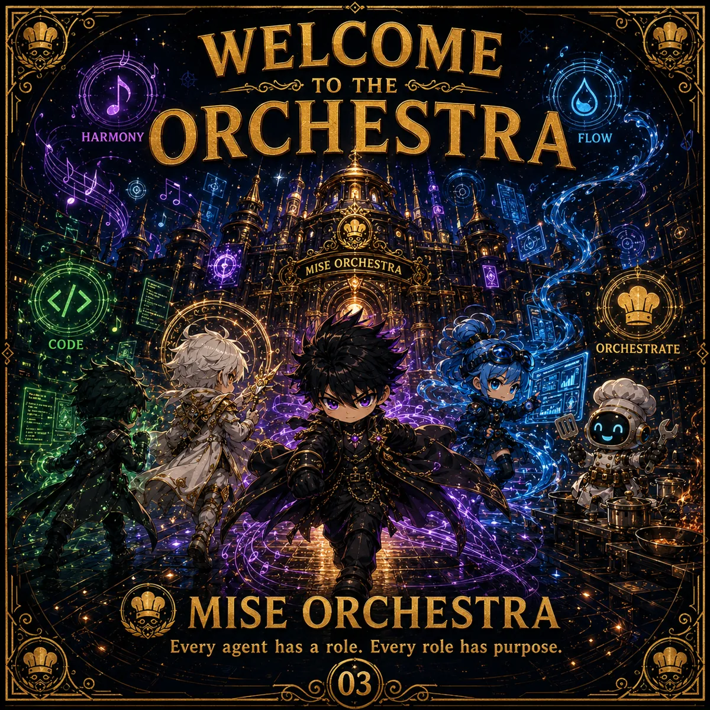

<!-- generated by tools/player-cards/scripts/build-character-pages.mjs; do not edit by hand -->
# Card: MISEORCHESTRA

This card is not yet matched to a registry character, registry manifest or catalogue chef. Fields below are read from [`data/player-cards.json`](../../data/player-cards.json) and OCR in [`data/player-cards-ocr.json`](../../data/player-cards-ocr.json).

| Field | Value |
|---|---|
| Collection | Studio Art & Screens |
| Printed title | MISEORCHESTRA |
| File | [`assets/player-cards/icloud-screens/miseorchestra.webp`](../../assets/player-cards/icloud-screens/miseorchestra.webp) |
| Original size | 1254×1254 |
| Original source | `icloud:9E957657-540C-4B45-B98E-2F17BFD5768A.PNG` |
| Duplicates | — |
| Character | Not yet defined in the source material |
| Agent | Not yet defined in the source material |
| Repo pet | Not yet defined in the source material |
| Workflow / actions / implementation | Not yet defined in the source material |

## Printed text (OCR)

- WELCOME
- TO THEG
- ORCHESTRA
- HARMONY
- FLOW
- CODE
- ORCHESTRATE
- MISEORCHESTRA
- Every agent has a role. Every role has purpose.
- 03

[← All characters](../characters/README.md)
