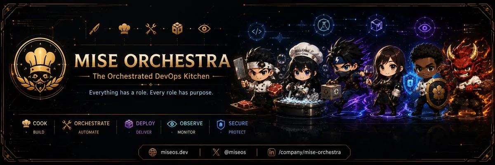

<!-- generated by tools/player-cards/scripts/build-character-pages.mjs; do not edit by hand -->
# Card: @miseos

This card is not yet matched to a registry character, registry manifest or catalogue chef. Fields below are read from [`data/player-cards.json`](../../data/player-cards.json) and OCR in [`data/player-cards-ocr.json`](../../data/player-cards-ocr.json).

| Field | Value |
|---|---|
| Collection | Studio Art & Screens |
| Printed title | @miseos |
| File | [`assets/player-cards/icloud-screens/miseos.webp`](../../assets/player-cards/icloud-screens/miseos.webp) |
| Original size | 2172×724 |
| Original source | `icloud:89A4F10D-D729-4240-A83B-E09295E9DD95.PNG` |
| Duplicates | — |
| Character | Not yet defined in the source material |
| Workflow / actions / implementation | Not yet defined in the source material |

## Printed text (OCR)

- LL-CHAN
- MISEORCHESTRA
- ULL-CHAN
- TheOrchestratedDevOpsKitchen
- Everything has a role.Every role has purpose
- COOK
- DEPLOY
- ORCHESTRATE
- OBSERVE
- SECURE
- BUILD
- AUTOMATE
- DELIVER
- MONITOR
- PROTECT
- @miseos
- miseos.dev
- /company/mise-orchestra

[← All characters](../characters/README.md)
