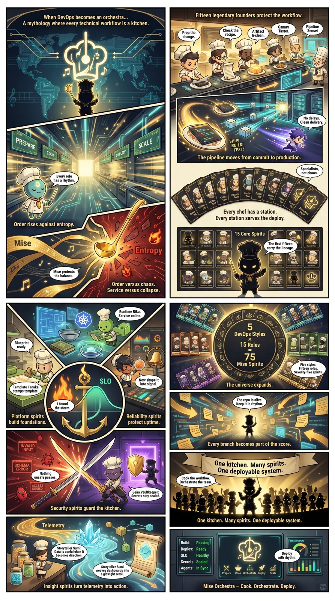

<!-- generated by tools/player-cards/scripts/build-character-pages.mjs; do not edit by hand -->
# Card: One kitchen.Many spirits.

This card is not yet matched to a registry character, registry manifest or catalogue chef. Fields below are read from [`data/player-cards.json`](../../data/player-cards.json) and OCR in [`data/player-cards-ocr.json`](../../data/player-cards-ocr.json).

| Field | Value |
|---|---|
| Collection | Studio Art & Screens |
| Printed title | One kitchen.Many spirits. |
| File | [`assets/player-cards/icloud-screens/one-kitchen-many-spirits.webp`](../../assets/player-cards/icloud-screens/one-kitchen-many-spirits.webp) |
| Original size | 1536×2752 |
| Original source | `icloud:Catalogue/All images/Mise/IMG_4679.JPG` |
| Duplicates | — |
| Character | Not yet defined in the source material |
| Agent | Not yet defined in the source material |
| Repo pet | Not yet defined in the source material |
| Workflow / actions / implementation | Not yet defined in the source material |

## Printed text (OCR)

- When DevOps becomes an orchestra...
- Fifteen legendary founders protectthe workflow.
- Amythology whereeverytechnical workflowis akitchen.
- Canary
- Check the
- Pipeline
- Artifact
- Taster.
- Prep the
- Sensei
- recipe.
- change.
- f.clean.
- No delays.
- Clean delivery.
- PREPARE
- SHIP!
- SCALE
- TEST!
- Thepipelinemoves fromcommitto production.
- Specialists,
- not chaos.
- Every role
- has a rhythm.
- Tan
- Every chef has a station.
- Every station serves the deploy.
- Orderrises againstentropy.
- 15CoreSpirits
- Mise
- Thefirstfteen
- Entropy
- Mise protects
- the balance.
- Order versus chaos.
- Service versus collapse.
- Runtime Riku.
- Service online.
- DevOps Styles
- Blueprint
- 15 Roles
- ready.
- 75
- Mise Spirits
- Five styles.
- Fifteen roles.
- Seventy-five spirits.
- SLO
- Now shape it
- into signal.
- Template Tanaka
- The universe expands.
- stamps template.
- Ifound
- The repo is alive.
- Keep it in rhythm.
- the storm.
- Platformspirits
- Reliability spirits
- build foundations.
- protect uptime.
- INVALID
- Everybranchbecomespart ofthe score.
- INPUT
- One kitchen. Many spirits.
- SCHEMA
- ERROR
- Nothing
- unsafe passes.
- Cook the workflow.
- Orchestrate the team.
- Seira Vaultkeeper
- Secrets stay sealed.
- Security spirits guard the kitchen.
- Onekitchen.Many spirits.Onedeployable system.
- Telemetry
- Passing
- Storyteller Sumi
- Deploy:
- Ready
- Data is useful uhen it
- Deploy
- becomes direction.
- SLO:
- Healthy
- with rhythm.
- Secrets: Sealed
- Storyteller Sumi
- Agents:In Sync
- weaves dashboards into
- Prepare
- a glowight scroll.
- Cook Orchestrate Depley
- Scale
- Insight spiritsturntelemetry intoaction.
- Mise Orchestra -Cook.Orchestrate.Deploy.

[← All characters](../characters/README.md)
